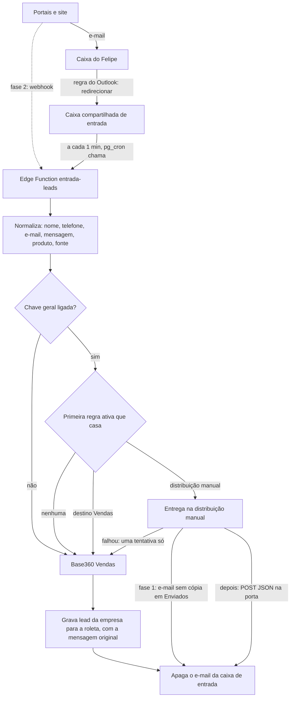

# Direcionador de leads do Base360 (estudo)

> Estudo de 05/11/2026, aprovado pelo Felipe. É a etapa 1 do módulo de Marketing (brief `docs/codex-marketing-direcionador.md`) e fica em `base360.mbigucci.com.br/marketing`, só para o gerente geral. Protótipo: `docs/mockups/direcionador.html`. Especificação da porta de entrada: `docs/direcionador/porta-de-entrada-leads.md`. O resto do Marketing (substituto do RD Station) está em `docs/marketing/roteiro.md`.
>
> **Sigilo:** para onde parte dos leads vai nunca é nomeado. Esse destino se chama **"Distribuição manual"**, e o nome é um dado do banco, não um texto do código.

## Sumário
No topo: as decisões do Felipe em rodadas (quarta, terceira, segunda e a primeira, com as perguntas respondidas). Depois:
1. Resumo da recomendação
2. O que chega hoje: o site e os 4 portais (pesquisa)
3. As três formas de entrada e a recomendada
4. Fluxo de ponta a ponta
5. Como as regras decidem
6. Banco e RLS do sigilo
7. "Não fica registrado": onde o dado ainda pode ficar
8. O lead que vai para o Vendas
9. Como o produto é reconhecido
10. Site do módulo: pasta própria ou telas no Vendas
11. Porta de entrada da distribuição manual
12. O que o Felipe e o TI precisam fazer
13. Perguntas ao Felipe
14. O Marketing (substituto do RD Station)
15. Pesquisado e suposição, com as fontes
16. Como ficou (código, 06/11/2026)

## Quarta rodada: divisão por porcentagem e limite por dia (Felipe, 05/11/2026)

**Para que serve:** quando o volume cresce e um destino não dá conta de atender, parte dos leads volta para os corretores do Base360.

- **Divisão na regra:** em "Mandar para", a regra pode ter dois ou mais destinos, cada um com sua porcentagem (por exemplo 70% para um destino e 30% para o Base360 Vendas). A soma tem de dar 100%. Uma regra com um destino só é 100% para ele, como antes.
- **Contador, divisão exata:** o próximo lead vai ao destino que está mais abaixo da sua parte (menor `enviados / porcentagem`; empate, a ordem da regra). O banco guarda só **números**: quantos leads cada regra mandou a cada destino, sem nenhum dado de cliente. Só o gerente geral lê (`is_gerente_geral()`). O Felipe liberou guardar esse número, inclusive o da Distribuição manual, porque só ele tem acesso; isso ajusta a decisão 10. O contador zera quando a regra é editada.
- **Limite por dia no destino:** cada destino externo pode ter um teto opcional, como "até 20 leads por dia". Passou do teto, o resto do dia vai para o Base360 Vendas. O dia é o de São Paulo. Para saber se passou, o banco guarda o total do dia por destino (também só um número).
- **Ordem das verificações:** a regra casa, o contador escolhe o destino, o limite do dia daquele destino é conferido (passou, vai para o Vendas), e a entrega é tentada uma vez (falhou, vai para o Vendas).
- **Banco:** `direcionador_regras` troca `destino_id` por uma lista de partes (`destino_id`, `porcentagem`), por exemplo numa tabela `direcionador_regra_partes`. `direcionador_destinos` ganha `limite_dia` (nulo = sem limite). Nova tabela `direcionador_contadores` (regra, destino, enviados) e `direcionador_contagem_dia` (destino, dia, total), as duas só com números e só para o gerente geral. A escolha e o incremento ficam numa função do banco com trava, para dois leads ao mesmo tempo não lerem o mesmo contador.
- **Simulador:** mostra a divisão da regra ("→ 70% Distribuição manual · 30% Base360 Vendas") e o limite do dia de cada destino.

## Terceira rodada: vários destinos, de volta ao Marketing (Felipe, 05/11/2026)

**Vale sobre a segunda rodada e a decisão 7.**

- **Em `/marketing`:** o direcionador é uma tela do Marketing, em `base360.mbigucci.com.br/marketing`, só com o login do Base360. Sem pasta à parte e sem senha do servidor.
- **Vários destinos externos:** além do Vendas, o Felipe cadastra quantos destinos quiser. Exemplo do Felipe: uma imobiliária parceira que trabalha no stand, tem CRM próprio, não acessa o Base360 e recebe leads daqui. Cada destino tem **nome**, **entrega** (e-mail ou porta de entrada, pela mesma especificação neutra) e **endereço** (no Vault, mostrado mascarado).
- **Por que o sigilo melhora:** os destinos são linhas do banco, lidas só por `is_gerente_geral()`. O código da tela só conhece "uma lista de destinos" e não tem nenhum nome escrito. Quem baixar o código do `/marketing` vê, no máximo, que existe uma tela de destinos. "Distribuição manual" é só o nome que o Felipe dá a uma dessas linhas.
- **Registro por destino:** cada destino tem a chave **"Registrar os envios"**. Decisão do Felipe: **ligada nos parceiros, desligada na Distribuição manual**.
  - **Ligada (parceiros):** o lead entra no **banco do Marketing** como contato, para controle, e o **histórico do lead na parte de Marketing** ganha o evento "Enviado ao parceiro <nome do destino>", com data, hora, produto e fonte. Serve para medir a parceria e cobrar retorno.
  - **Desligada (Distribuição manual):** nada fica, nem contato nem evento.
- **Falha na entrega:** igual para todo destino. Uma tentativa; falhou, o lead vai para o Vendas.

**O que muda no banco (seção 6):**
- `direcionador_destinos` ganha `nome` e `registrar_envios` (booleano). O `tipo` passa a ser `vendas` ou `externo` de novo, porque agora há vários externos.
- Quando o destino tem `registrar_envios` ligado, a função grava o contato na base do Marketing (a mesma do roteiro, etapa 2 de `docs/marketing/roteiro.md`) e um evento "enviado ao parceiro" no histórico dele, com o id do destino. Com a chave desligada, não grava nada. Quem vê o histórico do Marketing segue as permissões do Marketing, a definir no brief do código.
- Um endereço no Vault por destino.

## Segunda rodada (Felipe, 05/11/2026)

Superada em parte pela terceira rodada: o nome "Distribuição manual" e o fim do apelido continuam valendo; a pasta à parte com senha do servidor não.

- **Nome:** o destino passa a se chamar **"Distribuição manual"** em todo lugar (antes "destino externo").
- **Sem apelido:** sai o campo de apelido da tela e do banco.
- **Fora do Marketing:** o direcionador não é do módulo de Marketing. Fica numa **pasta à parte, de nome neutro, protegida por senha do servidor** (`.htaccess` com usuário e senha do Apache), além do login do Base360. Sem a senha, o servidor nem entrega os arquivos da tela. A pasta não aparece em menu, link nem portal, e o nome dela é escolhido pelo Felipe na publicação (`BASE_PATH`, fora do Git). Isso substitui a decisão 7 abaixo.

## Decisões do Felipe (05/11/2026)

Respostas às perguntas da seção 13. **Onde o texto abaixo diverge, valem estas decisões.**

| # | Pergunta | Decisão |
| --- | --- | --- |
| 1 | Onde o lead espera uma nova tentativa | Na origem, nada no banco |
| 2 | Entrada na fase 1 | E-mail lido pela Graph numa caixa compartilhada interna; webhooks depois |
| 3 | Prazo X | **Sem novas tentativas.** Se a entrega à distribuição manual falhar, o lead vai na hora para o Base360 Vendas, como um lead sem regra, para não ficar sem atendimento. Não há fila nem prazo X |
| 4 | Onde cai o lead no Vendas | **Roleta automática**, estudada numa frente própria. **O direcionador só vai ao ar junto com a roleta** |
| 5 | A mesma pessoa chega de novo | **As regras sempre decidem**, mesmo com lead ativo no Vendas |
| 6 | O e-mail original na caixa do Felipe | **Uma regra do Outlook apaga** depois de redirecionar |
| 7 | Onde ficam as telas | O Base360 é um site só, `base360.mbigucci.com.br` (commit `0d9f7dc`): o substituto do RD Station fica em `/marketing`. **O direcionador é um app pequeno à parte**, numa pasta de nome neutro. Na segunda rodada, ganhou também a **senha do servidor** (acima) |
| 8 | Regra de produto com produto não reconhecido | Não vale |
| 9 | Histórico de mudanças das regras | Não guardar |
| 10 | Contar os envios externos | Não contar por enquanto |

**O que muda no desenho:**
- **Entrega:** uma tentativa só, pelo modo configurado (e-mail agora, a porta de entrada depois). Falhou (erro, recusa ou tempo esgotado), o lead segue para o Vendas na mesma passada, e o e-mail sai da caixa de entrada. Não há aviso de "entrega descartada". Se a resposta não chega por tempo esgotado, o outro lado pode ter recebido mesmo assim: nesse caso raro o lead fica nos dois lugares.
- **Sem fila:** não há tabela temporária, contagem de tentativas nem propriedade estendida no e-mail. A seção 7 vale só pela tabela de onde o dado ainda pode ficar.
- **Mesmo login:** o Vendas e o Marketing ficam na mesma origem, então a sessão do Supabase é a mesma. O código do direcionador não entra no app do Vendas.
- **Sem histórico de regras:** sai a tabela `direcionador_regras_historico`.
- **Próxima frente:** o estudo da roleta automática do lead da empresa, de que o direcionador depende para ir ao ar.

---

## 1. Resumo da recomendação

- **Entrada, fase 1: tudo por e-mail, lido pela Microsoft Graph numa caixa só de entrada.** Uma regra do Outlook do Felipe **redireciona** os e-mails de lead (site e portais) para uma **caixa compartilhada interna** (por exemplo `entrada-leads@`). Redirecionar dentro da empresa não é bloqueado pelo Microsoft 365. Um app registrado pelo TI lê e escreve **só nessa caixa** (RBAC para aplicativos do Exchange). A Edge Function `entrada-leads` passa a cada minuto, aplica as regras e entrega. É a opção (b), com a regra de (a) só para dentro da empresa.
- **Sem fila no banco.** O lead que vai à distribuição manual **nunca é gravado no Supabase**. Uma tentativa só: se a entrega falhar, o lead vai para o Vendas (decisão de 05/11/2026, acima).
- **Entrega na distribuição manual:** por e-mail, saindo da mesma caixa, para o endereço que o Felipe digita na tela, sem cópia em Itens Enviados. Quando a porta de entrada daquele sistema existir, passa a ser um POST JSON (seção 11), com o e-mail como reserva.
- **Fase 2: webhooks.** ZAP e Viva Real (Grupo OLX), Chaves na Mão e talvez Imovelweb mandam o lead direto para a função. O formulário do site também. Isso tira o atraso de 1 minuto e os e-mails do caminho, mas depende de homologação em cada portal. Não é preciso para começar.
- **Banco:** regras, destinos e a chave geral em tabelas que só passam por `is_gerente_geral()`, fora do esquema exposto pela API. Os endereços da distribuição manual ficam no **Vault**, e a tela mostra só uma versão mascarada.
- **Site:** tela do Marketing, em `base360.mbigucci.com.br/marketing`, só do gerente geral. Os nomes dos destinos ficam só no banco, nunca no código, que é baixável por quem abre o endereço (terceira rodada, seção 10).

## 2. O que chega hoje: o site e os 4 portais (pesquisa)

Pesquisa feita em 05/11/2026. "Pesquisado" quer dizer que a fonte é do próprio portal ou fabricante. O resto está marcado "a confirmar".

| Fonte | O que oferece além do e-mail | Formato que chega | Como ativa | Situação |
| --- | --- | --- | --- | --- |
| **Site MBigucci** (Contact Form 7 no WordPress) | O próprio WordPress pode mandar um POST JSON a cada envio, pelo gancho `wpcf7_before_send_mail` ou por plugin de webhook do diretório oficial | Hoje: e-mail montado no modelo do CF7. **Nós controlamos esse modelo**, então dá para deixá-lo com rótulos fixos (`Nome:`, `Telefone:`, `Produto:`) | Editar o modelo de e-mail do CF7 (fase 1) ou instalar o envio (fase 2) | Pesquisado |
| **ZAP Imóveis e Viva Real** (Grupo OLX) | **Webhook oficial**: um POST JSON por lead, para um endereço homologado. Campos `leadOrigin`, `timestamp`, `originLeadId`, `name`, `email`, `ddd`, `phone`, `message`, `originListingId`, `clientListingId`, `temperature`, `transactionType`, `extraData`. Só 2xx é sucesso; até 3 tentativas; depois o lead fica guardado 14 dias para reenvio. Pede idempotência por `originLeadId` | E-mail de lead do portal (layout a confirmar com um e-mail real) | Validar o endereço no validador do portal, preencher o formulário de homologação e falar com o suporte de integração. **O sistema que recebe precisa ser homologado** | Pesquisado (portal de desenvolvedores do Grupo OLX). Se o mesmo webhook cobre os anúncios da OLX: a confirmar |
| **OLX** | Para imóveis, não achei webhook próprio da OLX Brasil. O portal internacional do grupo OLX tem API de leads, mas é de outros países e não vale como prova | E-mail | — | **A confirmar com a OLX**. Tratar como só e-mail |
| **Imovelweb** | A central de ajuda tem o artigo "Como habilito uma integração de leads?", mas a página **não carregou** na pesquisa. O portal de desenvolvedores do Grupo OLX lista "ImovelWeb e Casa Mineira" na tela de integração de leads, com códigos de integração | E-mail | A confirmar com o Imovelweb | **A confirmar** |
| **Chaves na Mão** | **Webhook oficial**: POST JSON para o endereço que o cliente informa, autenticação Basic com e-mail e token do cliente, resposta 401 para credencial errada. Campos `id`, `name`, `email`, `phone`, `message` e o anúncio (`ad`). Política de nova tentativa não documentada | E-mail | Pedir a ativação ao portal (processo não documentado na página) | Pesquisado (documentação do portal no GitHub). Tentativas: a confirmar |

**O que falta para fechar esta tabela:** um e-mail real de cada fonte, **com os dados do cliente trocados**, para o leitor reconhecer remetente, assunto e campos. O Cadastro Mágico já lê "e-mail de portal com rótulos ou em tabela" (`docs/leads.md`, seção 7), então a base do leitor existe.

## 3. As três formas de entrada e a recomendada

| | (a) Regra do Outlook encaminha para um serviço de e-mail de entrada | (b) Leitura da caixa pela Microsoft Graph | (c) Webhooks dos portais e o site direto |
| --- | --- | --- | --- |
| **Como é** | Regra na caixa do Felipe encaminha para um endereço de um serviço externo (Postmark Inbound, Cloudflare Email Routing), que chama a função | App registrado no Entra ID lê a caixa e a função busca os e-mails novos | Cada portal e o site fazem POST na função |
| **Cobre** | Todas as fontes | Todas as fontes | Só quem tem webhook: site, ZAP/Viva Real, Chaves na Mão, talvez Imovelweb. **A OLX fica de fora** |
| **TI precisa** | **Liberar o encaminhamento externo** da caixa: no Microsoft 365, o padrão "Automático" equivale a desligado na maioria dos locatários desde 2021 (pode estar ligado em quem já o usava antes), e o bloqueio devolve o erro 5.7.520 | Registrar o app, dar `Mail.ReadWrite` e `Mail.Send` **só para uma caixa** pelo RBAC para aplicativos, e tirar a permissão ampla do Entra | Nada no Microsoft 365 |
| **Sigilo** | ✕ Um terceiro guarda cópia de cada e-mail (retenção do serviço) e o TI vê uma regra de encaminhamento para fora | ✓ Nada sai da Microsoft até a entrega. O app não enxerga outras caixas | ✓ Os dados vão direto à função |
| **Atraso** | Segundos | Até 1 minuto (leitura a cada minuto) | Segundos |
| **Esforço** | Médio, mais um fornecedor e um contrato | Médio, uma vez | Alto: homologação e ativação em cada portal, cada um no seu tempo |

**Recomendada: (b) agora, (c) aos poucos.**

- **Fase 1, só (b):** uma caixa compartilhada interna, que só recebe leads. A regra do Outlook do Felipe redireciona para ela os e-mails dos portais e do site. O Felipe continua recebendo tudo como hoje, e nada muda na rotina dele até ele desligar a separação à mão.
- **Fase 2, (c) por fonte:** o site primeiro (é nosso), depois Chaves na Mão e ZAP/Viva Real quando a homologação sair. A fonte que passa a vir por webhook sai da regra do Outlook, para o mesmo lead não chegar duas vezes.
- **(a) fica descartada:** pede liberar encaminhamento externo e põe um terceiro com cópia de todos os leads, o que contraria o "não fica registrado".

**Por que a caixa compartilhada, e não a do Felipe:** o app só tem permissão sobre ela. A caixa pessoal do Felipe, com os outros e-mails dele, nunca fica ao alcance do app.

## 4. Fluxo de ponta a ponta

- **Nada é gravado antes da decisão.** A função lê, normaliza e decide só em memória.
- **Vendas:** grava o lead e a mensagem original como primeira interação (seção 8). O e-mail só é apagado depois de o lead estar no banco. Se a gravação falhar, o e-mail fica na caixa e volta na passada seguinte.
- **Distribuição manual:** uma tentativa. Entregou, apaga o e-mail. Falhou, o lead segue para o Vendas na mesma passada (decisão de 05/11/2026).
- **Webhook (fase 2):** o mesmo. Se nem o Vendas gravar, a função responde erro e o portal tenta de novo (o Grupo OLX tenta 3 vezes e guarda por 14 dias).

## 5. Como as regras decidem

**Campos de uma regra:** nome (só para o Felipe), produtos (um ou mais do catálogo, ou "qualquer produto"), fontes (uma ou mais, ou "qualquer fonte"), dias da semana, hora de início e de fim, destino (Base360 Vendas ou a distribuição manual), ativa sim/não e a ordem (prioridade).

**Como decide:**
1. Com a **chave geral** desligada, tudo vai para o Vendas, e as regras nem são lidas.
2. As regras ativas são lidas **na ordem** da lista. A **primeira que casar decide**.
3. Uma regra casa quando o produto, a fonte, o dia e a hora do lead estão dentro dela.
4. Nenhuma casou: vai para o **Vendas**.

**Detalhes que precisam ficar fixos:**
- **Fuso:** o dia e a hora são os de São Paulo (`America/Sao_Paulo`). A função roda em UTC, então a conversão é explícita, e o horário vale pelo **momento em que o lead chegou** (a data do e-mail ou do webhook), não pela hora em que a função passou.
- **Intervalo que vira a meia-noite** (das 19h às 9h): vale das 19h do dia marcado até as 9h do dia seguinte. A segunda-feira 19h–9h pega segunda às 22h e terça às 3h, mas **não** pega segunda às 3h (essa madrugada pertence ao domingo).
- **Início igual ao fim** (das 0h às 0h): o dia inteiro.
- **Hora de fim exclusiva:** das 9h às 18h pega 17h59 e não pega 18h00. Assim duas regras "9h–18h" e "18h–9h" não se sobrepõem.
- **Produto não reconhecido:** só casa com regra de "qualquer produto". Uma regra de produto específico não casa (seção 9).
- **Fonte desconhecida** (e-mail que o leitor não reconheceu): idem, só "qualquer fonte". Esse e-mail também gera um aviso ao gerente geral para o leitor ser ajustado.

**Código:** a decisão é uma função pura (`direcionador.ts`), com testes, usada pela Edge Function e pelo simulador da tela. O simulador nunca grava nada.

## 6. Banco e RLS do sigilo

**Precedente:** Faixas de VGV, só do gerente geral por regra fixa no banco (`docs/crm-arquitetura.md`). Aqui vale o mesmo, mais forte.

**Tabelas** (num arquivo SQL próprio, por exemplo `direcionador/supabase/direcionador.sql`, idempotente):

| Tabela | O que guarda | Dados de cliente |
| --- | --- | --- |
| `direcionador_config` (uma linha) | `ativo` (a chave geral), quem mudou e quando | Nenhum |
| `direcionador_destinos` | `id`, `tipo` (`vendas` ou `manual`), `modo` (`email` ou `porta`), `ativo` | Nenhum. **Os endereços não ficam aqui** |
| `direcionador_regras` | `id`, `nome`, `ativa`, `ordem`, `produtos` (ids do catálogo, vazio = qualquer), `fontes` (vazio = qualquer), `dias` (0 = domingo … 6), `hora_inicio`, `hora_fim`, `destino_id`, carimbos | Nenhum |
| `direcionador_regras_historico` (por gatilho) | Quem mudou qual regra, quando, de/para | Nenhum. Opcional (pergunta 9) |
| `lead_fontes` | Catálogo das fontes (site, ZAP, Viva Real, OLX, Imovelweb, Chaves na Mão, outra) e como reconhecer cada uma no e-mail | Nenhum |

**Segredos no Vault** (nunca em tabela, nunca no código): o endereço de e-mail da distribuição manual, e depois o endereço e a chave da porta de entrada. Duas funções `security definer`, as duas conferindo `is_gerente_geral()`:
- uma grava o endereço no Vault;
- outra devolve só a versão mascarada (`c••••@e••••.com`). A tela nunca recebe o endereço inteiro de volta.

**RLS e exposição:**
- Toda tabela do direcionador: `for all to authenticated using (public.is_gerente_geral()) with check (public.is_gerente_geral())`. Sem permissão no catálogo, sem `has_permission`.
- `revoke all ... from anon`. A Edge Function lê com a chave de serviço, que só existe nos Secrets.
- **Esquema fora da API:** o PostgREST publica em `/rest/v1/` a lista das tabelas do esquema exposto. Para nem os nomes aparecerem a um corretor curioso, as tabelas ficam num esquema que não está em "Exposed schemas" (por exemplo `interno`), e a tela usa funções RPC que conferem `is_gerente_geral()`. **Os nomes dessas funções continuam aparecendo na lista**, porque ficam no esquema exposto. Por isso elas têm nomes neutros (por exemplo `cfg_ler` e `cfg_salvar`), sem "direcionador", "destino" ou "distribuição". A confirmar no painel do Supabase quanto essa lista mostra hoje para um usuário logado.
- **Nenhum aviso, menu ou texto** de outro perfil cita o direcionador. O aviso de "entrega falhou" vai só para o gerente geral.

**Testes** (no padrão de `crm/supabase/testes/`): cada perfil (corretor, gerente, operacional, recepção, desativado, anônimo) recebe zero linhas e erro ao gravar; só o gerente geral lê e grava; a função de endereço nunca devolve o valor inteiro.

## 7. "Não fica registrado": onde o dado ainda pode ficar

No desenho recomendado, o lead que vai à distribuição manual **nunca entra no banco do Base360**. Ainda assim há lugares, fora do Base360 ou de infraestrutura, onde algo pode ficar. Cada um tem o que fazemos e o que sobra:

| Onde | O que fazemos | O que sobra |
| --- | --- | --- |
| **Banco do Supabase e backups** | O lead externo não é gravado. Não há fila no banco | Nada. Com uma fila no banco (desenho B abaixo), a linha apagada continuaria nos backups até eles girarem |
| **`net._http_response` (pg_net)** | A entrega é feita pelo `fetch` da própria Edge Function, **nunca** pelo `pg_net`, que guarda as respostas numa tabela | O `pg_net` só chama a função, sem dados de cliente |
| **Logs da Edge Function** | A função nunca escreve dados do cliente no log, e os erros saem com código genérico ("entrega falhou, tentativa 3") | O Supabase registra cada chamada (hora, status, duração), sem o conteúdo. A confirmar no painel de logs |
| **Serviço de e-mail de terceiros** | Não usamos (a opção (a) foi descartada) | Nada |
| **Caixa compartilhada de entrada** | O e-mail é apagado de vez depois de entregue (`permanentDelete` da Graph) | O Exchange guarda o item apagado em Itens Recuperáveis por 14 dias, ou mais se houver retenção ou bloqueio legal na empresa. A confirmar com o TI |
| **Rastreamento de mensagens do Exchange** | O e-mail de entrega sai com assunto neutro ("Novo contato") e **sem cópia em Itens Enviados** | O rastreamento guarda remetente, destinatário e assunto por até 90 dias. O endereço do destino aparece ali para quem administra o Microsoft 365. A porta de entrada (POST) elimina isso |
| **Caixa do Felipe** | Continua com o e-mail original, como hoje | É a rede de segurança dele. Ele pode apagar à mão ou criar uma regra (pergunta 6) |
| **Administradores** | O app só enxerga a caixa de entrada | O TI, como administrador do Microsoft 365, pode acessar qualquer caixa. Isso já vale hoje para a caixa do Felipe |

**Duas formas de guardar a fila de entrega.** O brief previa uma fila temporária no banco. Há duas formas:

| | **A. A origem guarda a fila** (recomendada) | B. Fila temporária no banco |
| --- | --- | --- |
| Como é | O e-mail fica não lido na caixa até ser entregue. No webhook, a função responde erro e o portal tenta de novo | Uma tabela `private.fila_externa`, sem policy nenhuma (só a chave de serviço), com o lead até ser entregue |
| Sigilo | ✓ O lead externo nunca toca o banco | ! A linha apagada continua nos backups e no histórico de recuperação (PITR) até eles girarem |
| Retentativas | Intervalos crescentes (1, 5, 15 e 30 minutos, depois a cada hora) até X. A contagem e a hora da próxima tentativa ficam no próprio e-mail (propriedade estendida da Graph), e a leitura pula o e-mail até essa hora. No webhook, o portal tenta poucas vezes (3 no Grupo OLX), então a reserva por e-mail é tentada na hora | Até X, no nosso ritmo |
| Quando falta | No webhook, se o portal desistir antes de X. Por isso a reserva por e-mail é tentada na mesma hora | — |

**X proposto: 24 horas.** Cobre uma noite e um domingo de queda do outro lado sem segurar dado por dias. Depois de X, o e-mail é apagado e o gerente geral recebe "Um contato não foi entregue em 24 h e foi descartado", sem nome nem telefone. Alternativas na pergunta 3.

**O que vai no e-mail e no POST à distribuição manual:** só os dados do contato, o produto, a fonte e a data. **Nunca** o nome da regra, o id da regra ou qualquer coisa interna. Assunto fixo e neutro: "Novo contato". O e-mail traz no corpo o mesmo `id` do lead que iria no POST: se o envio der certo e a exclusão da caixa falhar, a passada seguinte manda de novo, e o outro lado reconhece a repetição pelo `id`.

## 8. O lead que vai para o Vendas

- **Hoje não existe lead sem dono.** `docs/leads.md`, seção 1, lista "fila de leads da empresa sem corretor" em "ficou de fora": o gerente cadastra o lead da empresa já com um corretor. O brief do código vai precisar de:
  - `leads.dono_id` aceitar nulo **só** para origem "empresa" vinda da entrada (check). O desenho completo está na distribuição automática, `docs/estudo-roleta-leads.md`, seção 8;
  - uma tela "A distribuir" e quem a vê (pergunta 4);
  - o prazo de 15 minutos começar na **atribuição** (já é assim para o lead reatribuído, `docs/leads.md`, seção 4);
  - a policy e o `leads_guard` aceitarem a gravação da função (chave de serviço) e a atribuição posterior.
- **O lead entra como:** origem "empresa", canal pela fonte (a tabela `lead_canais` proposta em `docs/estudo-relatorios.md`), produto reconhecido, e o texto do e-mail como interação "Mensagem original". Nenhum campo diz que passou por um direcionador.
- **Repetido na entrada** (o mesmo e-mail lido duas vezes, ou o webhook e o e-mail do mesmo lead): um id fixo por origem (`internetMessageId` do e-mail ou `originLeadId` do portal) com índice único. A segunda chegada não cria outro lead.
- **A mesma pessoa de novo** (mesmo telefone, outro formulário): é a pergunta 5. O Vendas já tem a regra de duplicado entre carteiras (`docs/leads.md`, seção 9), que só avisa e deixa seguir.

## 9. Como o produto é reconhecido

- **Os e-mails dos portais trazem o título ou o código do anúncio**, não o id do catálogo. O webhook do Grupo OLX traz `clientListingId`, o código que o anunciante deu ao anúncio.
- **Fase 1:** o leitor reaproveita o parser do Cadastro Mágico (`crm/src/lib/cadastro-magico.ts`) e o `acharNoCatalogo` (`docs/crm-arquitetura.md`, catálogo), que já reconhecem o empreendimento pelo nome com tolerância a acento e grafia.
- **Fase 2:** uma tabela de códigos de anúncio por portal → empreendimento, preenchida pelo operacional ou pelo marketing, para o webhook casar pelo código.
- **Não reconhecido:** o produto fica vazio e o lead segue só pelas regras de "qualquer produto" (seção 5). No Vendas, entra sem empreendimento e com a mensagem original, como hoje.

## 10. Onde a tela fica

**O que decide é que o código de um site estático é público.** Os arquivos de uma pasta do site são entregues a quem digita o endereço; o login só é conferido depois, no navegador. Por isso nenhum nome de destino pode estar escrito no código. Foi o mesmo problema do sigilo do programa de verba (`docs/historico.md`).

**Como ficou (terceira rodada, Felipe, 05/11/2026):**
- **No Marketing:** a tela Direcionador fica no app do Marketing (`marketing/` no repositório), publicado em `base360.mbigucci.com.br/marketing`, só com o login do Base360. Nada dela entra no app do Vendas.
- **Nomes só no banco:** os destinos (inclusive a Distribuição manual) são linhas de `direcionador_destinos`, que só o gerente geral lê. O código, os textos fixos e o build não têm nome de destino nenhum. A busca de sigilo antes de publicar confere o `out/` do Marketing.
- **Menu:** o item Direcionador aparece só para o gerente geral. Para os outros perfis, nem o item nem a rota mostram dados.
- **Mesma origem do Vendas:** a sessão do Supabase é a mesma, um login só.
- **Casca:** a mesma do Vendas (cabeçalho, lateral, tema), pelos tokens de `marca/tokens/`, com o logo "Base360 · Marketing".

## 11. Porta de entrada da distribuição manual

A especificação completa e neutra, para entregar ao dono daquele sistema, está em `docs/direcionador/porta-de-entrada-leads.md`. Em resumo:

- `POST` HTTPS com corpo JSON, um lead por chamada, chave no cabeçalho `Authorization: Bearer`.
- Campos: `versao`, `id` (UUID, chave de idempotência), datas em ISO 8601 com fuso, contato (nome, telefone em E.164, e-mail, mensagem), interesse (produto) e origem (fonte).
- Respostas: 2xx é entregue; **409 (já recebido) também conta como entregue**; qualquer outra resposta, ou nenhuma em 10 s, é "não entregue".
- Uma tentativa só: o lead não entregue vai para o Base360 Vendas (decisão de 05/11/2026). Chave errada ou corpo inválido (401, 403, 400, 422) também avisam o gerente geral, sem dados do cliente, porque indicam configuração quebrada.

Até a porta existir, a entrega é por e-mail para o endereço configurado. Quando existir, o modo do destino muda para "porta" na tela, e o e-mail vira reserva.

## 12. O que o Felipe e o TI precisam fazer

> **O passo a passo valendo está em `docs/direcionador/instalacao.md`** (06/11/2026), na ordem certa e com o caminho de volta de cada passo. A lista abaixo é a do estudo e fica como registro; onde divergir, vale a instalação (por exemplo, a regra do Outlook apaga o original, decisão 6, e só é ligada depois do modo de teste).

**Felipe (fase 1):**
1. Pedir ao TI a caixa compartilhada de entrada e o app (abaixo).
2. Criar a regra do Outlook: mensagens dos remetentes dos portais e do site → **Redirecionar para** a caixa de entrada. Manter a cópia na caixa dele.
3. Mandar **um e-mail de cada fonte, com nome, telefone e e-mail do cliente trocados**, para o leitor ser feito sobre o formato real.
4. Rodar o SQL do direcionador no Supabase, pôr os segredos da Graph nos Secrets da função e publicar a função (como foi com a `avisos`).
5. Na tela: digitar o endereço da distribuição manual, criar as regras e ligar a chave geral.
6. Mandar ao dono do outro sistema a especificação da porta de entrada.

**TI (fase 1):**
1. Criar a **caixa compartilhada** `entrada-leads@` (sem licença), com acesso só do Felipe.
2. Registrar um app no **Entra ID** (`Base360 Entrada`), com segredo de cliente ou certificado. Mandar ao Felipe o id do locatário, o id do app e o segredo, que vão direto para os Secrets da função.
3. **Não** dar `Mail.ReadWrite` nem `Mail.Send` no Entra (lá vale para todas as caixas). Dar pelo **RBAC para aplicativos do Exchange**, só sobre a caixa de entrada: `New-ServicePrincipal`, `New-ManagementScope` para essa caixa e `New-ManagementRoleAssignment` com as funções `Application Mail.ReadWrite` e `Application Mail.Send`. Conferir com `Test-ServicePrincipalAuthorization` que outra caixa responde `InScope = False`.
4. Conferir a retenção que vale para essa caixa (Itens Recuperáveis, políticas de retenção, bloqueio legal) e dizer ao Felipe.
5. Anotar a validade do segredo do app (no máximo 24 meses). Ele precisa ser renovado antes de vencer, senão a entrada para.

**Fase 2 (webhooks):** o Felipe pede a homologação ao Grupo OLX (ZAP e Viva Real) e a ativação ao Chaves na Mão e ao Imovelweb, com o endereço da função e a chave de cada um. O TI não precisa fazer nada.

## 13. Perguntas ao Felipe

Respondidas em 05/11/2026: as decisões estão no topo deste arquivo. As opções ficam aqui como registro.

1. **Fila de entrega: onde ela fica?**
   - **(a) Na origem: o e-mail fica na caixa e o portal tenta de novo, nada no banco** (recomendada).
   - (b) Numa tabela temporária no banco, apagada ao entregar (fica nos backups até eles girarem).
2. **Entrada na fase 1:**
   - **(a) Tudo por e-mail, lido pela Graph numa caixa compartilhada, e webhooks depois** (recomendada).
   - (b) Já começar com os webhooks onde houver, e e-mail só para o resto.
   - (c) Encaminhar para um serviço de e-mail de terceiros.
3. **X, o prazo até desistir de uma entrega:**
   - **(a) 24 horas** (recomendada).
   - (b) 6 horas.
   - (c) 72 horas.
4. **O lead que vai para o Vendas cai onde?**
   - **(a) Em "A distribuir" do gerente geral, que manda para um gerente com um toque, como faz hoje por e-mail** (recomendada).
   - (b) Em "A distribuir" de todos os gerentes, e o primeiro que pegar fica.
   - (c) A regra também escolhe a equipe, e cai direto no gerente dela.
5. **A mesma pessoa chega de novo (mesmo telefone):**
   - **(a) Se ela tem lead ativo no Vendas, vai para o Vendas como nova interação no lead que existe, avisando o dono, seja qual for a regra. Se não tem, as regras decidem de novo, sem memória do que foi para fora** (recomendada).
   - (b) As regras sempre decidem, mesmo com lead ativo no Vendas.
   - (c) Guardar por um tempo uma marca do telefone (sem o número) para repetir o mesmo destino. É um registro, mesmo sem dado legível.
6. **O e-mail original na sua caixa:**
   - **(a) Fica como hoje. Você apaga quando quiser** (recomendada).
   - (b) Uma regra sua apaga os e-mails já redirecionados.
7. **Onde ficam as telas do Marketing:**
   - **(a) Pasta própria `marketing/`, em `marketing.base360.mbigucci.com.br`, com senha do servidor enquanto só você usa** (recomendada).
   - (b) Pasta própria sem a senha do servidor.
   - (c) Telas dentro do Vendas (o código fica visível para todo corretor).
8. **Uma regra para um produto específico, quando o produto do lead não foi reconhecido:**
   - **(a) Não casa. O lead segue para as regras de "qualquer produto" ou para o Vendas** (recomendada).
   - (b) Casa, como se fosse qualquer produto.
9. **Histórico de mudanças das regras** (quem ligou ou desligou, quando, sem dados de cliente):
   - **(a) Guardar, visível só para você** (recomendada).
   - (b) Não guardar nada.
10. **Contar os envios à distribuição manual**, só o número por dia, sem dados (o brief deixou para depois):
    - **(a) Não contar por enquanto** (recomendada).
    - (b) Contar, visível só para você.

## 14. O Marketing (substituto do RD Station)

Saiu deste arquivo: o roteiro do Marketing está em `docs/marketing/roteiro.md`. O lead que vai para a distribuição manual nunca entra na base de contatos do Marketing.

## 15. Pesquisado e suposição, com as fontes

**Pesquisado (fonte do próprio portal ou fabricante, consultada em 05/11/2026):**
- Webhook de leads do Grupo OLX (ZAP e Viva Real): campos, só 2xx é sucesso, 3 tentativas, 14 dias guardado, idempotência por `originLeadId`, homologação. [developers.grupozap.com/webhooks/integration_leads.html](https://developers.grupozap.com/webhooks/integration_leads.html). A tela de integração de leads lista "ImovelWeb e Casa Mineira": [developers.grupozap.com/leadManager/how_to_setup_integration.html](https://developers.grupozap.com/leadManager/how_to_setup_integration.html).
- Webhook de leads do Chaves na Mão: POST JSON, Basic com e-mail e token, campos do contato. [chavesnamao.github.io/documentation/lead-documentation/](https://chavesnamao.github.io/documentation/lead-documentation/) e [github.com/chavesnamao/documentation](https://github.com/chavesnamao/documentation).
- No Microsoft 365, o encaminhamento automático para fora é controlado pela política de spam de saída. O padrão "Automático" passou a equivaler a desligado em 2021 para locatários novos e para os que não o usavam (o bloqueio devolve o erro 5.7.520), e o encaminhamento entre usuários internos não é afetado. Como está no locatário da MBigucci, o TI confere (só importa para a opção (a)). [learn.microsoft.com, Control external email forwarding](https://learn.microsoft.com/en-us/defender-office-365/outbound-spam-policies-external-email-forwarding).
- RBAC para aplicativos do Exchange limita `Mail.ReadWrite` e `Mail.Send` a um conjunto de caixas, desde que a permissão ampla do Entra seja retirada. [learn.microsoft.com, Application RBAC](https://learn.microsoft.com/en-us/exchange/permissions-exo/application-rbac).
- `sendMail` da Graph aceita `saveToSentItems: false` e pede `Mail.Send`. [learn.microsoft.com, user: sendMail](https://learn.microsoft.com/en-us/graph/api/user-sendmail?view=graph-rest-1.0).
- Contact Form 7 manda os dados por POST JSON por plugin do diretório oficial ou pelo gancho `wpcf7_before_send_mail`. [wordpress.org/plugins/rt-webhook-for-contact-form-7](https://wordpress.org/plugins/rt-webhook-for-contact-form-7/).
- Serviço de e-mail de entrada (só para comparar a opção (a)): o Postmark tenta o webhook 10 vezes em cerca de 10 horas e meia. [postmarkapp.com, inbound webhook retries](https://postmarkapp.com/support/article/understanding-inbound-webhook-retries-in-postmark).

**A confirmar (não achei fonte do próprio portal, ou a página não carregou):**
- OLX: se há webhook de leads de imóveis no Brasil, ou se o webhook do Grupo OLX já cobre os anúncios da OLX. Tratado como só e-mail.
- Imovelweb: o artigo "Como habilito uma integração de leads?" da central de ajuda não carregou. O formato do e-mail e se há webhook direto.
- Chaves na Mão: a política de novas tentativas e o processo de ativação.
- O formato exato dos e-mails de cada fonte: depende dos e-mails de exemplo do Felipe.

**Suposições deste estudo:**
- Os leads de todas as fontes chegam hoje em uma caixa só, a do Felipe, e uma regra consegue separá-los pelo remetente.
- O Microsoft 365 da MBigucci permite criar uma caixa compartilhada e registrar um app (é o comum em planos Business e Enterprise).
- O Supabase não grava o corpo das chamadas nos logs das Edge Functions, só o resumo. A conferir no painel.
- A retenção padrão de itens apagados no Exchange é de 14 dias, sem bloqueio legal na empresa. O TI confirma.
- O rastreamento de mensagens do Exchange guarda remetente, destinatário e assunto por até 90 dias.
- A lista de tabelas em `/rest/v1/` aparece para um usuário logado no Supabase da MBigucci. A conferir antes do código.
- O validador e a homologação do Grupo OLX aceitam um sistema próprio da construtora, e não só CRMs de mercado.

## 16. Como ficou (código, 06/11/2026)

Brief: `docs/codex-direcionador.md`. Etapas 1 a 4 nos commits `96ca499`, `c4ea7b9`, `61b77ad` e `9c9823f`. A instalação, passo a passo, está em `docs/direcionador/instalacao.md`.

**Onde está cada parte**

| Parte | Arquivo | Testes |
| --- | --- | --- |
| Banco: tabelas, funções, trava e contatos do Marketing | `crm/supabase/direcionador.sql` | `crm/supabase/testes/direcionador.test.mjs` (no `test:banco`) |
| Regra pura: casar a regra, divisão, limite, depois da entrega | `marketing/src/lib/direcionador.ts` | `direcionador.test.ts`; e a paridade com o banco no teste do banco |
| Leitor de e-mail: fonte, campos e produto | `marketing/src/lib/leitor-email.ts` (usa as cópias do Cadastro Mágico e do catálogo) | `leitor-email.test.ts`, `copias.test.ts` |
| Edge Function `entrada-leads` | fonte `crm/supabase/functions/entrada-leads/entrada.ts`; o `index.ts` (arquivo só, para o Supabase) é **gerado** por `gerar.mjs` | `entrada.test.ts` (no `npm test` do `crm/`) |
| Agendador | `crm/supabase/agendar-entrada.sql` (pg_cron a cada minuto, segredo no Vault) | conferência no Supabase real |
| Tela Direcionador | `marketing/` (Next.js estático, `BASE_PATH=/marketing`), `src/app/direcionador/` e `src/lib/telas.ts` | `telas.test.ts`; `npm test` em `marketing/` |

**Banco e sigilo**
- As tabelas ficam no esquema `interno`, que **não** vai em "Exposed schemas". Ninguém tem grant nelas, nem o gerente geral; tudo passa por funções. O RLS com `is_gerente_geral()` fica ligado como segunda camada.
  - `direcionador_config`, `direcionador_destinos`, `direcionador_regras`, `direcionador_regra_partes`, `direcionador_contadores`, `direcionador_contagem_dia`, `lead_fontes` e `entrada_turno`.
- As funções públicas têm nomes e parâmetros neutros, porque aparecem na lista da API. Um teste confere que nenhuma tem "direcionador", "destino" ou "distribui" no nome ou nos parâmetros.
  - **Tela** (`authenticated`; cada uma confere `is_gerente_geral()`): `cfg_ler`, `cfg_salvar` (chave geral), `cfg_item_salvar`, `cfg_item_excluir`, `cfg_item_endereco_salvar`, `cfg_item_endereco` (mascarado), `cfg_regra_salvar`, `cfg_regra_ligar`, `cfg_regra_ordem` e `cfg_regra_excluir`. Para os outros perfis, a leitura volta com zero linhas e a gravação dá erro 42501.
  - **Edge Function** (só `service_role`): `cfg_motor`, `cfg_escolher`, `cfg_desfazer`, `cfg_item_entrega` (endereço inteiro), `mkt_registrar_envio`, `entrada_segredo_ok`, `entrada_turno_pegar` e `entrada_turno_devolver`.
- **Endereços** só no Vault, um segredo por destino com nome neutro (`cfg_end_<id>`). A tela recebe só a versão mascarada (`c••••@e••••.com.br`), e a chave da porta nunca volta.
- **Contatos do Marketing:** `mkt_contatos` e `mkt_contato_eventos` (`enviado_parceiro`) só recebem envios a destinos com "Registrar os envios" ligado. Só o gerente geral lê. O `parceiro_id` não tem chave estrangeira para o esquema interno, para o nome da tabela não aparecer na API.
- **Seed:** só a linha do Base360 Vendas, a chave geral desligada e as 6 fontes (sem padrões de remetente). Nenhum destino externo. Os nomes dos destinos são dados que o Felipe digita na tela.

**Como decide e conta**
- Regra pura e banco fazem a mesma conta: o teste de paridade passa 80 leads pelos dois.
- **Escolha com trava:** `cfg_escolher` usa `pg_advisory_xact_lock`. Com 20 leads ao mesmo tempo num Postgres de verdade, a divisão sai exata e o limite não estoura.
- **Contadores** (decisões a–f do cabeçalho do SQL, aceitas em 05/11/2026):
  - a escolha soma 1 na hora, e `cfg_desfazer` tira esse 1 quando a entrega falha;
  - acima do limite do dia nada conta;
  - salvar a regra zera os contadores dela; ligar, desligar e mudar a ordem não zeram;
  - parte com destino desligado é pulada;
  - a ordem das partes decide o empate, e a tela mantém essa ordem ao editar.
- **Passada repetida:** se o e-mail não for apagado, a passada seguinte conta de novo. É um desvio pequeno, aceito, porque evitá-lo exigiria guardar o id da mensagem, e um destino sem registro não pode deixar nada.

**Edge Function**
- **Turno:** pega o turno (`entrada_turno_pegar`, validade de 2 min), lê até 5 não lidos e devolve o turno ao fim. Outra passada no meio sai sem fazer nada, e assim o mesmo lead nunca vai para dois lugares.
- **Destino externo:** uma tentativa só.
  - Por **e-mail:** `sendMail` com `saveToSentItems: false` e assunto "Novo contato".
  - Pela **porta:** POST da especificação 1.0, com 10 s de tempo.
  - Falhou ou passou do limite: o lead vai na mesma passada para o Vendas, e o `cfg_desfazer` só roda quando o motivo foi a divisão.
- **Vendas:** chama `lead_empresa_entrada` com a assinatura fechada. O `p_recebido_em` é o `receivedDateTime`. Só um erro lançado deixa o e-mail na caixa.
- **Id do lead:** um UUID derivado do `internetMessageId` (SHA-256). Vai no POST, na linha `Id:` do e-mail e no log.
- **Logs:** só o id, a hora e o código (por exemplo `vendas:sem_regra:criado` ou `externo:entregue`). Um teste procura nome, telefone, e-mail, mensagem, remetente e endereço nos logs e falha se achar. A resposta da função (guardada pelo pg_net) tem só `{ok, modo, ocupado, lidos}`.
- **Modo de teste** (`MODO` diferente de `producao`, que é o padrão): decide e registra só o código. Não entrega, não grava, não apaga e não marca como lido. O mesmo e-mail aparece no log a cada passada.

**Tela (`/marketing/direcionador/`)**
- Mobile primeiro, nos dois temas, com a casca do Vendas e o logo "Base360 · Marketing". O menu Direcionador aparece só para o gerente geral.
- **Chave geral:** liga e desliga o direcionador inteiro.
- **Regras:** ligar, subir, descer, editar e excluir com confirmação. Cada regra mostra os contadores desde que foi salva.
- **Simulador:** usa a mesma regra pura, com os contadores e totais de agora.
- **Destinos:** entrega, endereço mascarado, limite, total de hoje e registro, com o editor de destino.
- Capturas de 06/11/2026, de um teste isolado com dados fictícios: `marketing/local/capturas/`, fora do Git.

**Pendências**
1. **Avisos ao gerente geral:** quando a porta responde 400, 401, 403 ou 422 (configuração quebrada) e quando a fonte é desconhecida. Hoje são só códigos no log (`falha_configuracao`, `:fonte_desconhecida`).
2. **Logo:** a palavra "Marketing" do logo está como texto em Inter; falta o desenho em curvas, como o do "Vendas".
3. **E-mails reais de exemplo:** os testes do leitor usam e-mails fictícios. Trocar pelos reais do Felipe, com os dados do cliente trocados, e ajustar o leitor.
4. **Remetentes dos portais:** o leitor usa os domínios públicos (`REMETENTES_SUGERIDOS`) enquanto `lead_fontes` estiver vazia. A confirmar com os e-mails reais e gravar em `lead_fontes`.
5. **Tela para editar `lead_fontes`:** não existe; hoje é só por SQL.
6. **Só no Supabase real:**
   - `delete from vault.secrets` como `postgres` (usado ao excluir um destino ou trocar o modo);
   - o que `/rest/v1/` lista para um usuário logado;
   - se o runtime das Edge Functions aceita `namespace` (o `index.ts` gerado usa);
   - o `permanentDelete` e o `internetMessageId` depois do redirecionamento do Outlook;
   - os logs sem corpo de chamada.
7. **Ordem de carga no teste do banco:** quando o `distribuicao.sql` existir, o teste carrega schema → distribuição → direcionador.
