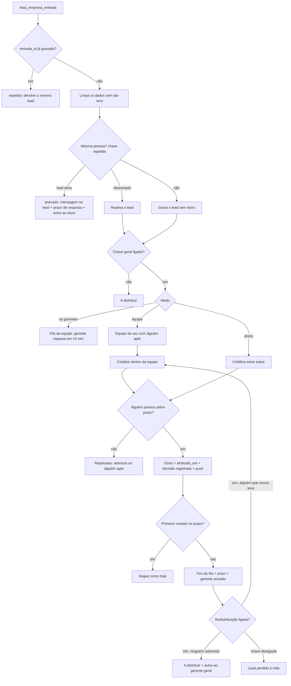

# Distribuição automática do lead da empresa (desenho)

> **Desenho da Etapa 1.1, de 05/11/2026.** Brief: `docs/codex-distribuicao-automatica.md`. Decisões: `docs/estudo-roleta-leads.md` (rodadas 1 a 4; onde o estudo diverge, valem as decisões). Mockup: `docs/mockups/distribuicao-automatica.html`, publicado (privado) em https://claude.ai/artifact/ERSUePbD8HkdBNDYJSo8y2.
>
> **Estado:** desenho para o Felipe aprovar. Ainda sem SQL de produção e sem código. A assinatura de `lead_empresa_entrada` (seção 5) foi fechada com o Marketing em 05/11/2026. As 11 perguntas da seção 16 foram respondidas em 05/11/2026 (16.0). A 16.2 muda a decisão 7, porque a passagem automática não tem mais limite. A 16.8 ajusta a R3-1, porque a vez da recepção conta como presença. As três propostas que vieram depois (16.1, 16.12 e 16.13) também foram respondidas. Falta o ok final do Felipe no desenho.

## Sumário

1. [O que muda em uma página](#1-o-que-muda-em-uma-página)
2. [Tudo com chave](#2-tudo-com-chave)
3. [Banco: tabelas e colunas](#3-banco-tabelas-e-colunas)
4. [Banco: a escolha, o rodízio e os pulos](#4-banco-a-escolha-o-rodízio-e-os-pulos)
5. [A entrada: `lead_empresa_entrada`](#5-a-entrada-lead_empresa_entrada)
6. [Presença: check-in, sinal, ausência e plantão](#6-presença-check-in-sinal-ausência-e-plantão)
7. [Desempenho: as duas notas e as faixas](#7-desempenho-as-duas-notas-e-as-faixas)
8. [Rotinas no `pg_cron`](#8-rotinas-no-pg_cron)
9. [Funções, permissões e RLS](#9-funções-permissões-e-rls)
10. [Avisos no celular](#10-avisos-no-celular)
11. [O que muda no que já existe](#11-o-que-muda-no-que-já-existe)
12. [Fluxo de ponta a ponta](#12-fluxo-de-ponta-a-ponta)
13. [Telas e textos](#13-telas-e-textos)
14. [Testes da Etapa 1.2](#14-testes-da-etapa-12)
15. [Riscos](#15-riscos)
16. [Perguntas ao Felipe](#16-perguntas-ao-felipe)

## 1. O que muda em uma página

- O lead da empresa chega pelo direcionador do Marketing, que chama `public.lead_empresa_entrada(...)`. **Numa transação só**, a função:
  - confere se a entrada já chegou;
  - confere se a pessoa já tem lead;
  - grava o lead;
  - escolhe quem recebe;
  - registra a decisão com todos os pulos.
- **Três modos:**
  - **Equipe e depois corretor**, o padrão: rodízio igual entre equipes e, dentro da equipe, rodízio por créditos;
  - **Direto ao corretor**: créditos entre todos os aptos da empresa;
  - **Só gerentes**: o lead fica sem dono na fila da equipe, e o gerente tem 15 min para repassar.
- **Quem está na fila agora:**
  - no horário, quem está no stand (fez check-in **ou** foi posto na vez pela recepção) e está com **"Recebendo leads"** ligado;
  - fora do horário, quem está com "Recebendo leads" ligado e usou o app nos últimos 30 min (o plantão);
  - sem ninguém, o lead fica **represado** até a abertura.
- **Prazo estourado:** uma rotina a cada minuto passa o lead adiante até alguém atender, primeiro na mesma equipe (modo equipe), nunca a quem já o teve, e manda quem perdeu ao fim da fila, com aviso.
- **Chaves:** cada mecanismo tem uma chave em Configurações > Distribuição automática, só do gerente geral. O banco lê as chaves a cada decisão.
- **Desempenho:** "Nota do CRM" e "Nota do plantão", 50% cada. Os textos dizem sempre que o cálculo **não muda pontos nem verba**.
- **O primeiro teste** é o carimbo de `atribuido_em` quando a troca de dono é feita pelo banco, sem usuário logado (seção 11.1). Sem ele, o prazo e o push quebram.

## 2. Tudo com chave

As chaves são colunas de `distribuicao_config` (seção 3.1), alteradas só pelo gerente geral (`is_gerente_geral()`), com cada mudança registrada em `distribuicao_config_historico` (quem, quando, chave, de e para). As funções leem a linha da config **dentro da trava** de cada decisão, então a mudança vale no lead seguinte. As telas leem a config ao abrir e a cada 5 min; o banco recusa o que a chave desligou, mesmo que a tela ainda mostre.

| Chave (coluna) | Ligada (padrão) | Desligada | Dados já gravados quando muda |
| --- | --- | --- | --- |
| **Distribuição automática** (`ligada`) | A roleta escolhe | Todo lead da entrada vai para **"A distribuir"**, sem dono, e é atribuído à mão. O lead repetido continua indo ao dono (chave própria) | **Ao desligar:** represados e leads aguardando ficam onde estão e passam a aparecer em "A distribuir". A redistribuição para. Os créditos, as faixas e as presenças ficam guardados. **Ao ligar:** os leads de "A distribuir" que vieram da entrada **não** voltam sozinhos à roleta, para não surpreender quem já está trabalhando neles. O gerente geral tem o botão "Mandar todos à distribuição" |
| **Modo** (`modo`: `equipe`, `direto`, `gerentes`) | Escolha entre três | Não é liga/desliga | **Os créditos não zeram** ao trocar de modo. No modo equipe a comparação é dentro da equipe; no direto, entre todos. Os leads na fila de uma equipe (modo gerentes) continuam lá até o gerente repassar |
| **Peso por desempenho** (`pesos`) | Créditos 3, 2 e 1 pela faixa | Todos com peso 1 (rodízio igual) | As faixas continuam sendo calculadas toda segunda e guardadas, mas somem das telas do corretor. Os créditos ficam, e o rodízio igual parte deles |
| **Exigir check-in no horário** (`exigir_checkin`) | No horário, na fila só quem está no stand (check-in aberto **ou** na vez da recepção, 6.1.1) e com o botão ligado | Vale **só o botão "Recebendo leads"**, e a vez da recepção também deixa de contar. O check-in, o check-out e a pergunta "Você saiu do stand?" somem das telas | **Ao desligar:** as presenças abertas fecham na hora, com saída "chave desligada". As ausências abertas fecham junto. **Ao ligar:** ninguém entra na fila até fazer check-in. Quem estava com o botão ligado continua com ele ligado |
| **Sinal de localização** (`sinal`) | Com o CRM aberto e check-in aberto, o app manda a posição a cada 10 min. Fora do raio, pergunta "Você saiu do stand?". Sem sinal há 30 min, o corretor fica "sem sinal" | Sem leitura de posição e sem a pergunta. Vale o check-in e o check-out manuais. O "sem sinal" deixa de existir no horário | **Ao desligar:** apaga os sinais guardados (só o último de cada um) e fecha as ausências de "Fora do raio" e "sem sinal". **Com o check-in desligado, esta chave não faz nada**, e a tela de Configurações mostra isso ("Só vale com o check-in ligado"). Fora do horário o app continua mandando o "app aberto", **sem posição**, para o plantão (chave do plantão) |
| **Plantão fora do horário** (`plantao`) | Fora do horário recebe quem está com o botão ligado e usou o app nos últimos 30 min. Sem uso há 30 min, o botão desliga sozinho | Ninguém recebe fora do horário. O que acontece com o lead depende da chave "Represar" (matriz abaixo) | **Ao desligar:** nada a fechar. Quem estava de plantão para de receber no lead seguinte |
| **Represar quando não há ninguém** (`represar`) | Fora do horário e sem ninguém de plantão, o lead espera a abertura e sai pela roleta, um por vez, em ordem de chegada | Fora do horário, distribui na hora entre todos os que participam e não estão em pausa, sem olhar botão nem stand; o prazo começa na abertura (regra de hoje do `prazo.ts`; Felipe, 16.6) | **Ao desligar:** os represados saem na hora, pela roleta, com essa regra. **Ao ligar:** nada muda nos leads já distribuídos |
| **Produtos que o corretor atende** (`produtos`) | Pula quem não atende o produto; pula a equipe sem ninguém que atenda, sem ela perder a vez | Todos atendem todos | As exceções marcadas ficam guardadas e somem das telas. Ao ligar de novo, voltam a valer |
| **Redistribuição pelo prazo** (`redistribuir`) | O lead estourado passa sozinho adiante até alguém atender: na mesma equipe e depois na próxima (modo equipe), ou ao próximo da fila (modo direto). Nunca volta a quem já teve | O gerente é avisado e usa o **Lead perdido** à mão, como hoje | **Ao desligar:** a rotina para no minuto seguinte. Nenhum lead fica sem dono por isso: o lead estourado continua com quem estava. **Ao ligar:** só leads que estouram dali em diante são passados; os que já estavam estourados há mais de 30 min ficam para o Lead perdido, para não sair uma rajada |
| **Prazo estourado manda ao fim da fila** (`fim_da_fila`) | Quem deixa estourar vai ao fim, com aviso no celular | Só pula, mantendo a posição, enquanto tiver lead estourado na carteira | Os créditos já mexidos ficam como estão |
| **Lead repetido vai ao dono** (`repetido_ao_dono`) | Pessoa com lead ativo: a mensagem entra no lead dela, o dono é avisado e tem 15 min para responder. Lead descartado: reativa e vai pela roleta | Cria lead novo e passa pela roleta, com o aviso de duplicado de hoje | Os prazos de resposta já abertos continuam até a resposta ou o estouro |
| **Atribuição à mão conta como vez** (`manual_conta`) | Quem recebe lead da empresa à mão vai ao fim da fila | A atribuição à mão não mexe na fila | Nada a corrigir |
| **Transparência para o corretor** (`transparencia`) | O corretor vê "Minhas vezes", a posição e os motivos | "Minhas vezes" e a posição somem para o corretor. O gerente continua vendo | O registro de decisões continua sendo gravado. Ao ligar, o corretor vê também o passado |
| **Períodos pelo check-in** (`periodos_checkin`, **Etapa 2**) | O check-in gera o lançamento pendente do período | Os períodos voltam a ser registrados à mão, pela recepção e pelo gerente, como hoje. O check-in serve só à distribuição (se ligado) | **Ao desligar:** os pendentes já gerados ficam pendentes, para aprovar ou recusar. Nenhum novo é gerado. Desenho na Etapa 2 |
| **Aprovação pelo gerente da equipe** (`aprova_gerente`, **Etapa 2**) | Aprovam o gerente da equipe e o gerente geral | Só o gerente geral aprova, como em 29/10 | As aprovações já feitas valem. Desenho na Etapa 2 |

**Fora do horário, as duas chaves juntas** (é a única combinação em que uma chave mexe no efeito de outra, e por isso fica escrita):

| | Represar ligado | Represar desligado |
| --- | --- | --- |
| **Plantão ligado** | Vai a quem está de plantão; sem ninguém, espera a abertura | Vai a quem está de plantão; sem ninguém, distribui na hora entre os que participam, com o prazo na abertura |
| **Plantão desligado** | Todo lead espera a abertura | Todo lead é distribuído na hora entre os que participam, com o prazo na abertura (regra de hoje) |

**Pausa, "fora da distribuição" e o botão** não têm chave porque são escolhas de cada pessoa, não mecanismos. Com a chave geral desligada eles somem das telas, e o que foi marcado fica guardado.

## 3. Banco: tabelas e colunas

Tudo num arquivo novo e idempotente, `crm/supabase/distribuicao.sql`, rodado depois de `schema.sql`, `recepcao.sql` e `agendar-avisos.sql`. Os nomes reais são os de `schema.sql`.

### 3.1 Configuração e auditoria

- **`distribuicao_config`**, uma linha (`id boolean primary key default true check (id)`, como `horario_atendimento`):
  - `ligada` (padrão **false** na instalação, para o Felipe ligar no dia), `modo` (`equipe`), `pesos`, `exigir_checkin`, `sinal`, `plantao`, `represar`, `produtos`, `redistribuir`, `fim_da_fila`, `repetido_ao_dono`, `manual_conta`, `transparencia` (todas true), `periodos_checkin` e `aprova_gerente` (Etapa 2, false até lá);
  - números que hoje são regra fixa, guardados aqui para não ficar no código: `minutos_sem_sinal` (30), `minutos_plantao` (30), `minutos_prazo_gerente` (15);
  - `updated_at`, `updated_by`.
- **`distribuicao_config_historico`**: `id`, `quando`, `quem`, `chave`, `de`, `para`. Gravada por gatilho na config. Só o gerente geral lê.

### 3.2 Quem participa

- **`distribuicao_corretores`** (`corretor_id` pk), uma linha por pessoa com a permissão `distribuicao.receber`, criada sozinha na primeira leitura:
  - `participa` (padrão true): o gerente tira e põe ("fora da distribuição pelo gerente");
  - `recebendo` (padrão false) e `recebendo_desde`: o botão "Recebendo leads";
  - `pausado_ate` (nulo = sem pausa; `'infinity'` = pausa sem data);
  - `creditos numeric` (padrão 0): o rodízio (seção 4.2);
  - `ultimo_app_em`: o último "app aberto" (seção 6.4), sem posição;
  - `atualizado_por`, `atualizado_em`.
- **`distribuicao_pausas`**: o registro de cada pausa, volta, saída e retorno pelo gerente e do botão desligado por inatividade (`corretor_id`, `tipo`: `pausa`, `volta`, `fora`, `dentro`, `plantao_fim`, `ate`, `quem`, `quando`). Ninguém apaga.
- **`distribuicao_produtos`** (`corretor_id`, `empreendimento_id`, pk dupla): só as **exceções**, a linha diz "não atende". Empreendimento novo já sai atendido por todos. Cada marca e desmarca fica em `distribuicao_produtos_historico` (`corretor_id`, `empreendimento_id`, `atende`, `quem`, `quando`).

### 3.3 Leads

Colunas novas em `public.leads`:
- **`dono_id` aceita nulo**, com o check `leads_sem_dono_so_empresa`: `dono_id is not null or (origem = 'empresa' and distribuicao_estado is not null)`. O `default auth.uid()` continua para o cadastro à mão; a entrada (sem usuário) sempre informa o dono ou o estado.
- **`distribuicao_estado text`** (nulo quando tem dono):
  - `represado`: espera a abertura (fora do horário) ou alguém ficar apto (no horário);
  - `fila_equipe`: modo só gerentes, na fila da equipe;
  - `a_distribuir`: com o gerente geral e quem tem `leads.distribuir`.
- **`equipe_id uuid`** (referência a `teams`): a equipe do lead na fila (modo gerentes) ou a equipe que recebeu pela distribuição. Serve para a redistribuição ficar na mesma equipe. Nulo nos leads que não vieram da distribuição.
- **`distribuido boolean not null default false`**: o lead veio da distribuição (só esses são redistribuídos sozinhos, estudo 6.6).
- **`redistribuicoes smallint not null default 0`**: só a contagem das passagens, sem limite (16.2).
- **`prazo_imediato boolean not null default false`**: recebido de plantão fora do horário, com o prazo de 15 min de relógio (decisão 6). Volta a false em toda troca de dono feita no horário.
- **`resposta_ate timestamptz`**: o prazo de 15 min da mensagem repetida num lead ativo fora de "novo" (seção 5.4). Limpo pela próxima conversa ou toque.

Índices: `(distribuicao_estado, created_at) where distribuicao_estado is not null`, `(equipe_id) where dono_id is null` e `(origem, etapa, status) where distribuido`.

### 3.4 Entradas (idempotência)

- **`distribuicao_entradas`** (`entrada_id text` pk): `lead_id`, `recebido_em`, `gravado_em`, `fonte` (o slug de `lead_fontes`), `campanha` (jsonb, as UTMs), `empreendimento_id`, `situacao` (a que a função devolveu) e `resultado` (jsonb interno: quem recebeu, equipe, represado ou fila). **Não guarda dado do cliente** (nome, telefone, mensagem ficam só no lead) **nem nada do direcionador** (regra, destino, falha de entrega). A segunda chamada com o mesmo `entrada_id` devolve o mesmo `lead_id` com a situação `repetido`.
- **A fonte fica aqui, e não no lead**, porque `leads` não tem coluna de canal. O canal do lead da empresa (`lead_canais`, `docs/estudo-relatorios.md`) é de outra frente; quando ele existir, a entrada passa a preencher `leads.canal` a partir desta coluna, e a fonte aparece no lead (Felipe, 16.10, 05/11/2026).

### 3.5 Decisões (o registro de cada escolha)

- **`distribuicao_decisoes`**: uma linha por escolha, só o banco escreve, na mesma transação da escolha (estudo 12.6):
  - `id`, `lead_id`, `quando`, `modo`, `motivo_entrada` (`nova`, `redistribuida`, `represada`, `reativada`, `manual`, `gerente`);
  - `equipe_id` (a escolhida), `equipes` (jsonb: cada equipe considerada, a posição e o motivo do pulo);
  - `recebeu_id` (nulo se ficou represado, na fila ou em "A distribuir"), `resultado` (`recebeu`, `represado`, `fila_equipe`, `a_distribuir`);
  - `candidatos` (jsonb, na ordem: corretor, posição, créditos antes, peso, resultado, motivo, `mantem_posicao`).
- Leitura só por funções (seção 9). Guardado por 13 meses.

### 3.6 Presença

**Por que não reaproveitar `plantao_presencas`:** a tabela é a **vez** dos clientes do stand. Ela exige `ordem > 0` única por vez e uma linha por pessoa, dia e turno. Um check-in gravado ali poria o corretor na vez, o que a R4-14 proíbe para quem chega depois das 9h15, e bateria com a linha que a recepção grava para a mesma pessoa. O estudo (12.9) supunha a reutilização; o esquema não deixa.

- **`distribuicao_presencas`**: o check-in do próprio corretor.
  - `id` (gerado no aparelho, contra duplicado), `corretor_id`, `plantao_id`, `dia` (São Paulo), `entrada_em` (hora do servidor), `entrada_dist_m`, `entrada_precisao_m`, `entrada_metodo` (`gps` ou `selfie`, o plano B);
  - `saida_em`, `saida_dist_m`, `saida_metodo` (`gps`, `manual`, `sem_saida`, `chave_desligada`);
  - `status` (`aberta`, `fechada`, `sem_saida`). Índice único parcial: uma `aberta` por corretor.
  - **Sem latitude nem longitude.** A função calcula a distância e grava só os metros arredondados.
- **`distribuicao_ausencias`**: os intervalos fora do stand com a presença aberta (`presenca_id`, `inicio`, `fim`, `motivo`: `saiu`, `fora_do_raio`, `sem_sinal`, `visita`). A Etapa 2 soma estes intervalos para a regra de 1h15.
- **`distribuicao_sinais`** (`corretor_id` pk): **só o último sinal** (`quando`, `dentro boolean`, `precisao_m`). Não é histórico. Apagada inteira quando a chave do sinal desliga.
- **`plantoes`** ganha `lat numeric(9,6)`, `lng numeric(9,6)` e `raio_m integer default 200` (estudo do check-in, decisão 8). Sem coordenadas, o stand não aceita check-in.
- **`distribuicao_checkin_tentativas`** (diagnóstico, 30 dias): `corretor_id`, `quando`, `resultado`, `dist_m`, `precisao_m`. Limita a 1 tentativa a cada 20 s.

### 3.7 Desempenho

- **`distribuicao_followup_dia`** (`corretor_id`, `dia`, `ativos`, `em_dia`): a foto diária da carteira, para a média dos 30 dias (R4-13).
- **`distribuicao_desempenho`** (`corretor_id`, `semana` date, pk dupla): `prazo_respondidos`, `prazo_total`, `followup_pct`, `pontos_aprovados`, `nota_crm_rel`, `nota_plantao_rel`, `total_rel`, `faixa` (`acima`, `media`, `abaixo`), `peso` (3, 2, 1), `novo boolean`. A da semana mais recente vale.

### 3.8 Avisos

- **`distribuicao_avisos`** (modelo de `parceiro_avisos`): `id`, `para_id`, `tipo`, `lead_id`, `chave` única, `criado_em`, `enviado_em`. A rotina grava; a Edge Function `avisos` lê por `avisos_dados()` e marca. Seção 10.

## 4. Banco: a escolha, o rodízio e os pulos

### 4.1 Uma função e uma trava

- `private.distribuir_lead(p_lead uuid, p_motivo text, p_excluir uuid[] default '{}')`, `security definer`, `volatile`.
- Faz `pg_advisory_xact_lock(7305002)`, **chave própria** (a 7305001 é dos parceiros), e trava o lead com `for update`. Como nos parceiros, a trava e a leitura ficam em comandos separados, para quem pega a trava depois enxergar a escolha anterior.
- Lê a config, monta a fila (4.3), escolhe, ajusta os créditos, grava o lead e grava a decisão. **Não existe caminho que escolha sem registrar.**
- A troca de dono usa `set_config('crm.motivo_dono', <motivo>, true)` com `distribuicao`, `redistribuido`, `represado_liberado` ou `repetido_reativado`, e o `leads_guard` carimba `atribuido_em` (11.1).
- **A fila visível e a escolha usam a mesma função** `private.distribuicao_fila(p_equipe uuid, p_lead uuid default null)`, como `private.parceiro_fila`. Nunca há outra ordenação em outro lugar.

### 4.2 Rodízio por créditos

O "smooth weighted round robin" do estudo (12.4), determinístico:
1. **Quem está na fila** (o conjunto F): participa, `recebendo` ligado, sem pausa e, no horário, no stand pelo check-in aberto ou pela vez da recepção (mesmo ausente; 6.1.1). **Com `exigir_checkin` desligado, o check-in sai da conta: no horário basta o botão.** Fora do horário, de plantão.
2. A cada lead decidido no grupo (a equipe, no modo equipe; todos, no modo direto), **cada um de F ganha créditos iguais ao peso** (3, 2 ou 1; todos 1 sem os pesos).
3. Entre os de F que passam pelos pulos (4.3), recebe quem tem **mais créditos**. Empate: quem recebeu há mais tempo, depois o id.
4. Quem recebe **perde a soma dos pesos de F**.
5. **Teto:** os créditos nunca passam da soma dos pesos de F. Assim quem passou a manhã ausente, mantendo a posição, volta na frente e recebe **um** lead, sem rajada.
6. **Fim da fila** (prazo estourado com a chave ligada, ou atribuição à mão com `manual_conta`): créditos = menor crédito de F menos 1.
7. Quem sai de F (botão desligado, pausa, fora pelo gerente) **não ganha créditos** enquanto está fora (R4-9). Ao voltar, entra com os créditos que tinha, limitados ao teto.

A posição mostrada é a ordem de F por créditos, a mesma da escolha.

### 4.3 A ordem dos pulos

Para cada lead, a função percorre F em ordem e aplica as regras. O primeiro que passa recebe. Os que estavam à frente ficam na decisão, **pulados, com o motivo**.

| # | Regra | Motivo que aparece | Posição |
| --- | --- | --- | --- |
| 1 | Está em F | (fora de F não aparece como pulo: "Fora da fila" na lista da equipe) | Não ganha créditos |
| 2 | **No horário:** presente no stand, não ausente (só com `exigir_checkin`; desligado, a regra não existe e o "sem sinal" também não). **Fora:** de plantão | "Fora do stand desde 10h40", "Sem sinal desde 11h05", "Em visita" | Mantém |
| 3 | Atende o produto do lead (chave `produtos`; lead sem produto do catálogo: todos atendem) | "Não atende Marco Zero One" | Mantém |
| 4 | Sem lead da empresa com o prazo estourado na carteira | "Tem lead com prazo estourado" | Mantém (o fim da fila acontece no estouro, 4.5) |
| 5 | Não teve este lead antes | "Já teve este lead" | Mantém |

- **Equipe sem ninguém que passe:** a equipe é pulada ("Equipe sem ninguém no stand", "Ninguém da equipe atende Marco Zero One") e **não perde a vez**.
- **Ninguém em equipe nenhuma:** `represado` (seção 4.6).

### 4.4 Os três modos

- **Equipe e depois corretor (`equipe`):**
  - **rodízio igual entre equipes**: a equipe que recebeu lead da distribuição há mais tempo, entre as que têm alguém que passe; quem nunca recebeu vem primeiro;
  - a equipe pulada não perde a vez, porque o critério é "recebeu há mais tempo";
  - **é por equipe.** Felipe (16.1): cada gerente tem uma equipe só, então por equipe e por gerente dá no mesmo. **O banco passa a impedir** um gerente com duas equipes (Felipe, 16.1, 05/11/2026). O `distribuicao.sql` primeiro confere se já existe gerente com mais de uma equipe. Se existir, para com um aviso que diz quantos são, sem nomes, e não cria nada. Se não existir, cria o índice único `teams_gerente_unico` em `teams (gerente_id)`. A tela de Equipes mostra o erro do índice como "Este gerente já tem uma equipe."
- **Direto ao corretor (`direto`):** F de todas as equipes, numa fila só de créditos. O lead guarda `equipe_id` da equipe de quem recebeu.
- **Só gerentes (`gerentes`):**
  - rodízio igual entre equipes, com as mesmas regras, mas sem olhar presença: o gerente não precisa estar no stand (R2-7);
  - a equipe entra se tiver ao menos um corretor que atenda o produto; corretor nenhum precisa estar presente;
  - o lead fica com `dono_id` nulo, `distribuicao_estado = 'fila_equipe'` e `equipe_id`, visível ao gerente da equipe;
  - **prazo do gerente:** 15 min no horário de atendimento, contados de `created_at` por `private.fim_do_prazo`. Estourou: aviso ao gerente geral, uma vez;
  - o repasse é a atribuição à mão (`leads_guard`), que carimba `atribuido_em`, e os 15 min do corretor começam aí;
  - não há redistribuição automática na fila do gerente.

### 4.5 Prazo estourado e redistribuição

`private.distribuicao_estourados()`, a cada minuto (seção 8), com `for update skip locked`:
- **Pega:** lead ativo, `origem = 'empresa'`, `etapa = 'novo'`, `distribuido`, com dono, e `now()` passou do fim do prazo (11.3).
- **Sempre, para cada estouro novo** (chave do estouro `lead:atribuido_em`, para não repetir):
  - com `fim_da_fila`, o dono vai ao fim da fila e recebe o aviso "Você foi para o fim da fila";
  - o gerente da equipe recebe o aviso da perda.
- **Com `redistribuir`, sem limite de passagens** (Felipe, 16.2, 05/11/2026; muda o "até 2 vezes" da decisão 7). O lead continua passando adiante até alguém atender. Para quem vai depende do modo:
  - **equipe e depois corretor:** passa entre os corretores aptos da mesma equipe (`equipe_id`). Quando acabam, vai à próxima equipe pela vez entre equipes, e essa passagem **gasta a vez** dessa equipe;
  - **direto ao corretor:** vai ao próximo da fila de créditos, de qualquer equipe;
  - **só gerentes:** não se aplica, porque o lead da fila da equipe não tem dono nem prazo de corretor.
- Cada passagem chama `distribuir_lead(lead, 'redistribuida', excluir = todos os donos anteriores)` e grava `detalhe = 'redistribuido'` no evento de dono, com `redistribuicoes + 1` (só para contar, sem limite).
- **Proteção contra loop:**
  - **nunca volta a quem já teve o lead.** A exclusão vale para todos os donos anteriores, então o mesmo corretor nunca recebe o mesmo lead duas vezes;
  - **ninguém sobrando** (todos os aptos da empresa já tiveram o lead, ou ninguém está apto agora): o lead **vai para "A distribuir"**, sem dono (`distribuicao_estado = 'a_distribuir'`, evento de dono com `detalhe = 'a_distribuir'`), e o gerente geral é avisado, uma vez por lead (Felipe, 16.12, 05/11/2026). Dali ele sai só pela atribuição à mão ou por "Mandar todos à distribuição". Quem perdeu continua contando o perdido;
  - **uma passagem por lead a cada estouro:** o prazo recomeça em cada passagem, então o lead anda no máximo uma vez a cada 15 min de atendimento. A noite não conta, porque o prazo só corre no horário (menos para o plantão).
- **Aviso ao gerente:** a cada passagem, o gerente da equipe de quem perdeu recebe "Lead passado a outro corretor". Mais de 3 na mesma rodada viram um aviso só, como o aviso de equipe de hoje. Quando o lead sai da equipe, o gerente da equipe nova também é avisado.
- **Sem `redistribuir`:** nada se move. O gerente é avisado e usa o Lead perdido, como hoje.
- **Não move** lead atribuído à mão (`distribuido = false`), como no estudo 6.6.
- **No painel:** o evento `redistribuido` conta como **perdido** em `leads_perdidos` (passa a ler `detalhe in ('perdido', 'redistribuido')`), com a marca "automático" (Felipe, 16.3).

### 4.6 Represados e aguardando

- **Fora do horário** (com a chave `represar` e sem ninguém de plantão): o lead fica `represado`.
- **No horário, sem ninguém apto em equipe nenhuma:** o lead também fica `represado`, e a rotina tenta a cada minuto (Felipe, 16.4).
- **Liberação:** a rotina de cada minuto libera os represados **em ordem de chegada (`p_recebido_em`), um por vez**, pela roleta. Cada um passa pela conta de créditos, então quem chega primeiro às 9h não recebe todos.
- **Plantão à noite com represados** (Felipe, 16.5 e 16.13, 05/11/2026): quando alguém liga "Recebendo leads" fora do horário, a rotina do minuto seguinte libera os represados pela roleta entre quem está de plantão, com o prazo de 15 min de relógio de cada um.
  - **Um represado por vez para cada um:** quem está de plantão só recebe o próximo represado depois de **atender** o anterior. Com uma pessoa só de plantão, ela recebe um, atende, recebe o seguinte. Quando outro corretor liga o botão, ele entra na roleta e recebe o próximo.
  - **Atender** é o mesmo critério do fim do prazo de 15 min (`docs/leads.md`, seção 4): o lead sai de "novo". Isso acontece na primeira conversa registrada (WhatsApp, ligação, e-mail, visita ou o registro da recepção), no toque em Abrir no WhatsApp ou em Ligar, ou quando o corretor muda a etapa. Anotação, Sem resposta e Mensagem original não contam. Descartar o lead também libera o próximo.
  - **O teto vale só para os represados liberados à noite.** Um lead novo que chega pela entrada enquanto a pessoa está de plantão vai para ela normalmente, pela roleta.
  - O represado que ela deixar estourar passa adiante pela regra de 4.5. Sem mais ninguém de plantão, ele vai para "A distribuir" (16.12).
  - Na conta: um represado conta como "pendente com quem está de plantão" enquanto o lead que ele recebeu nessa liberação estiver em "novo". A rotina confere isso a cada minuto, pelo evento de dono `represado_liberado`.
- **Aviso:** se um represado no horário passa de 15 min sem sair, o gerente geral é avisado, uma vez.
- O prazo do lead liberado começa na liberação (carimbo de `atribuido_em`).

### 4.7 Atribuição à mão

- O gerente (pela fila da equipe, pela ficha ou pelo cadastro do lead da empresa) e quem tem `leads.distribuir` (em "A distribuir") atribuem à mão.
- Com `manual_conta`, o gatilho depois da troca de dono num lead `origem = 'empresa'` manda quem recebeu ao fim da fila e grava uma decisão `manual`.
- O Lead perdido manual (`lead_perdido`) também conta como vez de quem recebe.

## 5. A entrada: `lead_empresa_entrada`

Para a sessão master fechar com a sessão principal do Marketing. **Não é pergunta ao Felipe.**

### 5.1 Assinatura (fechada com o Marketing, 05/11/2026)

A sessão master fechou esta assinatura com a sessão principal do Marketing em 05/11/2026. Os três pontos de 5.5 ficaram decididos.

```sql
public.lead_empresa_entrada(
  p_entrada_id   text,          -- obrigatório: internetMessageId hoje, id do portal depois; chave de idempotência
  p_recebido_em  timestamptz,   -- obrigatório: quando chegou à caixa ou ao portal
  p_nome         text,          -- obrigatório; vazio só se não houver nenhum
  p_telefone     text,          -- só dígitos, com 55, ou nulo
  p_email        text,          -- minúsculas, ou nulo (um dos dois sempre vem)
  p_mensagem     text,          -- o texto original
  p_fonte        text,          -- obrigatório: site, zap, vivareal, olx, imovelweb, chavesnamao, outra
  p_produto      text,          -- nome do empreendimento como está no catálogo, ou nulo
  p_empreendimento_id uuid default null, -- id do catálogo; quando vem, vale sobre p_produto
  p_campanha     jsonb default null  -- UTMs, nulo por enquanto
) returns table (lead_id uuid, situacao text)
-- security definer, set search_path = ''
-- grant execute só a service_role (revoke de public, anon, authenticated)
```

**`situacao`:**

| Valor | Quando |
| --- | --- |
| `criado` | Lead novo gravado. Inclui os que foram a um corretor, à fila da equipe (modo só gerentes) ou ficaram represados |
| `anexado` | A pessoa já tem lead ativo: a mensagem entrou no lead dela (decisão 8, chave `repetido_ao_dono`) |
| `reativado` | A pessoa tinha lead descartado: reativado e mandado pela roleta (decisão 9) |
| `a_distribuir` | A chave geral está desligada: o lead ficou sem dono em "A distribuir" |
| `repetido` | O mesmo `p_entrada_id` já tinha chegado. Devolve o mesmo `lead_id` e não grava nada |

O detalhe da distribuição (quem recebeu, a equipe, represado ou fila) não volta para o Marketing. Ele fica em `distribuicao_entradas.resultado` e em `distribuicao_decisoes`, e a distribuição não precisa contar ao Marketing para onde o lead foi.

**Como a função trata os dados** (qualquer situação conta como gravado; o Marketing só tenta de novo quando há erro):
- **Tudo numa transação:** não existe gravação parcial. Se a função cai no meio, nada fica, e a próxima chamada com o mesmo `p_entrada_id` grava do zero.
- **Dado ruim não vira erro**, para o e-mail não voltar a cada minuto:
  - `p_nome` vazio: grava "Sem nome";
  - telefone fora do formato `^55[0-9]{10,11}$`: grava sem telefone, e o lead segue pelo e-mail;
  - sem telefone e sem e-mail válidos: grava assim mesmo (o lead aceita `whatsapp` nulo desde 04/11/2026), e o corretor vê "Sem telefone";
  - **produto:** com `p_empreendimento_id` válido, vale ele, e `leads.empreendimento` recebe o nome do catálogo. Sem id, a função procura `p_produto` por `lower(nome)` no catálogo. Sem nenhum dos dois no catálogo, o lead fica com o texto em `leads.empreendimento`, e a regra dos produtos trata o lead como sem produto (todos atendem). Um id que não existe é ignorado, sem erro.
- **Erro só para o que é de verdade:** banco fora, trava que não sai, `p_entrada_id` ou `p_fonte` vazios. Os `raise` usam só códigos e o `p_entrada_id`, **nunca nome, telefone ou e-mail**.
- **`p_fonte` e `p_campanha`** ficam em `distribuicao_entradas` (3.4), porque o lead ainda não tem coluna de canal.

**Sigilo (requisito do Marketing):**
- nenhum campo ou coluna diz que o lead passou pelo direcionador, qual regra casou ou que uma entrega a outro destino falhou;
- o lead entra exatamente como um lead da empresa sem regra: `origem = 'empresa'`, `criado_por` nulo, `distribuido = true`;
- `distribuido` e `distribuicao_entradas` dizem só que o lead **entrou pela distribuição automática**, como todo lead da empresa daqui em diante. Não dizem nada do direcionador nem dos destinos dele;
- `distribuicao_entradas` guarda o id da entrada, as datas, a fonte, as UTMs e o resultado, sem nome, telefone, e-mail nem mensagem.

### 5.2 O que acontece dentro, em ordem

1. Trava `pg_advisory_xact_lock(7305002)`.
2. `p_entrada_id` já em `distribuicao_entradas`: devolve `(lead_id, 'repetido')`.
3. Limpa os dados (5.1).
4. **Mesma pessoa** (5.4), pelo telefone; sem telefone, pelo e-mail.
5. Grava o lead novo com `origem = 'empresa'`, `distribuido = true`, `criado_por` nulo, `dono_id` nulo e `distribuicao_estado = 'represado'` provisório.
6. Grava a interação `mensagem` sem autor, se houver texto.
7. Chama `private.distribuir_lead`, com `p_recebido_em` como hora de chegada. A troca de dono passa pelo `leads_guard`, que carimba `atribuido_em = greatest(p_recebido_em, now() - 5 min)` (5.5 e 11.1), e o gatilho de avisos dispara o push. O represado guarda `p_recebido_em` para a ordem de saída.
8. Grava `distribuicao_entradas` e devolve.

### 5.3 O que o Marketing precisa saber

- Uma chamada por lead, com a chave de serviço, da Edge Function `entrada-leads`. Nunca do front.
- A função não devolve nome nem telefone de ninguém, só o `lead_id` e a situação.
- O teste do Marketing pode usar um banco PGlite com `distribuicao.sql` carregado e a função de verdade.

### 5.4 Lead repetido

Com a chave `repetido_ao_dono`:
- **Lead ativo com dono ativo:**
  - a mensagem entra no lead como interação `mensagem`, com o texto "Mensagem nova pela empresa: …";
  - **não cria lead nem gasta vez**;
  - **A mensagem nova não pode mexer no último contato.** Hoje `lead_interacao_atualiza_lead` atualiza `ultima_interacao_em` também para `mensagem`, o que esconderia o "Sem contato há N dias". A mudança vale **só para a mensagem gravada pela entrada** (interação `mensagem` sem autor, `autor_id` nulo, gravada sem usuário logado): ela fica fora dessa atualização, como os toques. A "Mensagem original" colada pelo corretor no Cadastro Mágico continua como hoje;
  - **prazo novo de 15 min:**
    - lead em "novo": `atribuido_em` é recarimbado, e o prazo atual recomeça;
    - **lead em outra etapa:** grava `leads.resposta_ate = fim_do_prazo(now())` (ou 15 min de relógio, se o dono está de plantão). A lista do dia e a ficha mostram "! Responder até 14h32 · mensagem nova". A próxima conversa ou toque (gatilho das interações) limpa `resposta_ate`;
  - estourou: **avisa o corretor e o gerente** (Felipe, 16.7, corrigido em 05/11/2026). Não redistribui, não conta como prazo estourado e não tira o corretor da vez;
  - aviso ao dono: "Mensagem nova de Ana Souza".
- **Lead descartado:** reativa o mesmo lead (`status = 'ativo'`, o histórico fica junto), grava a interação e chama a distribuição com `motivo = 'reativada'`. O antigo dono não é excluído da roleta.
- **Dono desativado:** pela roleta, no mesmo lead.
- **Mais de um lead ativo com o mesmo número:** vai ao mais recente.

Sem a chave: cria lead novo pela roleta, como qualquer entrada.

### 5.5 Os três pontos (fechados com o Marketing, 05/11/2026)

1. **`p_recebido_em` e o prazo.**
   - A **fila dos represados** usa `p_recebido_em` como está: é a ordem de saída.
   - O **prazo** conta de `greatest(p_recebido_em, now() - interval '5 minutes')`. Com até 5 min de atraso, conta da chegada. Com mais, o corretor ganha os 15 min a partir da entrega, para não receber um lead que já chega estourado.
   - O `leads_guard` grava esse valor em `atribuido_em`, lido de `crm.atribuido_em`, que só as funções da distribuição preenchem. O `created_at` do lead continua sendo a hora da gravação.
   - Vale só na entrada imediata. Um lead represado e liberado depois tem o prazo contado da liberação.
2. **Telefone.** O Marketing manda já normalizado. A função confere o formato e, se estiver errado, grava sem telefone em vez de dar erro (5.1).
3. **Produto.** `p_empreendimento_id` vale sobre `p_produto` (5.1).

## 6. Presença: check-in, sinal, ausência e plantão

### 6.1 Check-in e check-out

- `public.distribuicao_checkin(p_id uuid, p_lat numeric, p_lng numeric, p_precisao numeric)`:
  - acha o stand ativo com coordenadas mais perto e classifica pela regra do estudo do check-in (seção 2): **dentro** se a distância cabe no raio e a precisão é de até 100 m; **fora** se, mesmo com a margem, está longe; **incerto** no resto;
  - grava com a hora do servidor e **sem coordenadas**;
  - devolve o stand, a distância e o resultado.
- `public.distribuicao_checkout(p_lat, p_lng, p_precisao)`: fecha a presença. Sem posição (falha de leitura), fecha assim mesmo com `saida_metodo = 'manual'`: sair nunca depende do GPS.
- **Plano B, selfie:** fica para depois do piloto (Felipe, 16.9, 05/11/2026). Na Etapa 1, sem localização não há check-in. A exceção é a vez marcada pela recepção (6.1.1).
- **Sem saída:** a rotina fecha às 19h30 como `sem_saida` (R4-3). Não há check-out automático antes.
- **Recepção:** a tela `/recepcao/` mostra ao lado do corretor "✓ Check-in 9h04" ou "– Fora do stand desde 10h40", lido de `distribuicao_presencas` por uma função nova (`recepcao_checkins(p_plantao)`). A recepção não aprova o check-in.

### 6.1.1 A vez da recepção conta como presença (Felipe, 16.8, 05/11/2026)

Ajusta a R3-1: a recepção continua sem aprovar o check-in do corretor, mas **pôr o corretor na vez do stand vale como estar no stand** para receber leads da empresa.

- **Duas fontes de presença, um resultado só.** No horário, o corretor está "no stand" quando tem:
  - **check-in aberto** (`distribuicao_presencas`), ou
  - **linha na vez do turno que vale agora** (`plantao_presencas` do dia, com `private.recepcao_turno_atual`), com o estado da recepção `presente` (`private.recepcao_estado`).

  Uma função só, `private.distribuicao_no_stand(p_corretor)`, junta as duas e devolve o estado e a origem (`checkin` ou `recepcao`). A fila e a tela usam essa função. **Nada é copiado** de uma tabela para a outra.
- **O estado vem da recepção.** Na presença pela vez:
  - "Saiu" na recepção deixa o corretor **ausente** (mantém a posição), como "Saí" no app;
  - "Voltou" o traz de volta;
  - "Não está mais" (`encerrou`) tira o corretor do stand. Sem check-in próprio, ele sai da fila até a recepção o pôr de volta ou ele fazer check-in.
- **Turno:** a vez da manhã vale até a tarde começar (a partir das 13h45, quando já há alguém na vez da tarde, a mesma regra de `recepcao_turno_atual`). Quem está só na vez da manhã e não entrou na da tarde deixa de estar no stand pela recepção nessa hora. Para continuar recebendo, entra na vez da tarde ou faz check-in.
- **Sinal:** a presença pela recepção **não pede sinal de localização**. Quem confirma é a recepção, e o "sem sinal" e a pergunta "Você saiu do stand?" não valem para ela. Se o corretor também tem check-in aberto, o check-in segue as regras dele (sinal, ausência). Basta uma das duas fontes estar presente para ele estar no stand.
- **Fechamento das 19h30:** a vez da recepção não tem "aberta" nem "fechada", então não há o que fechar. Ela deixa de contar quando o horário de atendimento acaba (19h no padrão), porque fora do horário vale o plantão (6.4). A rotina das 19h30 fecha só os check-ins.
- **Chave `exigir_checkin` desligada:** nenhuma das duas fontes conta, e vale só o botão.
- **Tela do corretor:** "✓ Recebendo leads · na vez do Marco Zero desde 8h52". Sem os botões de check-out e de "Saí para visita", porque a saída e a volta são da recepção. O corretor pode fazer check-in também, se quiser o controle pelo app.
- **Etapa 2 (períodos):** quem esteve só na vez da recepção continua com o período marcado pela recepção, como hoje. O lançamento automático vale só para o check-in.

### 6.2 Sinal com a posição

- **Frequência proposta: a cada 10 min** com o CRM aberto e visível, e também ao abrir o app e ao voltar para ele (`visibilitychange`). Três chances antes dos 30 min de "sem sinal". O navegador do celular para o JavaScript da aba escondida, então "aberto" é o CRM na tela ou em primeiro plano.
- Só com check-in aberto e as chaves `exigir_checkin` e `sinal` ligadas. Sem check-in, o app não lê posição nenhuma.
- `public.distribuicao_sinal(p_lat, p_lng, p_precisao)`: calcula dentro ou fora e grava **só o último** (`distribuicao_sinais`). Devolve `dentro`, `fora` ou `incerto`.
- **Fora do raio:** o app mostra "Você saiu do stand?" com **"Saí"** e **"Estou no stand"**.
  - "Saí": abre uma ausência `saiu`. Volta sozinha quando um sinal seguinte cai dentro.
  - "Estou no stand": nada muda. Se os dois sinais seguintes também caírem fora, a pergunta volta.
  - **Sem resposta em 5 min:** abre a ausência `fora_do_raio`, mantendo a posição (Felipe, 16.11, 05/11/2026).
- **Sem sinal há 30 min:** a ausência `sem_sinal` abre na hora da conta (a fila calcula pelo `quando` do último sinal; a rotina grava o intervalo e o aviso "Abra o Vendas para continuar recebendo leads"). Volta no primeiro sinal.
- **Incerto** (precisão ruim, comum no computador): não muda nada e não pergunta.

### 6.3 Visita conta como presença

- **"Saí para visita"** na Lista do dia abre a ausência `visita`: o corretor é pulado mantendo a posição e o tempo conta como presença (R4-3). "Voltei" fecha.
- Visita marcada na Agenda com início entre agora e 30 min, com check-in aberto: a Lista do dia sugere "Saí para visita". Não abre sozinha.

### 6.4 Plantão fora do horário

- É o mesmo botão "Recebendo leads" (R4-1). Fora do horário, vale se `ultimo_app_em` tem até 30 min.
- O app manda o "app aberto" (`public.distribuicao_app_aberto()`, sem posição) junto com o sinal, ou sozinho a cada 10 min fora do horário.
- **Sem uso há 30 min:** a rotina desliga o botão (`recebendo = false`) e grava em `distribuicao_pausas` o tipo `plantao_fim`. O corretor liga de novo quando quiser.
- **Prazo de quem recebe de plantão:** 15 min de relógio, na hora (decisão 6), pelo `prazo_imediato` (11.3).
- No horário, o botão **não** desliga por inatividade: quem está no stand com o app fechado fica "sem sinal" (mantém a posição), não perde o botão.

## 7. Desempenho: as duas notas e as faixas

Recalculado **toda segunda às 6h**, com os últimos 30 dias (R4-8), por `private.distribuicao_desempenho_calcular()`.

- **Nota do CRM** (por corretor):
  - **prazo** (2/3): leads da empresa recebidos nos 30 dias e respondidos em até 15 min, sobre o total. Respondido = saiu de "novo" antes do fim do prazo, pelos eventos de etapa;
  - **follow-up** (1/3): a média diária de `distribuicao_followup_dia`. Em dia = lead ativo sem próximo contato vencido (a mesma regra de "Atrasado" da lista do dia), sobre os ativos;
  - sem lead da empresa nos 30 dias: a parte do prazo fica igual à média da empresa (não ajuda nem atrapalha).
- **Nota do plantão:** os pontos aprovados nos 30 dias (`lancamentos_pontos`, status `aprovado`). Só serve para a conta; **nunca aparece como pontos**.
- **Comparação com a empresa:** cada nota vira a razão sobre a média da empresa (todos os corretores ativos com `distribuicao.receber`). O total é `0,5 × CRM + 0,5 × plantão`. Até 10% acima ou abaixo de 1 é "na média".
- **Faixas:** "Acima da média" (peso 3), "Na média" (2), "Abaixo da média" (1). Nunca "Faixa 1, 2, 3".
- **Quem é novo** (conta com menos de 30 dias): "Na média".
- O gerente vê o mesmo detalhe de cada corretor da equipe.

## 8. Rotinas no `pg_cron`

Em `crm/supabase/agendar-distribuicao.sql`, separado do resto, como `parcerias-agendar.sql`. Sem segredo: as rotinas são SQL dentro do banco, sem `pg_net`.

| Rotina | Quando | O que faz | Chave que a para |
| --- | --- | --- | --- |
| `private.distribuicao_rotina()` | A cada minuto | Em ordem: (1) estourados e redistribuição (4.5); (2) liberação dos represados, no horário (4.6); (3) fim do plantão por inatividade (6.4); (4) ausências por "sem sinal" e "fora do raio sem resposta" (6.2); (5) prazo do gerente no modo só gerentes e prazo das mensagens repetidas, com os avisos | Cada passo confere a sua chave. Com `ligada = false`, só o passo 5 dos prazos de resposta roda |
| `private.distribuicao_fechar_presencas()` | Todo dia às 19h30 (São Paulo) | Fecha as presenças abertas como `sem_saida` e as ausências abertas | `exigir_checkin` |
| `private.distribuicao_followup_foto()` | Todo dia às 23h50 | Grava `distribuicao_followup_dia` | `pesos` |
| `private.distribuicao_desempenho_calcular()` | Segunda às 6h | Recalcula as faixas | `pesos` |
| `private.distribuicao_limpar()` | Todo dia às 3h | Apaga tentativas de check-in com mais de 30 dias e decisões com mais de 13 meses | Nenhuma |

- O `pg_cron` roda em UTC: o agendamento usa os horários em UTC (19h30 = 22h30 UTC), como em `agendar-avisos.sql`, e cada função confere a hora de São Paulo antes de agir.
- Os testes trocam o relógio por uma função (`private.distribuicao_agora()`), como `recepcao_agora()`.

## 9. Funções, permissões e RLS

### 9.1 Permissões novas no catálogo (descrições neutras)

| Slug | Descrição | Padrão |
| --- | --- | --- |
| `distribuicao.receber` | Receber leads da empresa pela distribuição automática | corretor |
| `distribuicao.produtos` | Marcar os produtos que cada corretor atende | gerente, operacional |
| `leads.distribuir` | Ver e atribuir os leads em "A distribuir" | ninguém (o gerente geral tem todas) |

- O gerente pausa e tira da distribuição os corretores da equipe com `pode_atribuir_a`, sem permissão nova. **Não proponho** `distribuicao.pausar_equipe`.
- A configuração é só do gerente geral, por regra fixa (`is_gerente_geral()`), como o horário de atendimento.
- O padrão entra só na criação da permissão.

### 9.2 Funções públicas

Todas `security definer`, com `auth.uid()` ativo, e leem a config.

| Função | Quem | O que faz |
| --- | --- | --- |
| `distribuicao_meu_estado()` | Quem tem `distribuicao.receber` | O botão, o check-in, a ausência, a pausa, a posição, a faixa (só com `pesos`) e as chaves que a tela precisa |
| `distribuicao_receber(p_ligar boolean)` | O próprio | Liga ou desliga o botão |
| `distribuicao_checkin`, `distribuicao_checkout`, `distribuicao_sinal`, `distribuicao_app_aberto`, `distribuicao_responder_saida(p_sai boolean)`, `distribuicao_visita(p_saindo boolean)` | O próprio | Presença (seção 6) |
| `distribuicao_pausar(p_corretor, p_ate)` e `distribuicao_voltar(p_corretor)` | O próprio, o gerente da equipe (`pode_atribuir_a`) e o gerente geral | Pausa, com registro |
| `distribuicao_participa(p_corretor, p_sim)` | Gerente da equipe e gerente geral | Tira ou põe na distribuição |
| `distribuicao_produtos_salvar(p_corretor, p_nao_atende uuid[])` | `distribuicao.produtos`; o gerente só da equipe | As exceções |
| `distribuicao_fila(p_equipe uuid)` | Corretor da equipe (com `transparencia`), gerente da equipe, gerente geral | A fila agora: apelido, posição, faixa (com `pesos`), situação (apto, fora do stand, sem sinal, em visita, em pausa, fora da fila) e quem recebeu por último. **Sem dado de lead** |
| `distribuicao_minhas_vezes(p_de, p_ate)` | O próprio (com `transparencia`) | Cada lead recebido (o nome, porque é dele) e cada pulo dele, com o motivo e se manteve a posição. Nunca o nome do lead de outro |
| `distribuicao_equipe(p_equipe, p_de, p_ate)` | Gerente da equipe e gerente geral | As decisões da equipe, com os pulos e os motivos de todos |
| `distribuicao_como_calculado(p_corretor)` | O próprio, o gerente da equipe e o gerente geral | Os números da seção 7 |
| `distribuicao_a_distribuir()` | `leads.distribuir` | A fila de "A distribuir" e os represados |
| `distribuicao_config_salvar(p jsonb)` | Gerente geral | Grava as chaves; o gatilho registra |
| `distribuicao_mandar_todos()` | Gerente geral | Manda à roleta os leads de "A distribuir" que vieram da entrada |
| `public.lead_empresa_entrada(p_entrada_id, p_recebido_em, p_nome, p_telefone, p_email, p_mensagem, p_fonte, p_produto, p_campanha)` | Só `service_role` | Seção 5 |

### 9.3 RLS

- **Tabelas novas:** `enable row level security`, `revoke all from anon, authenticated`. Leitura direta só onde a tela precisa:
  - `distribuicao_config`: leitura para todo usuário ativo (a tela precisa saber o que mostrar); escrita só pela função do gerente geral;
  - as demais: **sem leitura direta**, só pelas funções acima. `distribuicao_decisoes` tem jsonb com outros corretores e nunca é lida direto.
- **`leads` sem dono:**
  - `pode_ver_dados_de(null)` já devolve verdadeiro para o gerente geral e para `dados.ver_todos`. Isso continua;
  - **policy nova "ver leads da fila"**: `dono_id is null and origem = 'empresa' and ((distribuicao_estado = 'fila_equipe' and equipe_id in (equipes que eu gerencio)) or (distribuicao_estado in ('a_distribuir', 'represado') and has_permission('leads.distribuir')))`;
  - **policy "alterar leads"**: a mesma condição no `using`, e o `with check` exige `pode_atribuir_a(dono_id)` para o gerente (só a equipe) ou `distribuicao.receber` do novo dono para `leads.distribuir`;
  - interações e eventos do lead sem dono seguem a mesma visibilidade.
- **`plantoes`:** as colunas novas de posição são editáveis por `plantoes.gerenciar`, como o resto.

## 10. Avisos no celular

Pela Edge Function `avisos` de hoje. `avisos_dados()` passa a mandar também `distribuicao_avisos` pendentes; o `montarAvisos` ganha os tipos; a chave de não repetir é a de `distribuicao_avisos.chave`.

| Tipo | Para quem | Quando | Texto |
| --- | --- | --- | --- |
| Lead da empresa (`atribuido`, já existe) | Quem recebeu | No carimbo de `atribuido_em`. **Fora do horário com `prazo_imediato`, sai na hora** (hoje só sai na abertura) | "Lead novo para você" · "Ana Souza · Marco Zero One. Responda em até 15 min." |
| Fim da fila (`distribuicao`) | O corretor | No estouro, com a chave `fim_da_fila` | "Você foi para o fim da fila" · "O prazo de Ana Souza estourou. O lead foi passado a outro corretor." |
| Sem sinal (`distribuicao`) | O corretor | Ao completar 30 min sem sinal no horário, uma vez por ausência | "Abra o Vendas para continuar recebendo leads" · "Você está no stand, mas o Vendas está fechado há 30 min." |
| Plantão desligado (`distribuicao`) | O corretor | Quando o botão desliga por inatividade | "Recebendo leads desligado" · "Sem usar o Vendas há 30 min. Ligue de novo para receber." |
| Mensagem nova (`atribuido`) | O dono | Lead repetido | "Mensagem nova de Ana Souza" · "Responda em até 15 min." |
| Perda (`equipe`) | O gerente da equipe | Toda redistribuição e todo estouro | "Lead passado a outro corretor" · "Ana Souza · Marco Zero One: Bruno perdeu o prazo. Foi para Carla." |
| Mensagem sem resposta (`prazo`) | O dono | Prazo da mensagem repetida estourado (16.7) | "Mensagem sem resposta há 15 min" · "Ana Souza mandou mensagem nova. Responda agora." |
| Mensagem sem resposta (`equipe`) | O gerente da equipe | Prazo da mensagem repetida estourado | "Mensagem sem resposta na equipe" · "Ana Souza, com Bruno Lima, mandou mensagem nova há 15 min." |
| Fila da equipe (`equipe`) | O gerente da equipe | Lead novo na fila (modo só gerentes) | "Lead novo na fila da equipe" · "Ana Souza · Marco Zero One. Repasse em até 15 min." |
| Repasse atrasado e represado (`distribuicao`) | O gerente geral | Fila do gerente sem repasse em 15 min; represado no horário há 15 min; lead em "A distribuir" | "Lead parado na fila da Equipe Norte há 15 min" / "3 leads esperando na distribuição" |

O tipo novo `distribuicao` aparece em Minha conta > Avisos neste aparelho, ligado por padrão.

## 11. O que muda no que já existe

### 11.1 `leads_guard` (o primeiro teste)

Hoje, sem usuário logado, o guard **limpa** `atribuido_em` no insert e **não carimba** no update. E a comparação `old.dono_id <> v_eu` e `new.dono_id <> old.dono_id` dá nulo quando o dono antigo é nulo, então pegar um lead da fila passaria sem `pode_atribuir_a` e sem carimbo.

A mudança:
- **Insert e update:** se `crm.motivo_dono` está preenchido (só as funções da distribuição preenchem), e o dono mudou ou nasceu preenchido, carimba `atribuido_em = now()` e `atribuido_por = null`, mesmo sem usuário.
- **Todas as comparações de dono** passam a usar `is distinct from`.
- **Lead sem dono pego por usuário:** a regra "quem não é o dono só troca o dono" passa a valer também para `old.dono_id is null`, e a troca exige `pode_atribuir_a(new.dono_id)` (gerente) ou `leads.distribuir` (A distribuir). Carimba `atribuido_em` e limpa `distribuicao_estado`.
- `default auth.uid()` dá nulo com a chave de serviço: a entrada sempre informa o estado, e o check do 3.3 barra lead sem dono fora da distribuição.

### 11.2 Eventos e painel

- `lead_registra_eventos` já grava `crm.motivo_dono` em `detalhe`. Novos detalhes: `distribuicao`, `redistribuido`, `represado_liberado`, `repetido_reativado`, `fila_equipe`, `a_distribuir`.
- O evento `criado` de um lead sem dono grava `para = null`. O histórico da ficha mostra "Entrou pela distribuição automática".
- **Painel "Recebidos da empresa":** conta pelo evento `dono` com detalhe da distribuição, além do `criado`. Conferir em `docs/painel.md` na Etapa 1.3.
- `leads_perdidos`: conta também `redistribuido` (4.5; Felipe, 16.3).

### 11.3 O prazo de 15 min "na hora" tem quatro leitores

O prazo de quem recebe de plantão fora do horário corre na hora (decisão 6). Hoje o prazo só conta minutos de atendimento. A coluna `prazo_imediato` muda os quatro lugares que fazem a conta:
1. `private.fim_do_prazo`: ganha o parâmetro `p_imediato boolean default false`, que devolve `chegada + 15 min`. É usado por `lead_perdido`, pela redistribuição e pelo painel.
2. `crm/src/lib/prazo.ts`: a mesma regra, com teste.
3. `avisos_dados()`: manda `prazo_imediato` junto do lead.
4. `montarAvisos` (Edge Function `avisos`): manda o "Lead novo" e o "Faltam 5 min" fora do horário quando o lead é imediato.

### 11.4 Outros

- **`lead_interacao_atualiza_lead`:** a `mensagem` gravada pela entrada (sem autor) deixa de mexer no último contato (5.4); a do Cadastro Mágico fica como está. Toda conversa ou toque limpa `resposta_ate`.
- **`whatsapp_em_outra_carteira`** fica como está.
- **`docs/acessos-perfis.md`:** o gerente passa a acompanhar e repassar; `leads.distribuir` e as permissões novas.
- **`docs/leads.md`:** lead sem dono, "A distribuir", fila da equipe, `resposta_ate`, `prazo_imediato`.
- **`docs/notificacoes.md`:** os tipos novos.
- **`docs/recepcao.md`:** o "No stand desde" vindo do check-in.

### 11.5 Convivência com Parcerias (origem `parceiro`, 05/11/2026)

A etapa 5 de Parcerias cria a origem `parceiro`. O lead dessa origem é do gerente, e a distribuição nunca mexe nele.

- **Toda a distribuição filtra `origem = 'empresa'` de forma explícita**, mesmo onde o lead não tem dono. Não vale supor que "sem dono" significa "da empresa":
  - `private.distribuir_lead` recusa, sem erro, lead de outra origem (devolve nulo e não grava decisão);
  - a rotina de estourados (4.5): `origem = 'empresa' and distribuido`;
  - a liberação dos represados (4.6) e `distribuicao_mandar_todos()`: `origem = 'empresa' and distribuicao_estado in (...)`;
  - a fila da equipe, "A distribuir" (`distribuicao_a_distribuir()`) e a policy "ver leads da fila" (9.3): `origem = 'empresa'`;
  - o prazo de 15 min, o `prazo_imediato` e o `resposta_ate`: só `origem = 'empresa'`;
  - "atribuição à mão conta como vez" (4.7): só a troca de dono de lead `origem = 'empresa'`;
  - o lead repetido da entrada (5.4) procura a mesma pessoa em **qualquer** origem, porque ela pode já estar com o gerente como lead de parceiro. Quando acha um lead ativo de outra origem, a mensagem entra nele e o dono é avisado (`anexado`), sem roleta;
  - o check `leads_sem_dono_so_empresa` (3.3) continua: lead sem dono só com `origem = 'empresa'`.
- **`leads.parceiro_id`:** a coluna vem da etapa 5 de Parcerias. A distribuição não lê nem grava esse campo.
- **Policies de `leads`, `lead_interacoes` e `visitas`:** depois que o banco da distribuição for commitado, Parcerias vai trocar a permissão do dono para aceitar `leads.carteira_propria` além de `leads.cadastrar`. Para deixar espaço:
  - as policies novas da distribuição **não** testam `leads.cadastrar`. Elas testam `distribuicao.receber`, `leads.distribuir` ou `pode_atribuir_a`;
  - as policies de hoje que o `distribuicao.sql` reescreve ("ver leads", "alterar leads") mantêm a condição do dono exatamente como está. Só **acrescentam** o caso do lead sem dono, num `or` à parte, para Parcerias mudar a condição do dono sem tocar no caso da fila;
  - a distribuição não mexe nas policies de `lead_interacoes` nem de `visitas`, além da visibilidade do lead sem dono.
- **Teste:** um lead `origem = 'parceiro'` sem dono (se existir) e um com dono nunca entram na roleta, na redistribuição, em "A distribuir" nem na fila da equipe.

## 12. Fluxo de ponta a ponta



## 13. Telas e textos

Celular primeiro, no DS (skill `tela-ds-mbigucci`): card com barra de 4px, uma ação vermelha por grupo, sem sombra, sem ícone nem emoji, glifos ✓ ! ✕ – →. **O que a chave desligou some da tela.** Nenhum texto diz que o cálculo muda pontos ou verba.

### 13.1 Corretor

**Cabeçalho do celular e topo da Lista do dia: o card "Distribuição automática"**

| Estado | Texto | Ação |
| --- | --- | --- |
| Botão desligado | "– Você não está recebendo leads da empresa." | **"Começar a receber"** (vermelho) |
| Ligado, sem check-in (horário) | "! Faça o check-in no stand para receber leads da empresa." | **"Fazer check-in"** (vermelho) · "Parar de receber" |
| Ligado e no stand | "✓ Recebendo leads · Marco Zero desde 9h04 · você é o 3º da fila" | "Saí para visita" · "Fazer check-out" · "Parar de receber" |
| Ligado e na vez da recepção (6.1.1) | "✓ Recebendo leads · na vez do Marco Zero desde 8h52 · você é o 3º da fila" · "A saída e a volta são marcadas pela recepção." | "Parar de receber" |
| Ausente | "! Fora do stand desde 10h40. Você mantém a posição." | **"Voltei ao stand"** |
| Em visita | "→ Em visita desde 14h10. Você mantém a posição." | **"Voltei"** |
| Sem sinal | "! Sem sinal desde 11h05. Abra o Vendas no stand para continuar recebendo." | (o próprio abrir resolve) |
| Plantão (fora do horário) | "✓ De plantão · recebendo leads até você parar de usar o Vendas por 30 min" | "Parar de receber" |
| Em pausa | "– Em pausa até 12/11." | "Voltar a receber" |
| Fora pelo gerente | "– Seu gerente tirou você da distribuição. Fale com ele." | — |

- Chave `exigir_checkin` desligada: os estados de stand somem; ligado é "✓ Recebendo leads · você é o 3º da fila".
- Chave `transparencia` desligada: some "você é o 3º da fila" e o link "Minhas vezes".

**Pergunta do sinal (diálogo):** "Você saiu do stand?" · "Seu celular está a 600 m do Marco Zero. Enquanto estiver fora, você não recebe leads e mantém a posição na fila." Botões: **"Saí"** · "Estou no stand".

**Check-in, resultados:**
- "✓ Check-in no Marco Zero às 9h04. Você já pode receber leads da empresa."
- "! Você está a 480 m do Marco Zero. Chegue mais perto e tente de novo."
- "! Não foi possível confirmar onde você está. Vá para um lugar aberto e tente de novo."
- "! O Vendas não pode usar sua localização. Libere nas configurações do navegador e tente de novo."
- **Primeira vez (aviso de uso da localização):** "O Vendas usa sua localização só com o check-in aberto e o Vendas na tela, para saber se você está no stand e pode receber leads da empresa. Não acompanha seu trajeto e não guarda o ponto no mapa: guarda só se você está dentro ou fora do stand." Botão: "Entendi".

**"Minhas vezes"**
- Topo: "Você é o 3º da fila da Equipe Norte." · faixa (com `pesos`): "Desempenho na distribuição: na média" · link "Como é calculado".
- A fila da equipe: "1º Carla · acima da média · apta", "2º Diego · na média · fora do stand", "3º Você · na média · apta", "– Bruno · em pausa". Último a receber: "Carla, às 10h12".
- Lista das vezes, mais novas primeiro:
  - "✓ Recebeu Ana Souza · Marco Zero One · 10h12"
  - "→ Pulado às 11h40 · Fora do stand · manteve a posição"
  - "→ Pulado às 14h02 · Não atende Easy · manteve a posição"
  - "! Fim da fila às 15h30 · O prazo de Paulo Lima estourou"

**"Como é calculado"** (R4-12, com os números do corretor):
> **Nota do CRM:** nos últimos 30 dias você respondeu 18 de 23 leads da empresa em até 15 min (78%) e, em média, 85% da sua carteira ficou com o follow-up em dia.
> **Nota do plantão:** sua atividade no plantão foi 12% acima da média da empresa.
> Cada nota vale metade. No total você ficou 8% acima da média da empresa, então está **na média** (até 10% acima ou abaixo). Na média você recebe 2 leads a cada 3 de quem está acima e 1 de quem está abaixo. Recalculado toda segunda.
> **Este cálculo não muda seus pontos nem sua verba.** Serve só para a ordem da distribuição.

Texto fixo abaixo: a ordem da fila, os motivos de pulo, "Só o prazo de 15 min estourado manda você ao fim da fila", e "Desligar o recebimento ou pausar não tira sua posição; enquanto isso a fila anda sem você".

Com `pesos` desligado: "Hoje todos recebem na mesma proporção, sem desempenho." e só o texto fixo.

**Minha conta:** "Pausar o recebimento" com data opcional ("Volto em"), "Produtos que você atende" (só leitura: "Você atende todos os produtos" ou a lista dos que não atende, marcada pelo gerente).

### 13.2 Gerente (equipe)

**"Distribuição" (a fila da equipe, computador e celular):**
- Topo: "Equipe Norte · 6 na fila · 2 fora do stand · 1 em pausa". Modo só gerentes: card vermelho "Lead na fila da equipe: Ana Souza · Marco Zero One · repasse em 12 min" com **"Repassar"**.
- Tabela: posição, apelido, situação, faixa, créditos (só para o gerente), recebidos hoje, prazos estourados em 30 dias, ações ("Pausar", "Tirar da distribuição", "Produtos", "Como é calculado").
- Aba "Decisões": cada lead da equipe, quem recebeu e quem foi pulado, com os motivos de todos.
- Produtos (diálogo): "Produtos que Diego atende" · lista do catálogo com marca "Atende" (todos marcados por padrão) · "Desmarque o que ele não atende." · **"Salvar"**.
- Pausa (diálogo): "Pausar Diego" · "Volta em (opcional)" · **"Pausar"** · "Fica registrado quem pausou e quando."

### 13.3 Gerente geral

**Configurações > Distribuição automática:**
- Chave geral no topo, com o estado: "✓ Ligada desde 06/11 às 9h" / "– Desligada. Os leads da entrada vão para A distribuir."
- Modo: três opções, com uma frase cada:
  - "Equipe e depois corretor: as equipes se revezam, e dentro da equipe vale a fila";
  - "Direto ao corretor: uma fila só com todos";
  - "Só gerentes: o lead vai à fila da equipe, e o gerente repassa em até 15 min".
- Uma linha por chave, com o nome, a frase "Ligada: …" e "Desligada: …" da tabela da seção 2 e o interruptor. Sinal com o check-in desligado: "Só vale com o check-in ligado".
- "Histórico das mudanças": quem, quando, de e para.
- **"A distribuir"** (gerente geral e `leads.distribuir`): os leads sem dono (A distribuir e represados), com a hora de chegada, o produto, a fonte e o motivo ("Chave desligada", "Ninguém apto desde 9h", "Represado até a abertura"); botão **"Atribuir"** por lead, que abre a escolha do corretor; "Mandar todos à distribuição" quando a chave está ligada.
- **Fila entre equipes:** a ordem das equipes, quem recebeu por último e o motivo de cada equipe pulada hoje.

## 14. Testes da Etapa 1.2

Em `crm/supabase/testes/distribuicao.test.mjs`, no `npm run test:banco` (PGlite), com o relógio trocado por `private.distribuicao_agora()`.

1. **Carimbo de `atribuido_em`** na entrada sem usuário, na redistribuição e na liberação dos represados; o gatilho de aviso dispara.
2. Os três modos, com a equipe da vez e a equipe pulada sem perder a vez.
3. Equipe que não atende o produto; lead sem produto.
4. Créditos 3, 2 e 1 em 12 leads (6, 4 e 2) e a chave dos pesos (4, 4 e 4).
5. Teto dos créditos: quem volta da ausência recebe um lead, não uma rajada.
6. Fora do horário: plantão, plantão desligado por inatividade, represados liberados um por vez na abertura; as quatro combinações da matriz da seção 2.
7. Sem sinal e fora do raio: pulado mantendo a posição; sem resposta à pergunta, ausente em 5 min.
7b. Vez da recepção como presença: presente recebe; "Saiu" pula mantendo a posição; "Não está mais" tira do stand; a vez da manhã deixa de valer quando começa a da tarde; sem sinal nem fechamento às 19h30; com `exigir_checkin` desligado, não conta.
8. Prazo estourado: fim da fila, aviso, passagens sem limite (na equipe até acabarem os aptos, depois a próxima equipe; no modo direto, o próximo da fila), nunca ao mesmo, e "ninguém sobrando" vai para "A distribuir" com aviso ao gerente geral.
8b. Plantão à noite: ligar o botão libera os represados um por vez para cada um; o próximo só sai depois do toque, da conversa, da troca de etapa ou do descarte do anterior; anotação e Sem resposta não liberam; outro corretor ligando o botão recebe o próximo; lead novo da entrada não espera o teto.
8c. Gerente com duas equipes recusado pelo índice; o SQL para com aviso quando já existe esse caso.
9. Atribuição à mão contando como vez, e a chave.
10. Lead repetido: ativo (sem gastar vez, `resposta_ate`, último contato intacto), descartado (reativado pela roleta), dono desativado.
11. Idempotência: a mesma `entrada_id` duas vezes devolve `repetido`; queda no meio da transação e nova chamada gravam um lead só; dado ruim (nome vazio, telefone fora do formato, produto fora do catálogo) grava sem erro; nenhum `raise` traz nome, telefone ou e-mail; o prazo com `p_recebido_em` atrasado (5.5).
12. Dois leads ao mesmo tempo vão a corretores diferentes (duas conexões).
13. **Cada chave desligada**, inclusive no meio do dia, com gente na fila e leads represados.
14. RLS por perfil: corretor, gerente da equipe, gerente de outra equipe, operacional, recepção, gerente geral; `lead_empresa_entrada` recusada para `authenticated`.
15. O `leads_guard` com dono antigo nulo.
16. Lead de outra origem (`parceiro`, `plantao`) nunca entra na roleta, na redistribuição, em "A distribuir" nem na fila da equipe; a mensagem repetida de uma pessoa com lead de parceiro ativo vai ao dono dele (11.5).

## 15. Riscos

- **`atribuido_em` sem carimbo:** o prazo contaria do cadastro, a rotina estouraria o lead a cada minuto e o push não sairia. Coberto pelo teste 1.
- **Telas que supõem dono:** a Lista do dia, o painel, a ficha e os avisos leem `dono_id`. O lead sem dono aparece só em "A distribuir" e na fila da equipe. Conferir cada consulta com `dono_id is null` na Etapa 1.3.
- **Localização no computador:** vem do Wi-Fi ou do IP e erra por centenas de metros. O "incerto" não pergunta nada, mas o "fora" pode aparecer à toa. Medir no piloto; o plano B é o IP do stand.
- **Navegador do celular:** com a tela apagada, o JavaScript para, e o corretor no stand vira "sem sinal" após 30 min. É a regra decidida (mantém a posição e recebe aviso), mas pode gerar muitos avisos. Medir no piloto.
- **Créditos e trocas de modo:** os créditos não zeram ao trocar de modo; no primeiro dia do modo direto, equipes grandes podem ter créditos mais altos. Baixo impacto: o teto limita.
- **Volume pequeno:** com poucos leads por dia e 72 corretores, os pesos levam semanas para aparecer. A tela explica a proporção, não promete quantidade.
- **Vez da recepção como presença (16.8):** a recepção que esquece de marcar "Saiu" ou "Não está mais" mantém o corretor recebendo sem estar no stand. Na presença pela vez, não há sinal para pegar isso. O prazo estourado (fim da fila) e o relatório do stand são a defesa. O roteiro de treino da recepção precisa dizer que a saída agora tira o corretor dos leads da empresa.
- **Quem está só na vez da manhã** deixa de receber quando a vez da tarde começa. O roteiro do corretor precisa dizer: entre na vez da tarde ou faça check-in.
- **LGPD:** só o último sinal, sem coordenadas, e o aviso de uso na primeira vez. As ausências e presenças ficam para a Etapa 2 (períodos). Retenção a confirmar com o jurídico: proposta de 13 meses, como as decisões.
- **Fonte do lead:** sem coluna de canal no lead, o painel não separa os leads por fonte até a frente do canal.
- **Passagens sem limite (16.2):** um lead que ninguém atende roda pela equipe e depois pela empresa, e cada perda vai ao painel e ao gerente. A proteção é não voltar a quem já teve e esperar quando não sobra ninguém (4.5).
- **Represados à noite (16.13):** com um por vez, uma noite com muitos represados e uma pessoa de plantão anda devagar, e o resto sai na abertura. É o efeito pedido.
- **Índice único em `teams.gerente_id` (16.1):** se já houver gerente com duas equipes no banco, o SQL para e o Felipe precisa ajustar as equipes antes de rodar de novo. O roteiro de instalação traz a consulta que mostra quais são.
- **Chamada do Marketing antes do SQL:** a Edge Function tem o modo de teste e só chama a entrada quando a função existir. A ordem de instalação vai no roteiro do Felipe.

## 16. Perguntas ao Felipe

### 16.0 Respondidas (Felipe, 05/11/2026, pela sessão master)

| # | Pergunta | Resposta |
| --- | --- | --- |
| 16.1 | Gerente com duas equipes | "Isso não acontece": cada gerente tem uma equipe só. Volta como pergunta abaixo: impedir no banco ou só documentar |
| 16.2 | Lead estourado depois de passar adiante | **Sem limite: passa adiante até alguém atender.** Modo equipe: na mesma equipe até acabarem os aptos, depois a próxima equipe. Modo direto: o próximo da fila. **Muda o "até 2 vezes" da decisão 7.** Proteção contra loop em 4.5 |
| 16.3 | A passagem automática conta como perdido | **Sim**, junto com o Lead perdido |
| 16.4 | No horário, ninguém apto | O lead espera e sai sozinho; o gerente geral é avisado depois de 15 min |
| 16.5 | Plantão à noite com represados | **Os represados vão pela roleta a quem ligou o botão** (não era a recomendada) |
| 16.6 | "Represar" desligado e ninguém de plantão | Recebem todos os que participam, com o prazo na abertura |
| 16.7 | Mensagem nova sem resposta em 15 min | Avisa o corretor e o gerente (corrigido pelo Felipe). Não conta como prazo estourado nem tira o corretor da vez |
| 16.8 | A vez da recepção conta como no stand | **Sim** (não era a recomendada). Marcar a vez conta como presença; a recepção continua sem aprovar o check-in. Ajusta a R3-1. Como fica: 6.1.1 |
| 16.9 | Selfie como plano B do check-in | Fica para depois do piloto. Na Etapa 1, sem localização não há check-in, exceto pela vez da recepção |
| 16.10 | A fonte do lead | Fica guardada na entrada e aparece no lead quando os canais forem feitos |
| 16.11 | Sem resposta a "Você saiu do stand?" | Ausente depois de 5 min, mantendo a posição |

### 16.1 Respostas às propostas (Felipe, 05/11/2026)

| # | Proposta | Resposta |
| --- | --- | --- |
| 16.1 | Gerente com uma equipe só | **Impedir no banco**, com o índice único em `teams.gerente_id`. Antes, o SQL confere e para com um aviso se já houver gerente com duas equipes (4.4) |
| 16.12 | Lead estourado e ninguém sobrando | **Vai para "A distribuir"**, sem dono, e o gerente geral é avisado (não era a recomendada; 4.5) |
| 16.13 | Uma pessoa só de plantão com vários represados | **Um represado por vez.** O próximo só sai quando ela atender o anterior (o mesmo critério do prazo de 15 min) ou quando outro corretor ligar o botão (resposta própria do Felipe; 4.6) |

Não há mais perguntas abertas. Falta o ok final do Felipe no desenho antes do código.

A frequência do sinal (a cada 10 min com o Vendas aberto, seção 6.2) é proposta técnica e só volta como pergunta se o Felipe quiser outra.
