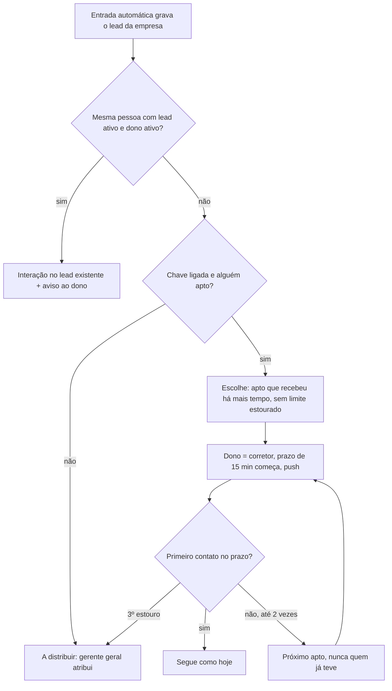

# Estudo: distribuição automática do lead da empresa no Base360 Vendas

> Estudo de 05/11/2026, sem código. Pedido do Felipe (05/11/2026): o lead da empresa que entra sozinho no Vendas vai por **roleta automática**, e a entrada automática só vai ao ar junto com ela (`docs/direcionador/direcionador.md`, decisão 4). Este arquivo junta o que existe hoje, o que o CRM da Bruna e os fabricantes fazem, as opções de desenho, o esboço de banco e RLS e as perguntas ao Felipe. Depois das respostas sai o brief de código.

## Decisões do Felipe (05/11/2026)

Onde o texto abaixo diverge, valem estas decisões.

| # | Pergunta | Decisão |
| --- | --- | --- |
| 1 | Para quem vai | **Opção b primeiro**: a roleta escolhe a equipe (rodízio igual entre gerentes) e depois o corretor dentro dela, sozinho. **Com uma chave para voltar à opção a** (rodízio direto entre todos os corretores aptos), a ser construída junto. |
| 1.1 | Chave "só gerentes" (Felipe, 05/11/2026) | **Outra chave do gerente geral desliga a parte dos corretores**: a roleta escolhe só a equipe (o gerente), e o lead fica na fila da equipe para o gerente repassar à mão, como na opção c. Ficam então três modos: equipe e depois corretor (padrão), direto ao corretor e só gerentes. **Prazo do gerente:** 15 min no horário de atendimento para repassar. Se estourar, o Felipe é avisado. Os 15 min do corretor começam no repasse. No banco, o lead fica sem dono e preso à equipe (ex.: `leads.equipe_id`), visível ao gerente dela. |
| 2 | Quem participa | **Todos os corretores ativos da equipe.** O gerente tira quem não deve receber, e **o próprio corretor também escolhe se recebe ou não** (liga e desliga em Minha conta). |
| 3 | Rodízio igual ou por peso | **Por desempenho**, medido pelo **prazo cumprido** (leads da empresa respondidos em 15 min) **e pelos pontos do programa**, com **o prazo valendo 2/3 e os pontos 1/3**. **Faixas, todos recebem**: peso 3, 2 e 1. **Com uma chave para desligar os pesos** e voltar ao rodízio igual. |
| 4 | Limite | **Pula o corretor que tem lead da empresa com o prazo de 15 min estourado.** Prazo correndo ou ainda não começado não tira da vez. |
| 5 | Pausa | **O corretor e o gerente pausam**, com data de volta opcional, e cada pausa fica registrada. |
| 6 | Fora do horário | **Só para quem aceita receber fora do horário e está online.** "Online" é o botão **"Estou de plantão"**, que o corretor liga e que desliga sozinho depois de **30 min** sem usar o app. **Quem recebe assim tem o prazo de 15 min correndo na hora.** **Sem ninguém de plantão, o lead fica represado e é liberado às 9h.** |
| 7 | Prazo estourado | **Sempre na mesma equipe**: passa sozinho a outro corretor da equipe, nunca ao mesmo, até 2 vezes. Só sai da equipe se ninguém estiver apto. **O gerente é avisado de toda perda.** |
| 8 | A pessoa já tem lead ativo | **Vai ao dono atual, com prazo**: a mensagem entra no lead que já existe, o dono é avisado e ganha um prazo novo de 15 min para responder. Se o prazo estourar, o gerente é avisado. Não cria lead novo nem gasta vez. |
| 9 | A pessoa tinha lead descartado | **Reativa o mesmo lead e manda pela roleta**, com o histórico junto. |
| 10 | Atribuição à mão conta como vez | **Conta**: quem recebe lead da empresa à mão vai para o fim da fila da distribuição. |
| 11 | Nome na tela | **"Distribuição automática"**; `distribuicao` no banco e nas permissões. |
| 12 | Por que a roleta antiga acabou | **A roleta antiga era a dos leads do Meta, não a do Google.** O Google continua; o Meta está sendo cortado. Eram muitos leads, de baixa qualidade e com pouco resultado. Na prática os corretores perderam a confiança nos leads, atendiam de qualquer jeito e perdiam os prazos. **Para não repetir:** o prazo cumprido pesa no desempenho (decisão 3), quem tem prazo estourado sai da vez (decisão 4) e o gerente é avisado de toda perda (decisão 7). |

**Rodada 2 (05/11/2026, seção 12): produto, stand e transparência**

| # | Pergunta | Decisão |
| --- | --- | --- |
| R2-0 | Pedido | O corretor tem marcas dos **produtos que atende**, além do peso. **Vê a posição na fila** e, quando é pulado, **o porquê**, com transparência igual à da roleta de parceiros. **No horário só recebe quem está no stand**; fora do horário, só quem está de plantão. |
| R2-1 | Quem marca os produtos | **O gerente (da equipe), o gerente geral e o operacional**, por permissão do catálogo (ex.: `distribuicao.produtos`). O corretor só vê. Padrão: atende todos; marcam-se as exceções. |
| R2-2 | Ninguém da equipe atende o produto | **Pula a equipe**, sem perder a vez, e vai à próxima que atenda. |
| R2-3 | Chegou ao stand depois das 9h15 | **A recepção marca "No stand, fora da vez"**: recebe lead da empresa, mas não entra na vez dos clientes do stand. |
| R2-4 | O corretor vê os pulos dos colegas | **Vê a situação de todos** (apelido, faixa, apto, fora do stand, pausado), mas **o motivo detalhado só dos próprios pulos**. O gerente vê tudo da equipe. |
| R2-5 | Recálculo da faixa | **Toda segunda**, com os últimos 30 dias. |
| R2-6 | Pulado perde a posição | **Depende do motivo.** Não perde quando saiu para visita, não atende o produto ou já teve o lead. **Perde** (zera os créditos e vai ao fim) quando está fora do stand, sem plantão, em pausa, com o recebimento desligado, fora da distribuição pelo gerente ou com prazo estourado. |
| R2-7 | Gerente no modo "só gerentes" | **Não precisa estar no stand.** |

**Rodada 3 (05/11/2026, seção 12.9): check-in e check-out do corretor**

| # | Pergunta | Decisão |
| --- | --- | --- |
| R3-0 | Pedido | Há stand sem recepção, então **o check-in e o check-out do próprio corretor são a presença** para a distribuição. |
| R3-1 | Onde vale o check-in | **Em todos os stands.** A recepção **não aprova** (seria redundância). Só aparece na tela dela que o corretor está no stand. Com isso a marcação "No stand, fora da vez" (R2-3) deixa de ser necessária: quem chega depois das 9h15 faz check-in e recebe. |
| R3-2 | Check-out esquecido | **Sinal com localização**: com o CRM aberto, no celular ou no computador, o app manda sozinho, de tempos em tempos, um sinal com a posição. **Fora do raio, o app pergunta "Você saiu do stand?" antes de tirar o corretor da fila.** **Sem sinal há 30 min** (CRM fechado): o corretor fica "sem sinal", é pulado **mantendo a posição** e **recebe um aviso no celular** de que está sem sinal. Volta a receber quando o CRM abre. |
| R3-3 | Jurídico | **O jurídico deu ok, desde que o check-in seja vinculado aos leads**: é benefício (receber lead), não vínculo. O check-in serve à distribuição, não ao controle de horário. |

**Rodada 4 (05/11/2026): botão, almoço, fim do período e períodos**

| # | Pergunta | Decisão |
| --- | --- | --- |
| R4-1 | Quando valem as regras de pulo | **Só com o botão "Recebendo leads" ligado.** É um botão só, o mesmo do plantão fora do horário: no horário vale junto com o check-in; fora do horário é o plantão. Com o botão desligado o corretor não está na fila: não há pulo, motivo nem perda de posição. Isso substitui o "Você desligou o recebimento" da regra 2 da seção 12.1 e o "Estou de plantão" como botão à parte. |
| R4-2 | Almoço e ausência curta | Não se faz check-out de quem foi almoçar. O corretor pode ficar **até 1h15 fora do stand por período** (R4-5), somando almoço e outras saídas, **sem perder o período**. Fora do stand, fica "ausente": não recebe lead e mantém a posição na fila, e a presença continua aberta. |
| R4-3 | Fim do período | **Sem check-out automático perto do horário de saída** (corrigido pelo Felipe). Quem vai embora mais cedo e não registra a saída simplesmente passa de 1h15 fora e não cumpre o período. A presença sem saída fecha às 19h30 como "sem saída" (estudo do check-in, decisão 5). A visita conta como presença. |
| R4-4 | O check-in conta os períodos | **Sim.** O check-in e o check-out também contam os períodos do programa (pontos e os 6 períodos da roleta do fim de semana). |
| R4-5 | Regra do período | **Decidido (Felipe, 05/11/2026): "chegue até 9h15 no stand (hora que fecha a vez) e fique até 1h15 fora."** O check-in vai até 9h15 na manhã e até 14h15 na tarde, os horários em que a vez fecha (`docs/recepcao.md`, seção 2). Depois da chegada, o corretor pode ficar **até 1h15 fora** do stand, somando almoço e saídas. A visita conta como presença. A folga total é de 1h30, e o mínimo no stand ou em visita fica em **3h30 de 5h**. Substitui os 80%, os 20% e os 30 min de tolerância do estudo do check-in. A distribuição não depende desta regra: ela só olha se o corretor está no stand agora. **Ainda a fechar, junto com as regras do check-in (Felipe, 05/11/2026):** chegar depois das 9h15 pode, mas o corretor não entra na vez e tem de ficar mais tempo no stand, com um limite de **2 chegadas depois da vez por semana**. Fica aberto quanto tempo a mais ele fica. |
| R4-9 | O que manda ao fim da fila | **Só o prazo estourado** (substitui a lista da R2-6). O botão desligado, a pausa e "fora da distribuição pelo gerente" só tiram o corretor da fila, sem penalidade, e enquanto isso ele não acumula créditos. A ausência, a visita, o produto e o "já teve o lead" pulam o corretor, que mantém a posição. |
| R4-10 | Aviso de pulo no celular | **Só quando o corretor vai ao fim da fila** (prazo estourado), com o lead. Os pulos que mantêm a posição aparecem só em "Minhas vezes". |
| R4-7 | Quem vê "A distribuir" | **O gerente geral e quem tiver a permissão** (`leads.distribuir`, dada em Configurações). |
| R4-8 | Janela do desempenho | **Últimos 30 dias para as duas medidas** (prazo cumprido e pontos aprovados), recalculadas toda segunda. Substitui o "mês corrente" escolhido antes. **O desempenho não tem nada a ver com os pontos da verba**: é só uma conta para a distribuição, e a tela deixa isso claro (Felipe, 05/11/2026: "tem que tomar muito cuidado com tudo que fazemos para não confundir os corretores"). Proposta de texto: "Desempenho na distribuição: na média. Respostas em até 15 min: 78% (30 dias). Atividade no plantão: acima da média (30 dias). Este cálculo não muda seus pontos nem sua verba." |
| R4-11 | Nome e corte das faixas | **"Acima da média", "Na média" e "Abaixo da média"** (peso 3, 2 e 1), nunca "Faixa 1, 2, 3". O corte compara o resultado do corretor (prazo 2/3, pontos 1/3) com a **média da empresa**, de todos os corretores ativos: até 10% acima ou abaixo da média é "na média". Quem é novo, sem 30 dias de dados, fica "na média". |
| R4-13 | Duas notas (substitui o 2/3 e 1/3 das decisões 3, R4-8 e R4-11) | O desempenho é a soma de **duas notas com 50% cada**, para que nem quem é melhor no online nem quem é melhor no stand saia beneficiado. **Nota do CRM:** prazo de atendimento (só leads da empresa respondidos em até 15 min) com **2/3** e follow-up em dia (todos os leads ativos da carteira) com **1/3**. O follow-up é a **média diária** dos 30 dias: todo dia o sistema anota que parte dos leads ativos está sem próximo contato atrasado. **Nota do plantão:** a atividade no plantão (pontos aprovados nos 30 dias). No total, o prazo pesa 1/3, o follow-up 1/6 e o plantão 1/2. Nas telas, as duas aparecem como "Nota do CRM" e "Nota do plantão", nunca como pontos. |
| R4-12 | Detalhe por escrito | **O corretor abre "Como é calculado"** (em "Minhas vezes" ou ao tocar no desempenho) e lê o detalhe por escrito, com os números dele. Proposta (com as duas notas da R4-13): "Nota do CRM: nos últimos 30 dias você respondeu 18 de 23 leads da empresa em até 15 min (78%) e, em média, 85% da sua carteira ficou com o follow-up em dia. Nota do plantão: sua atividade no plantão foi 12% acima da média da empresa. Cada nota vale metade. No total você ficou 8% acima da média da empresa, então está na média (até 10% acima ou abaixo). Na média você recebe 2 leads a cada 3 de quem está acima e 1 de quem está abaixo. Recalculado toda segunda. Não muda seus pontos nem sua verba." A mesma página explica, em texto fixo, a ordem da fila, os motivos de pulo e o que manda ao fim. O gerente vê o mesmo detalhe de cada corretor da equipe. |
| R4-14 | Chegou depois da vez (fecha a R4-5, Felipe, 05/11/2026) | **Fica o mesmo tempo do atraso a mais**: chegou 30 min depois das 9h15, fica 30 min a mais para cumprir o período. Não entra na vez dos clientes do stand, mas recebe lead da empresa com o check-in. Limite de **2 chegadas depois da vez por semana**; a terceira não conta o período. |
| R4-15 | Jurídico e períodos (Felipe, 05/11/2026) | **O ok do jurídico também cobre a contagem dos períodos** pelo check-in. |
| R4-16 | Brief (Felipe, 05/11/2026) | **Duas etapas em sequência**, escritas pela sessão master do Vendas: (1) presença e distribuição; (2) períodos pelo check-in e aprovação pelo gerente da equipe. Brief em `docs/codex-distribuicao-automatica.md`. |
| R4-6 | Lançamento do período | **Sozinho, pendente**: o período cumprido pelo check-in vira lançamento pendente sem a recepção marcar. **Aprovam o gerente da equipe e o gerente geral.** Isso **muda a regra de 29/10** ("só o gerente geral aprova", regra fixa no banco, `docs/acessos-perfis.md` e `docs/pontuacao-verba.md`). |

**O que as decisões mudam no texto abaixo:**
- A recomendação da seção 1 (rodízio direto e igual) vira a chave de volta (decisões 1 e 3). O padrão é a equipe primeiro e o desempenho por faixas.
- O limite da seção 6.3 é o prazo estourado (decisão 4), não 2 leads em "novo".
- A seção 6.5 ganha o "Estou de plantão" e a fila de represados das 9h (decisão 6). A distribuição sem usuário e a regra "o Vendas não tem presença" da seção 6.4 deixam de valer à noite.
- A redistribuição da seção 6.6 fica dentro da equipe (decisão 7).
- A seção 6.7 ganha o prazo novo para o dono (decisão 8).
- `docs/acessos-perfis.md` e `docs/fontes/regras-comerciais-2026-10.md` falam em "roleta do Google", e as regras de outubro dizem "A verba de leads do Google será cortada". Pela decisão 12, a roleta que acabou é a do Meta, e o Google continua. **O Felipe confirmou em 05/11/2026: foi a do Meta.** A sessão master corrige `docs/acessos-perfis.md`. As regras de outubro são o texto original do Felipe e ganham só uma nota.

## Sumário
1. Resumo da recomendação
2. Nome: três roletas no mesmo sistema
3. Como é hoje
4. Da Bruna
5. O que os fabricantes fazem
6. Opções de desenho
   - 6.1 Para quem vai: gerente ou corretor
   - 6.2 Geral ou por equipe
   - 6.3 Rodízio igual ou por peso, e o limite de leads sem resposta
   - 6.4 Pausa por ausência
   - 6.5 Fora do horário de atendimento
   - 6.6 Prazo de 15 min estourado
   - 6.7 A mesma pessoa com lead ativo
   - 6.8 Ninguém apto e chave desligada
7. Fluxo de ponta a ponta
8. Esboço de banco e RLS
9. Riscos e o que mudar no que já existe
10. Perguntas ao Felipe
11. Fontes
12. Rodada 2: produto, stand e transparência

## 1. Resumo da recomendação

- **Direto ao corretor**, sem passar pelo gerente: o banco escolhe o corretor na mesma transação em que grava o lead, e o prazo de 15 min começa na hora. O gerente acompanha a equipe, recebe o aviso e continua com o botão Lead perdido.
- **Um rodízio só, entre todos os corretores aptos**, de todas as equipes. Cada equipe recebe na proporção do número de corretores aptos.
- **Rodízio igual**: vai para quem recebeu lead da roleta **há mais tempo**, como na roleta de parceiros. Não há contador para zerar quando alguém entra ou sai.
- **Limite**: pula quem já tem 2 leads da empresa sem primeiro contato.
- **Pausa** por ausência (folga, férias, atestado), com data de volta, ligada pelo corretor ou pelo gerente e registrada. Não há detecção de "online".
- **Fora do horário**: distribui na hora; o prazo já começa na abertura seguinte (regra atual de `prazo.ts`).
- **Prazo estourado**: o banco passa sozinho ao próximo da roleta, nunca ao mesmo corretor, até 2 vezes. Depois o lead vai para "A distribuir", com o gerente geral.
- **Lead repetido**: se a pessoa já tem lead ativo com dono ativo, a mensagem nova entra como interação nesse lead e o dono é avisado. Não cria lead nem gasta vez. Lead descartado ou dono desativado: o lead é reativado e vai pela roleta.
- **Lead sem dono só quando ninguém está apto** ou a chave está desligada. Ele fica em "A distribuir", e o gerente geral atribui à mão, como hoje.

## 2. Nome: três roletas no mesmo sistema

O Base360 já tem a **roleta do fim de semana** (plantão, 6 períodos, `docs/pontuacao-verba.md`), a **roleta de parceiros** (entre gerentes, `docs/codex-parcerias.md`) e a **vez** do stand (a recepção chama de "vez", nunca de "roleta", `docs/estudo-recepcao.md`). Para não confundir, proponho **"Distribuição automática"** na tela e `distribuicao` no banco e nas permissões (pergunta 11).

## 3. Como é hoje

- **Fluxo:** o gerente geral recebe o lead da empresa por e-mail e passa a um gerente. O gerente cadastra o lead já com um corretor da equipe (`docs/leads.md`, seções 2 e 12). Só quem tem `leads.atribuir` usa a origem "empresa".
- **Prazo:** 15 min só para o lead da empresa em "novo", a partir do cadastro ou da atribuição (`atribuido_em`), contados só no horário de atendimento (9h às 19h, todos os dias). O prazo termina na primeira conversa ou no toque em WhatsApp ou Ligar (`docs/leads.md`, seção 4).
- **Lead perdido:** com o prazo estourado, o gerente passa o lead a outro corretor da equipe. A troca fica em `lead_eventos` com `detalhe = 'perdido'` (`lead_perdido` em `schema.sql`).
- **Repetido:** o cadastro avisa e deixa seguir (`whatsapp_em_outra_carteira`, `docs/leads.md`, seção 9).
- **Banco:** `leads.dono_id` é `not null`, com padrão `auth.uid()`. O `leads_guard` carimba `atribuido_por` e `atribuido_em` só quando há usuário logado e o dono é outro. Sem usuário (chave de serviço ou SQL Editor) ele não carimba nada. `lead_eventos` grava o `tipo` (`criado`, `etapa`, `temperatura`, `status` ou `dono`), `de`, `para`, `detalhe` e `automatico`, por gatilho. O motivo da troca de dono vem de `set_config('crm.motivo_dono', ...)`.
- **Ficou de fora** (`docs/leads.md`, seção 1): "fila de leads da empresa sem corretor".
- **O que chega pela entrada** (`docs/direcionador/direcionador.md`, decisões 3 e 4 e seção 8): o lead que o direcionador manda ao Vendas, **e também o lead cuja entrega à distribuição manual falhou**, que cai no Vendas como lead sem regra. Os dois entram na mesma distribuição, sem tratamento à parte. A seção 8 de lá chama a coluna de `corretor_id`; no banco ela é `leads.dono_id`.
- **A roleta antiga** (era a do Meta, decisão 12): as regras de outubro (`docs/fontes/regras-comerciais-2026-10.md`) e `docs/acessos-perfis.md` só registram que ela acabou junto com a verba descentralizada e que o lead da empresa passou ao gerente. O motivo não está escrito em `docs/historico.md` (pergunta 12).

## 4. Da Bruna

O CRM da Bruna tem dois usuários que veem os mesmos dados. A tabela `leads` não tem dono, e por isso não existe distribuição para copiar.

| Na Bruna | Aqui | O que fazer |
| --- | --- | --- |
| Sem dono e sem distribuição (`supabase/schema.sql`, tabela `leads` sem coluna de dono) | `dono_id` obrigatório; atribuição pelo gerente | **Nada a copiar.** A distribuição é nova. |
| Prazo de 15 min no horário comercial, de todo lead (`SLA_MINUTES`, `slaDeadline` em `lib/performance.ts`) | Já adaptado em `prazo.ts`, só para o lead da empresa | **Reaproveitar.** A distribuição usa o mesmo fim de prazo (`private.fim_do_prazo`). |
| Push "Lead novo: quando o outro usuário cadastrar um lead" (`lib/push.ts`) | Já adaptado: aviso de lead da empresa atribuído, por gatilho em `atribuido_em` (`agendar-avisos.sql`) | **Reaproveitar.** O lead distribuído dispara o mesmo aviso, desde que a distribuição carimbe `atribuido_em` (seção 8). Novo: aviso ao gerente quando um lead é passado adiante (pergunta 7). |
| Avisar no WhatsApp ao cadastrar (`new-lead-dialog.tsx`) | "Avisar no WhatsApp" depois de atribuir | **Fica para a atribuição à mão.** Na distribuição automática não há quem toque no botão; o aviso é o push. |

## 5. O que os fabricantes fazem

Só fontes do próprio fabricante. Consultadas em 05/11/2026.

| Fabricante | Como escolhe | Ausência e horário | Tempo para atender | Fonte e data |
| --- | --- | --- | --- | --- |
| **HubSpot** (ação "Rotate record to owner") | Divide igualmente. Para leads (beta) há três opções: rodízio em sequência, aleatório e "load balanced", que vai para quem tem menos itens abertos | "Só usuários disponíveis" pula quem está Ausente, pelo horário de trabalho de cada um. Se todos estão ausentes, fica sem dono. Só usuário ativo com licença paga recebe. Mudar a lista de donos **zera a contagem** | Não tem na ação | knowledge.hubspot.com, "Assign and rotate record owners using workflows", atualizado em 23/09/2026 |
| **Zoho CRM** (Assignment Rules) | Regra com critérios; com vários usuários escolhidos, rodízio | Usuário fora do turno, offline, desativado ou excluído: o registro vai para um **usuário padrão**. Só vale para registros que chegam por importação, formulário ou API, não para o cadastro à mão | Não informado | help.zoho.com, "Setting Assignment Rules" (sem data na página) |
| **Salesforce** (Omni-Channel) | Roteamento por presença, capacidade e habilidade, feito para fila de atendimento | Só recebe quem está com presença "disponível" | **"Push Time-Out"**: se o atendente não responde no tempo, o item vai para outro e o status dele muda. Se só há um atendente, o item não volta para ele | help.salesforce.com, "Routing Configuration Settings" e artigo 000382420 (páginas com data relativa, atualizadas há cerca de 1 mês) |
| **Dommus Prospecta** (construtoras) | Segue a sequência da roleta cadastrada. A roleta é configurada **por empreendimento**, na campanha, com roleta de SDR antes da equipe de vendas | Opção "Enviar corretor offline para o final da fila" | Não informado | duvida.dommus.com.br, "2.4 Gestão de roletas de atendimento" (a página diz "atualizada há 3 meses") |
| **Hypnobox** (construtoras, da Senior) | "Sorteio automático": embaralha os corretores com o recurso ligado, que entram na fila ao fazer login | Login controla quem está na fila | Não visto | suporte.senior.com.br. Os artigos pedem login; só o trecho da busca foi visto |
| **CV CRM** (Construtor de Vendas) | Não achei documentação do fabricante sobre a roleta. Só a página da RD Station sobre a integração diz que a roleta pode ser aplicada quando o lead vira oportunidade | | | rdstation.com/integracoes/construtor-de-vendas |

**O que se aproveita:**
- **Rodízio igual por padrão, com opção de carga** (HubSpot). Aqui, a carga é o limite de leads sem primeiro contato (6.3).
- **Quem não está disponível sai da vez** (todos os fabricantes). Eles usam presença ou login. O Vendas não tem presença, então a pausa é manual (6.4).
- **Redistribuição por tempo** existe no Salesforce (push time-out). O nosso equivalente é o prazo de 15 min (6.6).
- **Roleta por empreendimento** existe na Dommus. Aqui fica como opção para depois (6.2).
- **Sem ninguém apto**, o HubSpot deixa sem dono e o Zoho manda a um usuário padrão. Aqui é a fila "A distribuir" (6.8).
- **O HubSpot zera a contagem** quando a lista muda. Escolher quem recebeu há mais tempo não precisa de contador e não tem esse problema.

## 6. Opções de desenho

### 6.1 Para quem vai: gerente ou corretor

| Opção | Como fica | A favor | Contra |
| --- | --- | --- | --- |
| **a. Direto ao corretor** (recomendada) | A roleta escolhe o corretor; o gerente acompanha e reatribui | O prazo de 15 min começa na hora; não depende de alguém estar olhando | O gerente perde a escolha de quem recebe; ele fica com o acompanhamento e o Lead perdido |
| b. Roleta escolhe a equipe, e dentro dela o corretor, sozinho | Dois rodízios: entre gerentes, depois entre os corretores da equipe | Cada gerente recebe a mesma quantidade | Com equipes de 2 a 20 corretores (`docs/estudo-recepcao.md`, aba EQUIPES), o corretor de equipe pequena recebe até 10 vezes mais que o de equipe grande |
| c. Roleta ao gerente, que repassa | Como a roleta de parceiros, entre gerentes; o gerente atribui | Mantém o papel de hoje | O lead fica parado com o gerente e o prazo só começa na atribuição. Precisa de um segundo prazo para o gerente, e à noite ninguém repassa |

### 6.2 Geral ou por equipe

- **Geral (recomendada):** um rodízio entre todos os corretores aptos. É o mais simples, e cada equipe recebe na proporção de quem está apto.
- **Por equipe:** é a opção 6.1b.
- **Por empreendimento → equipe** (como a Dommus): o empreendimento do lead escolhe a equipe ou a lista de corretores. Depende do produto reconhecido na entrada (`docs/direcionador/direcionador.md`, seção 9), que às vezes vem vazio. Fica para depois, se o Felipe quiser.

### 6.3 Rodízio igual ou por peso, e o limite de leads sem resposta

- **Igual (recomendado):** vai para o apto que **recebeu lead da distribuição há mais tempo**. Quem nunca recebeu vem primeiro. Quem volta da pausa entra no topo e recebe **um** lead, sem rajada de compensação. Empate: o id, para ser determinístico.
- **Por peso:** cada corretor com um peso (1, 2, 3), configurado pelo gerente geral. Dá margem para disputa e precisa de critério.
- **Por desempenho** (pontos, conversão): liga a distribuição ao programa de pontos. Não recomendo agora.
- **Limite (recomendado: 2):** pula quem já tem 2 leads da empresa ativos em "novo", em qualquer estado do prazo. Conta também o lead que chegou à noite e cujo prazo só começa às 9h; senão o limite nunca valeria de madrugada, quando os leads se acumulam. É o "load balanced" do HubSpot nos termos do Vendas: não acumula lead em quem não está respondendo. Se todos os aptos estão no limite, o limite é ignorado, e vale o rodízio puro.

### 6.4 Pausa por ausência

O Vendas não sabe quem está "online", e o login no celular não diz que o corretor está trabalhando. Por isso a pausa é marcada à mão:
- **Pausa com data de volta opcional**, "Pausado até segunda". Volta sozinha na data; sem data, até alguém tirar.
- **Quem pausa (recomendado):** o próprio corretor (em Minha conta) e o gerente (para a equipe). O gerente geral pausa qualquer um. Cada pausa e volta fica registrada, com quem fez.
- **Sair da distribuição** (diferente de pausa): o gerente tira um corretor da distribuição sem data, por exemplo um corretor em treinamento. O corretor desativado sai sozinho.
- **Depois:** a escala semanal (item 25 do roadmap) pode pausar sozinha quem está de folga.

### 6.5 Fora do horário de atendimento

| Opção | Como fica |
| --- | --- |
| **a. Distribui na hora** (recomendada) | O corretor recebe à noite e pode responder se quiser. O prazo começa na abertura (9h15 para quem chegou às 22h), como já é hoje |
| b. Segura até a abertura | O lead fica sem dono até as 9h e é distribuído entre quem está apto às 9h. Pega a pausa do dia, mas ninguém responde à noite, e cria lead sem dono todo dia |
| c. Na hora, só para quem marcou "recebo fora do horário" | Mais um ajuste por corretor. O rodízio deixa de ser igual |

### 6.6 Prazo de 15 min estourado

| Opção | Como fica |
| --- | --- |
| **a. Automático, até 2 vezes** (recomendada) | Uma rotina a cada minuto acha o lead da distribuição em "novo" com o prazo estourado e passa ao próximo apto, **nunca a quem já o teve**. O prazo recomeça. No 3º estouro o lead vai para "A distribuir". O histórico grava "! Lead perdido por Carla. Passado para Diego · automático", e o gerente das duas equipes é avisado |
| b. Só o gerente, pelo Lead perdido (hoje) | Depende de o gerente ver. À noite e no fim de semana o lead espera |
| c. Automático, sem limite | Um lead que ninguém responde roda pela empresa inteira |

- **Recomendado também:** quem recebe o lead redistribuído **gasta a vez**, como na roleta de parceiros. Quem perdeu não ganha compensação.
- **Só o lead que veio da distribuição** é passado sozinho. O lead que o gerente atribuiu à mão continua com o Lead perdido manual.
- **O toque conta.** O toque em WhatsApp ou Ligar encerra o prazo (04/11/2026), então é o jeito fácil de parar o relógio sem falar com o cliente. O "A detalhar" já mostra isso ao gerente. Não proponho mudar.

### 6.7 A mesma pessoa com lead ativo

A decisão 5 do direcionador ("as regras sempre decidem") é sobre para onde o lead vai. Esta seção é sobre o que o Vendas faz quando ele chega. O mesmo vale para a pessoa que já está na carteira de um corretor por outra origem, por exemplo o anúncio dele.

| Caso | Recomendado | Outras opções |
| --- | --- | --- |
| Lead ativo com dono ativo | **Vai ao dono atual**: a mensagem nova entra como interação "Mensagem original" no lead que já existe, o dono recebe o aviso, sem lead novo e sem gastar vez. Igual à reentrada da roleta de parceiros | Criar lead novo pela roleta, com o aviso de duplicado de hoje (dois corretores com o mesmo cliente); ou criar lead novo para o mesmo dono |
| Lead descartado (de qualquer dono) | **Reativa o mesmo lead** e manda pela roleta, com o histórico junto | Volta ao antigo dono, se ele está ativo; ou cria lead novo |
| Dono desativado | **Pela roleta**, no mesmo lead | — |

- **Como reconhece:** pelo WhatsApp normalizado (`normalizarWhatsapp`, com o 9º dígito). Sem telefone, pelo e-mail em minúsculas.
- **A mesma mensagem lida duas vezes** é outra coisa: o id fixo da entrada com índice único, já desenhado no direcionador (seção 8).

### 6.8 Ninguém apto e chave desligada

- **Ninguém apto** (todos pausados ou fora): o lead fica sem dono em **"A distribuir"**. O gerente geral recebe o aviso e atribui à mão. Recomendado: a rotina de cada minuto tenta de novo, e o lead sai da fila assim que alguém volta.
- **Chave "Distribuição automática"** (só do gerente geral): desligada, todo lead da entrada vai para "A distribuir". É o caminho de volta, e serve para começar com cuidado.
- **Quem vê "A distribuir"** (recomendado): o gerente geral, por permissão nova `leads.distribuir`, que o gerente geral pode dar a outro perfil em Permissões.

## 7. Fluxo de ponta a ponta

## 8. Esboço de banco e RLS

Esboço para o brief. Os nomes reais são os de `crm/supabase/schema.sql`. O SQL vai num arquivo próprio e idempotente, como `parcerias.sql`.

**Leads**
- `leads.dono_id` passa a aceitar nulo **só** com `origem = 'empresa'` e lead vindo da entrada: check `dono_id is not null or (origem = 'empresa' and entrada_id is not null)`. O `entrada_id` é o id fixo da entrada, desenhado no direcionador.
- Telas, painel e avisos supõem dono. Com a escolha feita no próprio insert, o lead sem dono fica raro e aparece só em "A distribuir".
- **`leads_guard`:** quando a troca de dono vem da distribuição (sem usuário logado, com `crm.motivo_dono` = `distribuicao` ou `redistribuido`), carimbar `atribuido_em = now()`. Hoje ele limpa esse campo quando não há usuário, e o prazo contaria do cadastro.

**Quem participa**
- `distribuicao_corretores`: `corretor_id` (pk), `participa` (bool, padrão true), `pausado_ate` (timestamptz; nulo = sem pausa; data muito longe = pausa sem data), `atualizado_por`, `atualizado_em`.
- `distribuicao_pausas`: o registro de cada pausa e volta (corretor, de, até, quem, quando), para o gerente conferir.
- `distribuicao_config`: uma linha só, com `ligada`, `limite_sem_contato` (2) e `max_redistribuicoes` (2). Só o gerente geral altera (`is_gerente_geral()`), como `horario_atendimento`.

**A escolha**
- `private.distribuir_lead(p_lead uuid)`, `security definer`. Faz `pg_advisory_xact_lock` com uma chave **própria**, diferente da 7305001 dos parceiros, e trava o lead com `for update`. Escolhe:
  - perfil corretor, ativo, com `leads.cadastrar`, `participa` e sem pausa vigente;
  - fora quem já teve o lead (pelos eventos `dono` do lead);
  - fora quem está no limite, a menos que todos estejam;
  - ordem: o último evento `dono` com detalhe `distribuicao`/`redistribuido` do corretor, mais antigo primeiro, nulos antes; depois o id.
- Grava com `set_config('crm.motivo_dono', 'distribuicao', true)`. O gatilho `lead_registra_eventos` grava `tipo = 'dono'`, `detalhe = 'distribuicao'`, `automatico = true`, `autor_id` nulo.
- **Entrada:** `public.lead_empresa_entrada(...)`, chamada pela Edge Function com a chave de serviço (nunca no front). Numa transação só: confere a mesma pessoa (6.7), grava ou anexa a interação e chama `distribuir_lead`. É idempotente pelo `entrada_id`.
- **Redistribuição:** `private.redistribuir_estourados()` no `pg_cron`, a cada minuto. Pega leads ativos em "novo", com origem empresa e último evento de dono da distribuição, com `now() > private.fim_do_prazo(greatest(created_at, coalesce(atribuido_em, created_at)))` (a mesma conta do `lead_perdido`), usando `for update skip locked`. Grava `detalhe = 'redistribuido'` e, depois do limite, deixa sem dono com `detalhe = 'a_distribuir'`. O painel lê "perdido" em `leads_perdidos`, então o brief decide se `redistribuido` entra lá (proposta: sim, como perdido automático).
- **Atribuição à mão** pelo gerente não conta como vez (proposta, pergunta 10).

**RLS e funções**
- Lead sem dono: `pode_ver_dados_de(null)` já devolve verdadeiro para o gerente geral e para quem tem `dados.ver_todos`, porque a função libera esses perfis antes de olhar o dono. Para os outros é falso. Ou seja, o lead em "A distribuir" já aparece hoje para o gerente geral e para o operacional com `dados.ver_todos`. O brief decide se isso basta ou se a fila fica numa policy própria com `leads.distribuir`. A atribuição sem dono precisa de regra nova no `leads_guard`, porque hoje ele compara `old.dono_id` com o usuário.
- `distribuicao_pausar(p_corretor, p_ate)`, `security definer`: o próprio corretor, o gerente da equipe (`pode_atribuir_a`) ou o gerente geral.
- `distribuicao_fila()`: devolve a ordem (corretor, posição, pausado, no limite), sem dado de lead, como a "fila visível" dos parceiros. Para o gerente geral e os gerentes.
- Avisos: os gatilhos `leads_avisa_atribuicao_ins` e `_upd` (`agendar-avisos.sql`) disparam quando `atribuido_em` é preenchido ou muda, num lead da empresa ativo em "novo". Por isso o carimbo de `atribuido_em` no `leads_guard` (acima) é o que faz o corretor receber o push. Sem ele, o lead distribuído não avisa ninguém. Tipos novos: lead passado adiante (ao gerente) e lead em "A distribuir" (ao gerente geral).

**Testes do brief** (`npm run test:banco`, PGlite):
- duas entradas ao mesmo tempo vão para corretores diferentes;
- rodízio igual em 3 rodadas;
- pausa e volta sozinha na data;
- limite de 2, e o limite ignorado quando todos estão nele;
- redistribuição nunca para o mesmo, e "A distribuir" no 3º estouro (com datas simuladas);
- fora do horário, o prazo começa às 9h;
- mesma pessoa com lead ativo vai ao dono sem gastar vez;
- descartado volta pela roleta;
- RLS de "A distribuir", da config e da pausa por perfil.

## 9. Riscos e o que mudar no que já existe

- **`docs/acessos-perfis.md`** diz que o gerente distribui o lead da empresa. Com a opção 6.1a, o gerente passa a acompanhar e reatribuir. Atualizar junto com o código.
- **Cadastro à mão do lead da empresa pelo gerente** continua igual, para o lead que chega por outro caminho (telefone, indicação da diretoria).
- **Volume:** com 72 corretores e rodízio igual, cada um recebe poucos leads por mês. O limite e a pausa importam mais que o peso.
- **Corretor que não usa o app** recebe e estoura. Com a redistribuição automática o cliente não fica parado, e o painel mostra quem perdeu.
- **Fuso:** o banco calcula pelo horário de São Paulo (`fim_do_prazo` já faz assim).
- **`atribuido_em` sem carimbo:** se a troca de dono feita sem usuário não carimbar `atribuido_em`, o prazo conta do cadastro. A rotina veria o lead estourado de novo a cada minuto, e os três estouros aconteceriam em uns três minutos. E o push não sairia. É o primeiro teste do brief.
- **A mesma pessoa voltando (6.7a):** não há índice que limite uma "Mensagem original" por lead, então a segunda mensagem pode usar o mesmo tipo. O brief confere se esse tipo mexe em `ultima_interacao_em`; se mexer, a volta esconde o "Sem contato há N dias" do lead. Fica a decidir se a volta abre um prazo novo para o dono (pergunta 8).
- **WhatsApp vazio:** `docs/leads.md` diz que o lead pode ficar sem WhatsApp desde 04/11/2026. O brief confere a coluna no banco antes de usar o telefone como chave do repetido.

## 10. Perguntas ao Felipe

A recomendada é sempre a primeira (a), menos na 12, que é de fato. Responda como "1a, 2a, 3b...".

| # | Pergunta | Opções |
| --- | --- | --- |
| 1 | Para quem vai o lead da distribuição? A opção a muda a regra escrita em outubro ("os leads da empresa passam a ser distribuídos pelo gerente") | **a.** Direto ao corretor, num rodízio entre todos os corretores aptos; o gerente acompanha e usa o Lead perdido · b. A roleta escolhe a equipe (igual entre gerentes) e depois o corretor dentro dela · c. Ao gerente, que repassa (precisa de prazo para o gerente) |
| 2 | Quem participa? | **a.** Todos os corretores ativos; o gerente tira quem não deve receber · b. Só quem o gerente marcar · c. Só os aptos na roleta do fim de semana (6 períodos) |
| 3 | Rodízio igual ou por peso? | **a.** Igual: quem recebeu há mais tempo · b. Peso por corretor, definido pelo gerente geral · c. Por desempenho (pontos ou conversão) |
| 4 | Limite de leads sem primeiro contato? | **a.** Pula quem já tem 2 · b. Sem limite · c. Outro número: ___ |
| 5 | Quem pausa o corretor (folga, férias, atestado)? | **a.** O próprio corretor e o gerente, com data de volta, registrado · b. Só o gerente · c. Só o corretor |
| 6 | Lead que chega fora do horário (19h às 9h)? | **a.** Distribui na hora; o prazo começa às 9h · b. Fica esperando e é distribuído às 9h · c. Na hora, só para quem marcou que recebe fora do horário |
| 7 | Prazo de 15 min estourado? | **a.** Passa sozinho ao próximo, nunca ao mesmo, até 2 vezes; depois "A distribuir"; o gerente é avisado · b. Só o gerente, pelo Lead perdido, como hoje · c. Passa sozinho, sem limite |
| 8 | A pessoa já tem lead ativo com um corretor? | **a.** A mensagem entra no lead dela e o dono é avisado, sem gastar vez (e, se quiser, com um prazo novo de 15 min para responder: diga "8a com prazo") · b. Lead novo pela roleta, com o aviso de duplicado · c. Lead novo para o mesmo dono |
| 9 | A pessoa tinha lead descartado? | **a.** Reativa o mesmo lead e manda pela roleta · b. Volta ao antigo dono, se ativo · c. Lead novo pela roleta |
| 10 | O lead da empresa que o gerente atribui à mão conta como vez na distribuição? | **a.** Não, só a distribuição conta (como nos parceiros) · b. Sim |
| 11 | Nome na tela? | **a.** "Distribuição automática" · b. "Roleta de leads" (já há a roleta do fim de semana e a dos parceiros) |
| 12 | Por que a roleta antiga do Google acabou? (para não repetir o problema; sem recomendada) | a. Só por causa da verba descentralizada · b. Leads mal atendidos ou sem prazo · c. Outro motivo: ___ |

Com 1b ou 1c, as perguntas 4, 7 e 10 mudam de sentido (o limite, a redistribuição e a vez passam a valer entre equipes ou gerentes). Nesse caso volto com elas reescritas.

As perguntas da rodada 2 estão na seção 12.

## 11. Fontes

Consultadas em 05/11/2026.

- **HubSpot:** "Assign and rotate record owners using workflows", knowledge.hubspot.com/workflows/assign-and-rotate-record-owners-using-workflows, atualizado em 23/09/2026.
- **Zoho CRM:** "Setting Assignment Rules", help.zoho.com/portal/en/kb/crm-v2/automate-business-processes/assignment-rules/articles/crm-v2-set-assignment-rules, sem data na página.
- **Salesforce:** "Routing Configuration Settings" (help.salesforce.com, `service.service_presence_routing_configuration_settings.htm`) e o artigo 000382420, "Why doesn't Omni-Channel reroute a work item when only one agent is available?". As páginas mostram só a data relativa.
- **Dommus:** "2.4 Gestão de roletas de atendimento", duvida.dommus.com.br/books/dommus-prospecta/page/24-gestao-de-roletas-de-atendimento. A página diz "atualizada há 3 meses".
- **Hypnobox (Senior):** "Sorteio Automático", artigos 40379218710420 e 52997690661140 em suporte.senior.com.br. Os artigos pedem login; só o trecho da busca foi visto.
- **CV CRM:** não achei documentação do fabricante. O único trecho é da RD Station, sobre a integração (rdstation.com/integracoes/construtor-de-vendas).
- **CRM da Bruna:** `ref/CRM Bruna/supabase/schema.sql` (tabela `leads`), `src/lib/performance.ts` (`SLA_MINUTES`, `slaDeadline`) e `src/lib/push.ts`.
- **No projeto:** `docs/leads.md` (seções 1, 2, 4, 9, 10 e 12), `docs/acessos-perfis.md`, `docs/codex-parcerias.md` e `crm/supabase/parcerias.sql` (trava e fila), `docs/pontuacao-verba.md` (roleta do fim de semana), `docs/estudo-recepcao.md` (a vez e as equipes), `docs/direcionador/direcionador.md` (decisões e seção 8) e `crm/supabase/schema.sql` (`leads`, `lead_eventos`, `leads_guard`, `pode_atribuir_a`, `lead_perdido`).

## 12. Rodada 2: produto, stand e transparência

Pedido do Felipe (05/11/2026): o corretor tem marcas de **quais produtos atende**, além do peso; **vê a posição dele na fila**; e, **se estava na vez e foi pulado, vê o porquê**. A transparência é a mesma da roleta de parceiros (fila visível, `parceiros_fila()` em `parcerias.sql`). E, **no horário de atendimento, só recebe quem está no stand**. Fora do horário recebe só quem está de plantão (decisão 6).

### 12.1 Ordem das regras (o filtro)

Para cada lead, o banco percorre a fila da equipe escolhida e aplica as regras nesta ordem. O primeiro corretor que passa por todas recebe. Os outros, que estavam à frente, ficam registrados como **pulados, com o motivo**.

| # | Regra | Motivo que o corretor vê |
| --- | --- | --- |
| 1 | Corretor ativo, da equipe, na distribuição (o gerente não tirou) | "Fora da distribuição pelo gerente" |
| 2 | O próprio corretor deixou o recebimento ligado | "Você desligou o recebimento" |
| 3 | Sem pausa vigente | "Em pausa até 12/11" |
| 4 | **No horário: está no stand.** Fora do horário: está de plantão | "Fora do stand", "Saiu do stand às 10h40", "Sem plantão ligado" |
| 5 | **Atende o produto do lead** (lead sem produto: todos atendem) | "Não atende Marco Zero One" |
| 6 | Sem lead da empresa com o prazo estourado (decisão 4) | "Lead com prazo estourado: Maria S." (só o nome do próprio lead) |
| 7 | Não teve este lead antes (redistribuição) | "Já teve este lead" |

- **Equipe sem ninguém que passe:** a equipe é pulada e o lead vai à próxima equipe da roleta, com o motivo "Equipe sem corretor no stand" ou "sem corretor que atenda o produto". A equipe pulada **não perde a vez**.
- **Ninguém em equipe nenhuma:** o lead fica represado (decisão 6) e sai sozinho quando o primeiro corretor apto entra no stand ou liga o plantão. O gerente geral é avisado.
- **Posição do pulado** (decisão R2-6, depende do motivo): quem foi pulado por visita, produto ou "já teve este lead" continua com os créditos (12.4) e na frente. Pelos outros motivos, os créditos zeram e ele vai ao fim. Para valer a mesma regra que todos veem, o motivo de cada pulo diz também "mantém a posição" ou "foi para o fim".

### 12.2 Produtos que o corretor atende

- **Marca por empreendimento do catálogo** (`/empreendimentos/`), não por texto livre, para casar com o produto reconhecido na entrada (`docs/direcionador/direcionador.md`, seção 9).
- **Padrão:** todo corretor atende todos os produtos, e as exceções são marcadas pelo gerente da equipe, pelo gerente geral ou pelo operacional (decisão R2-1). O corretor só vê. Assim ninguém começa fora por esquecimento.
- **Mexe na recepção:** a decisão R2-3 pede uma ação nova na tela `/recepcao/`, "No stand, fora da vez", que grava presença sem entrar na vez. Isso toca `recepcao.sql` e a tela da recepção, e precisa entrar no brief combinado com quem cuida desses arquivos.
- **Lead sem produto reconhecido:** vale para todos.
- **Produto que ninguém da equipe atende:** a equipe é pulada sem perder a vez (12.1).
- Tabela: `distribuicao_produtos (corretor_id, empreendimento_id)`, só com as **exceções**: a linha diz "não atende". Assim um empreendimento novo já sai atendido por todos.

### 12.3 No stand: check-in e check-out

Hoje a presença é a da **recepção**, não a localização: o corretor não faz check-in por GPS agora (`docs/codex-recepcao.md`, decisão 11; a coluna `plantao_presencas.entrada_metodo` já aceita `gps` para depois).

- **Está no stand** = tem linha em `plantao_presencas` no dia e no turno que vale (manhã até 13h45; tarde a partir de 13h45, assim que existir a vez da tarde, `docs/recepcao.md`, seção 2), e o último evento dele não é `saida` nem `encerrou` ("Não está mais").
- **Saiu para visita** (`saida` com foto): pulado com "Saiu do stand", sem perder a posição. Ao "Voltou", volta a receber.
- **Furo de hoje: quem chega depois das 9h15** não entra na vez do stand, então não tem presença e não receberia lead da empresa o dia todo. Opções na pergunta R2-3.
- **Troca de turno:** quem estava de manhã e não entrou na vez da tarde deixa de estar no stand às 13h45. Quem fica o dia inteiro precisa ser posto na vez da tarde também, como já acontece na recepção.
- **Corretor que não está em stand nenhum** (trabalha de casa, visita externa): no horário, não recebe. É a regra pedida.
- **Gerente no modo "só gerentes"** (decisão 1.1): proposta, sem exigência de stand, porque o gerente roda entre os stands (pergunta R2-7).
- **Check-in por localização** fica como evolução, pelo estudo `docs/estudo-checkin-plantao.md`. Quando existir, o check-in do corretor vale como presença da mesma forma.

### 12.4 Posição na fila com peso: rodízio por créditos

Para o corretor ver a posição com os pesos ligados, a ordem precisa ser **calculável e estável**. Proposta: o **rodízio por créditos**, o "smooth weighted round robin", que é determinístico:
- a cada lead distribuído na equipe, cada corretor apto ganha créditos iguais ao peso dele (3, 2 ou 1);
- quem tem mais créditos recebe e perde a soma dos pesos;
- quem é pulado continua com os créditos e fica na frente.

Com os pesos desligados, todos têm peso 1 e vira o rodízio igual. A posição é a ordem dos créditos, com o mesmo critério que a escolha usa. É o mesmo princípio da `private.parceiro_fila`: uma função só para a fila e para a escolha.

- **Faixa e o porquê:** o corretor vê a própria faixa e as duas medidas: "Faixa 2. Prazo cumprido 78% (30 dias) · 140 pontos no mês." Proposta: as faixas são recalculadas toda segunda, para não mudar a cada lead (pergunta R2-5). Quem é novo começa na faixa do meio.

### 12.5 O que cada um vê (transparência)

Proposta igual à de parcerias, adaptada:

| Quem | Vê |
| --- | --- |
| **Corretor** | Na lista do dia: "→ Você é o 3º da fila da distribuição", ou o motivo de estar fora ("Fora do stand", "Em pausa"). Em "Ver fila": a fila da equipe com apelido, faixa e situação de cada um (apto, fora do stand, pausado), quem recebeu por último e quando. "Minhas vezes": cada lead recebido e **cada vez que foi pulado, com o motivo**. Nunca o nome do lead de outro corretor |
| **Gerente** | O mesmo da equipe, mais os motivos de todos os pulos da equipe e o resultado de cada distribuição (quem recebeu, quem foi pulado e por quê) |
| **Gerente geral** | Tudo, de todas as equipes, mais a fila entre equipes e as chaves |

Fica aberto se o corretor vê o motivo dos pulos dos colegas ou só o dele (pergunta R2-4). Um motivo como "Em pausa" pode ser pessoal.

### 12.6 Banco: o registro de cada decisão

- `distribuicao_decisoes`: uma linha por distribuição, só o banco escreve. Colunas: `lead_id`, `quando`, `modo` (equipe, direto ou só gerentes), `equipe_escolhida`, `recebeu_id`, `motivo_entrada` (nova, redistribuída, represada liberada) e `candidatos` (jsonb, na ordem: corretor, posição, créditos, faixa, resultado e motivo).
- É o registro que responde "por que fui pulado", e é gravado na mesma transação da escolha, sob a mesma trava.
- **Leitura só por funções** (`security definer`), sem dado de lead de outro corretor:
  - `distribuicao_fila(p_equipe)`: a fila agora;
  - `distribuicao_minhas_vezes()`: as vezes e os pulos do próprio corretor;
  - `distribuicao_equipe(p_de, p_ate)`: as decisões da equipe, para o gerente.
- **Ordem de escrita no banco** (12.1): a mesma função escolhe e grava os motivos. Não existe um caminho que escolha sem registrar.

### 12.7 Outras regras pertinentes (propostas)

- **Equipe pulada não perde a vez** entre as equipes, como o corretor (12.1).
- **Represado liberado em ordem de chegada:** às 9h ou quando alguém entra no stand, o lead mais antigo sai primeiro, um por vez pela roleta, sem jogar todos no primeiro a chegar.
- **Lead novo para quem acabou de entrar no stand:** o rodízio por créditos já evita que a primeira pessoa a chegar às 9h receba todos os represados. Cada lead passa pela conta.
- **Aviso ao corretor quando é pulado?** Proposta: não; ele vê em "Minhas vezes". O aviso no celular fica só para quando recebe.
- **Mudar produtos ou o recebimento não muda a posição.** Só receber gasta créditos.
- **Auditoria das chaves:** cada mudança de modo, de pesos ou de chave fica registrada com quem e quando. A diferença para o direcionador é de propósito: aqui a transparência é o objetivo.

### 12.8 Perguntas da rodada 2

| # | Pergunta | Opções |
| --- | --- | --- |
| R2-1 | Quem marca os produtos que o corretor atende? | **a.** O corretor marca, o gerente vê e pode corrigir · b. Só o gerente · c. O corretor marca e o gerente aprova |
| R2-2 | Nenhum corretor da equipe atende o produto do lead? | **a.** Pula a equipe sem perder a vez e vai a uma que atenda · b. Ignora o produto nessa equipe |
| R2-3 | Corretor que chega ao stand depois das 9h15 (fora da vez)? | **a.** A recepção marca "No stand, fora da vez": recebe lead da empresa, mas não entra na vez do stand · b. Não recebe até a vez da tarde · c. Entra na vez normalmente |
| R2-4 | O corretor vê o motivo dos pulos dos colegas? | **a.** Vê a situação de todos (apto, fora do stand, pausado), mas o motivo detalhado só o dele · b. Vê tudo de todos · c. Só a própria posição e os próprios pulos |
| R2-5 | Quando a faixa de desempenho é recalculada? | **a.** Toda segunda, com os últimos 30 dias · b. Todo dia · c. Todo mês |
| R2-6 | Pulado perde a posição? | **a.** Não: continua na frente e recebe o próximo lead para o qual estiver apto · b. Sim, vai para o fim |
| R2-7 | No modo "só gerentes", o gerente precisa estar no stand? | **a.** Não · b. Sim, pela presença da recepção |

### 12.9 Stand sem recepção: check-in e check-out do corretor

Felipe (05/11/2026): há stand sem recepção, e nele ninguém marca a presença. Por isso o check-in e o check-out do próprio corretor importam.

**O que já foi decidido no estudo do check-in** (`docs/estudo-checkin-plantao.md`, respostas de 04/11/2026):
- O check-in do corretor ficou **para uma etapa futura, com o jurídico consultado antes**, pelo risco de vínculo trabalhista de autônomo.
- Raio de 200 m por stand, cadastrado pelo gerente geral e pelo operacional.
- Falha de localização: plano B com selfie, guardada por 30 dias.
- Sem saída registrada: a presença fecha como "sem saída" às 19h30.

A distribuição traz o check-in do corretor para agora, pelo menos nos stands sem recepção (pergunta R3-1).

**Como fica a presença para a distribuição:**
- **Stand com recepção:** a presença é a da recepção (12.3).
- **Stand sem recepção:** "Registrar chegada" no celular. O navegador lê a posição, e o banco confere o raio (`plantao_checkin`, desenhado no estudo). Grava em `plantao_presencas` com `entrada_metodo = 'gps'`, que a coluna já aceita.
- **Check-out:** "Registrar saída", com a mesma conferência. Sair para visita é "Saí para visita", que pula o corretor sem perder a posição (R2-6).
- **Flag no stand:** `plantoes.tem_recepcao` diz qual regra vale. O gerente geral e o operacional marcam.

**O problema do check-out esquecido.** Uma página da web não sabe que o corretor saiu (estudo do check-in, seção 1). Quem esquece de sair continua "no stand" e recebe lead sem estar lá. Opções de defesa, que se somam:
- **a. O check-in vence no fim do turno** (13h45 e 19h). Para a tarde, faz outro check-in. É o mesmo ritmo da vez da recepção.
- **b. Prazo estourado tira do stand:** o corretor que deixa um lead da empresa estourar perde o check-in na hora e vai para o fim (R2-6). Para voltar a receber, faz check-in de novo. Quem esqueceu de sair e não está atendendo sai sozinho no primeiro lead.
- **c. Reconfirmação:** o app pede "Ainda no stand?" a cada 2 h, com nova leitura da posição. Sem resposta em 15 min, a presença fecha. Só funciona com o app aberto ou com o aviso no celular.

**Recomendado: a + b.** A opção c cobra demais do corretor e depende do celular.

**Como ficou (decisões R3-1 a R3-3):**
- **Check-in e check-out em todos os stands**, no celular ou no computador. A tela da recepção mostra "✓ No stand desde 9h04" ao lado do corretor, sem aprovar nada. A vez dos clientes do stand continua sendo da recepção.
- **Sinal sozinho com o CRM aberto:** a cada 10 min (proposta) o app manda a posição. Dentro do raio, nada aparece. **Fora do raio**, o app pergunta "Você saiu do stand?" com "Saí" e "Estou no stand". "Saí" deixa o corretor ausente (fora da fila, mantendo a posição) até ele voltar ao raio. Sem resposta, ele também fica ausente, com o motivo "Fora do raio". Não há check-out automático (R4-3).
- **Sem sinal há 30 min:** o corretor fica "sem sinal" e é pulado mantendo a posição, com aviso no celular ("Abra o Vendas para continuar recebendo leads"). O check-in continua até o fim do turno.
- **Também vale:** o prazo estourado tira da vez e manda ao fim (decisões 4 e R2-6). O check-in não vence sozinho no turno (R4-3); sem saída, fecha às 19h30.
- **Computador:** a localização vem do Wi-Fi ou do IP e às vezes erra por centenas de metros. A pergunta "Você saiu do stand?" impede que o erro tire o corretor sozinho, mas ela pode aparecer à toa no computador. Medir no piloto. Se incomodar, o plano B é conferir a rede do stand (o IP de cada stand, cadastrado).
- **Falha na leitura do check-in:** plano B com selfie, como decidido no estudo do check-in.
- **Finalidade:** os textos dizem "para receber leads da empresa". Pela decisão R4-4, o check-in também conta os períodos do programa. O ok do jurídico (R3-3) foi dado para o check-in vinculado aos leads. Vale confirmar com o jurídico que contar períodos e pontos também está coberto.
- **Ausente (R4-2 e R4-3):** fora do raio ou sem sinal, com o check-in aberto, o corretor fica "ausente": não recebe e mantém a posição. **Não há check-out automático.** O tempo ausente só desconta do período. Visita na agenda ou "Saí para visita" conta como presença.
- **Período (R4-5 e R4-6):** vale com check-in até 9h15 (manhã) ou 14h15 (tarde) e, depois da chegada, no máximo 1h15 fora do stand. A visita conta como presença. Ao fim do período, a função gera o lançamento pendente com origem "check-in", e o gerente da equipe ou o gerente geral aprova. A recepção só vê.
- **Banco:** `plantao_presencas` com `entrada_metodo = 'gps'` e a saída. Uma tabela de sinais (`distribuicao_sinais`: corretor, quando, dentro do raio, precisão), guardada só por poucos dias e **sem coordenadas**: a função calcula a distância e grava só "dentro" ou "fora". A conta da presença ("no stand", "sem sinal", "fora do raio") entra no filtro da seção 12.1, regra 4.
