# Revisão visual do CRM MBigucci

Revisão de 30/10/2026. Escopo: hierarquia, destaque, legibilidade e repetição visual. Sem mudanças em cálculos, regras de prazo, persistência, permissões ou textos do programa sigiloso.

**Resultado:** ajustes de prioridade alta aplicados. As propostas de média e baixa permanecem pendentes. Commits locais por tela; nada publicado ou enviado ao remoto.

## Sumário

1. [Método e critérios](#método-e-critérios)
2. [Base compartilhada](#base-compartilhada)
3. [Lista do dia](#lista-do-dia)
4. [Ficha do lead](#ficha-do-lead)
5. [Cadastro e Colar mensagem](#cadastro-e-colar-mensagem)
6. [Quadro](#quadro)
7. [Leads da equipe](#leads-da-equipe)
8. [Painel](#painel)
9. [Agenda](#agenda)
10. [Vendas](#vendas)
11. [Metas](#metas)
12. [Empreendimentos](#empreendimentos)
13. [Minha conta](#minha-conta)
14. [Configurações](#configurações)
15. [Pendências de média e baixa](#pendências-de-média-e-baixa)
16. [Validação e reprodução](#validação-e-reprodução)
17. [Modo escuro (item 18)](#modo-escuro-item-18)

## Método e critérios

- Referências: `CLAUDE.md`, `docs/design-system.md`, `docs/pesquisa-resultados.md`, skill `tela-ds-mbigucci` e documentos de cada módulo. O artifact externo do DS não ficou acessível; foram usados os tokens já versionados no projeto.
- Navegador em **375 × 812** e **1440 × 900**, com capturas da página inteira. As mesmas situações fictícias aparecem antes e depois: atraso, prazo estourado, visita futura de hoje, visita aguardando baixa, aniversário e VGV pago/pendente.
- O modo sem Supabase do README mostra somente o aviso de configuração. Para revisar o conteúdo, foi criada uma **cópia isolada de QA**, com sessão e consultas fictícias, sem copiar `.env.local`, sem autenticar e sem consultar banco real. Isso não adiciona bypass ao app.
- Capturas representam os componentes reais, com dados fictícios. Não comprovam RLS, envio ao WhatsApp, gravação de vendas ou funcionamento de push. As ações de escrita do adaptador de QA são bloqueadas.
- **Alta:** informação necessária para decidir ilegível, urgência escondida, ação principal sem destaque ou sobreposição. **Média:** reorganização de densidade, agrupamento e comparação. **Baixa:** acabamento sem prejuízo direto à tarefa.
- Uma ação vermelha por **grupo de ações**; filtros, voltar, cancelar e ações auxiliares ficam neutros. Uma barra brand por área de destaque. Nem toda tela de consulta precisa de botão vermelho.
- Capturas usam o relógio real do navegador. Os minutos de atraso e a projeção anual variam ligeiramente entre antes e depois; os dados de entrada e as fórmulas são os mesmos.

## Base compartilhada

| Prioridade | Problema | Proposta |
| --- | --- | --- |
| Alta | Labels essenciais tinham 11px e `concrete`; placeholders explicavam o preenchimento com contraste baixo. Selos de estado também tinham 11px. | Labels e selos com 12px; labels e placeholders em `ink-soft`. Preservar campos de 16px. |
| Alta | `.num` aplicava apenas algarismos tabulares; vários números permaneciam em Inter. | Aplicar Bricolage em `.num`, conforme DS. |
| Alta | Menu do gerente geral sobrepunha o logo no desktop. | Permitir quebra das linhas do menu dentro da largura disponível, preservando todos os destinos. |
| Alta | Títulos de seções decisivas usavam o mesmo eyebrow pequeno dos metadados. | Título de seção em 18px e `ink`; faixa escura do Veredito apenas nas sínteses. |
| Alta | Amarelo `wa` em texto pequeno de estados, prazo e baixa não atingia 4,5:1. | Manter a borda amarela, palavra e sinal; texto em `ink-soft` ou `ink`, com peso nos avisos. |
| Baixa | Eyebrows auxiliares ainda usam 11px e `concrete`: marca, contagens de catálogo/carteira e títulos secundários da ficha (Visitas, Venda, Andamento, Histórico). | Avaliar aumento para 12px no DS completo; não confundir esses metadados com labels essenciais. |

## Lista do dia

**Ação principal:** entrar em contato com quem precisa de atenção. Antes, o único botão vermelho era “Novo lead”; WhatsApp competia com “Abrir” e “Sem resposta”.

| Prioridade | Problema em 375px / desktop | Proposta |
| --- | --- | --- |
| Alta | Primeiro contato e atrasados apareciam depois de visitas e aniversários, fora da primeira dobra nos dois tamanhos. | Mostrar esses dois grupos primeiro, mantendo sua ordenação interna. Síntese escura dos contatos pendentes e contagens existentes. |
| Alta | Prazo e atraso tinham tamanho de metadado; todos os grupos tinham títulos apagados. | Ampliar prazo/atraso; título de seção legível. Uma barra brand e WhatsApp principal no primeiro lead de cada grupo. “Novo lead” secundário quando a carteira já tem dados. |
| Alta | Visita e aniversário de hoje não se separavam visualmente da sequência de cards. | Títulos de seção com peso; horário ampliado e confirmação em destaque; aniversário com título legível e ação contextual. |
| Média | Cada retorno ocupa um card completo, repetindo etapa e botões. No desktop, grupos pequenos deixam grandes espaços vazios. | Estudar lista de linhas com nome, prazo e WhatsApp; abrir ações secundárias na ficha. |

Capturas: [375 antes](revisao-visual/antes/lista-do-dia-375.jpg) · [375 depois](revisao-visual/depois/lista-do-dia-375.jpg) · [desktop antes](revisao-visual/antes/lista-do-dia-1440.jpg) · [desktop depois](revisao-visual/depois/lista-do-dia-1440.jpg).

<details>
<summary>Comparação em 375px</summary>

| Antes | Depois |
| --- | --- |
| 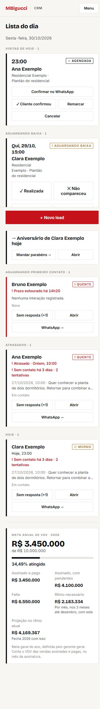 | 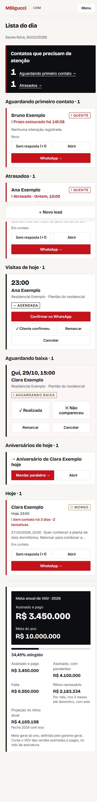 |

</details>

## Ficha do lead

**Ação principal:** falar com o cliente e registrar o contato. WhatsApp, Ligar e Sem resposta tinham peso idêntico; o formulário de interação vinha depois de visitas e vendas.

| Prioridade | Problema em 375px / desktop | Proposta |
| --- | --- | --- |
| Alta | Ação de contato sem destaque e registro distante do topo. | WhatsApp vermelho no grupo de contato; registro logo após o resumo, com seu único submit vermelho. Descarte fica secundário. |
| Alta | Nome pouco maior que o restante; rótulos de próximo/último contato e histórico em `concrete`. | Nome maior, prazos em peso/tamanho superior e rótulos/datas essenciais em `ink-soft`. |
| Média | Cards de visita e venda dentro de outros cards duplicam barras e bordas; ficha muito longa em 375px. | Listas internas com divisórias; agrupar histórico, documentos e dados complementares em seções expansíveis. |
| Baixa | Metadados de cadastro têm quase o mesmo espaço das informações atuais. | Compactar metadados após a reorganização das seções. |

Capturas: [375 antes](revisao-visual/antes/ficha-375.jpg) · [375 depois](revisao-visual/depois/ficha-375.jpg) · [desktop antes](revisao-visual/antes/ficha-1440.jpg) · [desktop depois](revisao-visual/depois/ficha-1440.jpg).

<details>
<summary>Comparação em 375px</summary>

| Antes | Depois |
| --- | --- |
| 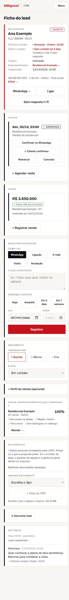 | 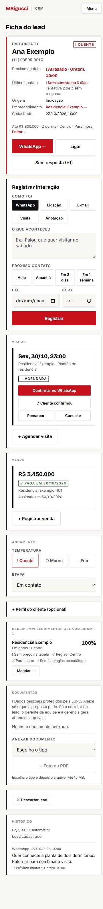 |

</details>

## Cadastro e Colar mensagem

**Ações principais:** “Cadastrar” e, na etapa de importação, “Usar estes dados”. Já havia uma ação vermelha por etapa, fixa no rodapé do celular; preservar.

| Prioridade | Problema em 375px / desktop | Proposta |
| --- | --- | --- |
| Alta | Labels de campos obrigatórios apagados; no Colar mensagem, identificação dos campos e selos pequenos. | Correção compartilhada dos labels/selos; termos da prévia em `ink-soft` e valores com peso. |
| Alta | Aviso de nome/WhatsApp ausente parecia um parágrafo auxiliar. | Faixa com fundo `tint-brand`, glifo e peso, sob os dados encontrados; manter exatamente a validação existente. |
| Média | “Colar mensagem” e “Mais detalhes” parecem cards de informação. | Transformar a entrada de colagem em atalho compacto; manter detalhes como acordeão de menor peso. |
| Baixa | Cabeçalho continua “Novo lead” durante a colagem. | Avaliar subtítulo “Colar mensagem” e indicação de retorno ao cadastro. |

Capturas do cadastro: [375 antes](revisao-visual/antes/cadastro-375.jpg) · [375 depois](revisao-visual/depois/cadastro-375.jpg) · [desktop antes](revisao-visual/antes/cadastro-1440.jpg) · [desktop depois](revisao-visual/depois/cadastro-1440.jpg).

Capturas da colagem: [375 antes](revisao-visual/antes/colar-mensagem-375.jpg) · [375 depois](revisao-visual/depois/colar-mensagem-375.jpg) · [desktop antes](revisao-visual/antes/colar-mensagem-1440.jpg) · [desktop depois](revisao-visual/depois/colar-mensagem-1440.jpg).

<details>
<summary>Comparação em 375px</summary>

| Antes | Depois |
| --- | --- |
|  | 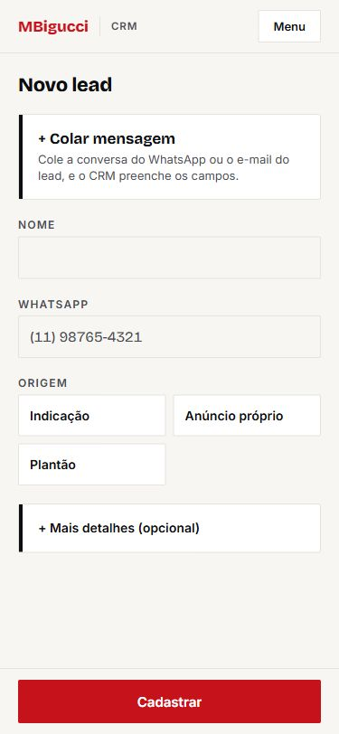 |

</details>

## Quadro

**Ação principal:** abrir o lead que exige atenção. O card inteiro é o alvo; não precisa de botão vermelho adicional.

| Prioridade | Problema em 375px / desktop | Proposta |
| --- | --- | --- |
| Alta | Lead da empresa com prazo estourado aparecia apenas como “Sem próximo contato”; a urgência existente ficava invisível nesta visão. | Reutilizar o mesmo componente de prazo da lista/ficha e o horário de atendimento existente. Não mudar a ordenação. |
| Alta | Etapas e totais em eyebrow; nomes de corretor em `concrete`. | Etapas com título, total ampliado e corretor em `ink-soft`; barra brand no primeiro lead urgente de cada coluna. |
| Média | Colunas vazias ocupam a mesma largura; rolagem horizontal necessária também no desktop. | Avaliar densidade das colunas e navegação explícita entre etapas, preservando o quadro como segunda visão. |
| Baixa | “Vazio” se repete em cada coluna. | Uma mensagem curta de estado vazio por coluna, com menor ruído. |

Capturas: [375 antes](revisao-visual/antes/quadro-375.jpg) · [375 depois](revisao-visual/depois/quadro-375.jpg) · [desktop antes](revisao-visual/antes/quadro-1440.jpg) · [desktop depois](revisao-visual/depois/quadro-1440.jpg).

<details>
<summary>Comparação em 375px</summary>

| Antes | Depois |
| --- | --- |
| 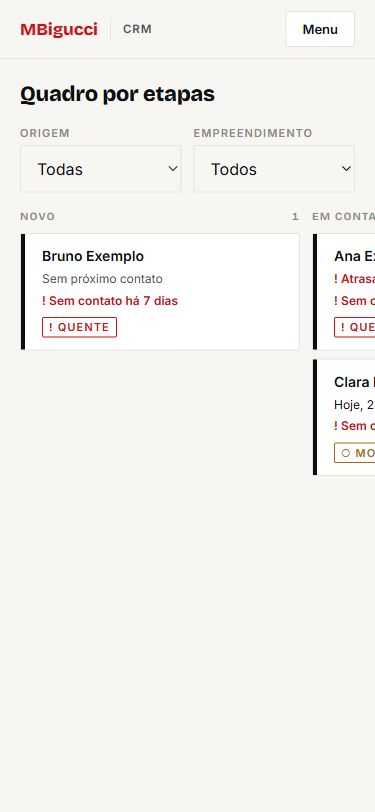 | 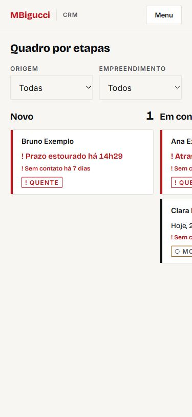 |

</details>

## Leads da equipe

**Ação principal:** identificar o corretor com pendências e abrir sua carteira. “Lead da empresa” continua como único cadastro vermelho no rodapé.

| Prioridade | Problema em 375px / desktop | Proposta |
| --- | --- | --- |
| Alta | Cabeçalhos de tabela apagados e contagens urgentes pouco diferentes das demais. | Cabeçalhos em `ink-soft`, números de prazo/atraso maiores e linhas com prazo estourado em `tint-brand`; uma barra brand no resumo. |
| Alta | Datas da última interação e etapa do card ilegíveis em comparação ao nome. | Corrigir as cores no componente compartilhado de lead. |
| Média | Em 375px, resumo precisa rolar horizontalmente; cards da carteira repetem muito conteúdo. | Resumo móvel em linhas por corretor e tabela compacta de leads no desktop, mantendo busca/ordem/filtros. |
| Baixa | “Ordenar por” ocupa uma linha separada no celular. | Ajustar espaço do cabeçalho depois de reduzir a densidade dos filtros. |

Capturas: [375 antes](revisao-visual/antes/leads-equipe-375.jpg) · [375 depois](revisao-visual/depois/leads-equipe-375.jpg) · [desktop antes](revisao-visual/antes/leads-equipe-1440.jpg) · [desktop depois](revisao-visual/depois/leads-equipe-1440.jpg).

<details>
<summary>Comparação em 375px</summary>

| Antes | Depois |
| --- | --- |
| 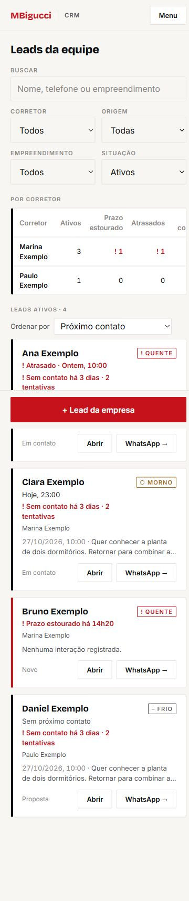 | 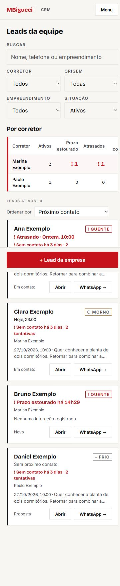 |

</details>

## Painel

**Ação principal:** identificar o resultado do período e abrir o detalhamento. Imprimir é auxiliar; os números já abrem as listas e não exigem todos botões vermelhos.

| Prioridade | Problema em 375px / desktop | Proposta |
| --- | --- | --- |
| Alta | Sem síntese: o usuário recebe várias tabelas com a mesma importância. | Faixa escura com recebidos da empresa, perdidos e “Venda no funil”, usando os totais existentes; detalhamento preservado. Este último conta mudanças de etapa no período, não o livro de vendas pagas. |
| Alta | Cabeçalhos e zeros em `concrete`; links de todos os corretores vermelhos competem com alertas. | Texto em `ink-soft`, links neutros com sublinhado e perdas destacadas por sinal/peso. |
| Média | Tabelas largas em 375px e muitas barras repetidas. | Visão móvel por corretor e agrupamento dos detalhes de funil/conversão; manter tabela para comparar e imprimir no desktop. |
| Baixa | Período quebra em duas linhas. | Avaliar navegação do período em duas linhas deliberadas, sem reduzir a fonte. |

Capturas: [375 antes](revisao-visual/antes/painel-375.jpg) · [375 depois](revisao-visual/depois/painel-375.jpg) · [desktop antes](revisao-visual/antes/painel-1440.jpg) · [desktop depois](revisao-visual/depois/painel-1440.jpg).

<details>
<summary>Comparação em 375px</summary>

| Antes | Depois |
| --- | --- |
| 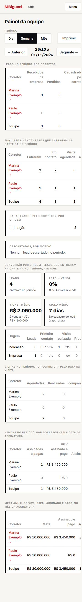 | 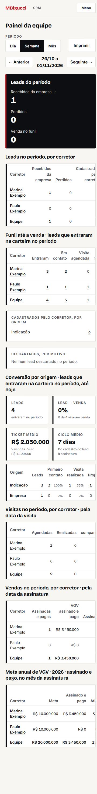 |

</details>

## Agenda

**Ação principal:** confirmar a próxima visita; depois do horário, informar o resultado. Na baixa, preservar o mesmo peso para os dois resultados para não favorecer uma resposta.

| Prioridade | Problema em 375px / desktop | Proposta |
| --- | --- | --- |
| Alta | Estado “Aguardando baixa” comprimindo hora/nome em 375px; título da pendência apagado. | Permitir quebra do cabeçalho do card; título com peso; hora ampliada e confirmação no WhatsApp como ação principal. |
| Alta | Dias e quantidades da semana com 11px. | Elevar a 12px sem alterar seleção, semana ou contagem. |
| Média | Pendências e dia selecionado podem repetir a mesma visita; cada visita exige muitos botões. | Agrupar ações secundárias e estudar lista por horário. Não deduplicar sem decidir o comportamento de navegação. |
| Baixa | Semana ocupa duas linhas no celular. | Ajustar a composição do controle, preservando a data completa. |

Capturas: [375 antes](revisao-visual/antes/agenda-375.jpg) · [375 depois](revisao-visual/depois/agenda-375.jpg) · [desktop antes](revisao-visual/antes/agenda-1440.jpg) · [desktop depois](revisao-visual/depois/agenda-1440.jpg).

<details>
<summary>Comparação em 375px</summary>

| Antes | Depois |
| --- | --- |
| 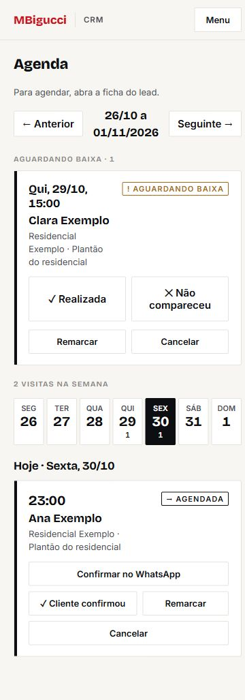 | 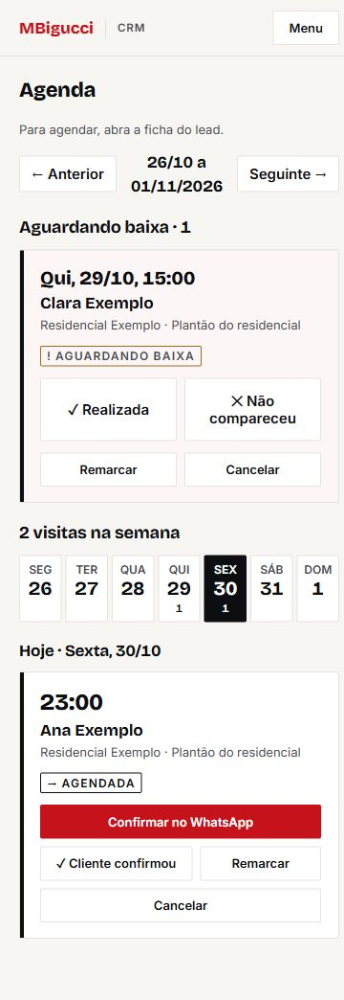 |

</details>

## Vendas

**Ação principal:** registrar venda; no item pendente, marcar o pagamento após conferir. Antes, “Registrar venda” era visualmente secundário.

| Prioridade | Problema em 375px / desktop | Proposta |
| --- | --- | --- |
| Alta | VGV pago, assinado e pendente pareciam igualmente dominantes; risco de confundir a base válida. | Pago em faixa escura, valor maior e rótulo contrastado; demais totais secundários, sem mudar cálculo. |
| Alta | Registro apagado, abaixo dos três resumos em 375px. | Botão vermelho fixo no rodapé móvel; uma ação principal no grupo, espaço reservado no conteúdo. |
| Média | Cards de venda repetem empreendimento, data e botões; comparação custosa. | Tabela no desktop e linhas de valor/cliente/estado no celular. |
| Baixa | Resumos repetem o valor pago dentro do bloco pendente. | Avaliar compactação da explicação, sem perder a distinção entre pago e assinado. |

Capturas: [375 antes](revisao-visual/antes/vendas-375.jpg) · [375 depois](revisao-visual/depois/vendas-375.jpg) · [desktop antes](revisao-visual/antes/vendas-1440.jpg) · [desktop depois](revisao-visual/depois/vendas-1440.jpg).

<details>
<summary>Comparação em 375px</summary>

| Antes | Depois |
| --- | --- |
| 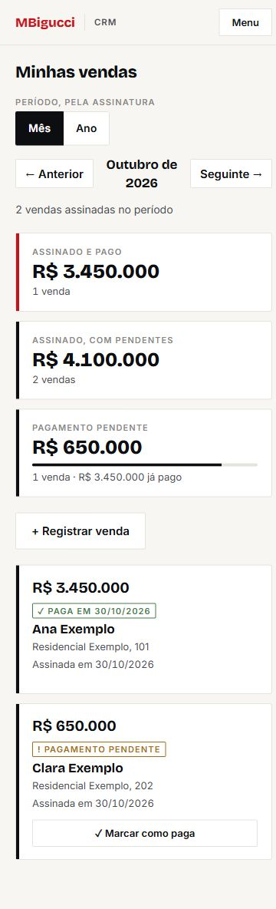 | 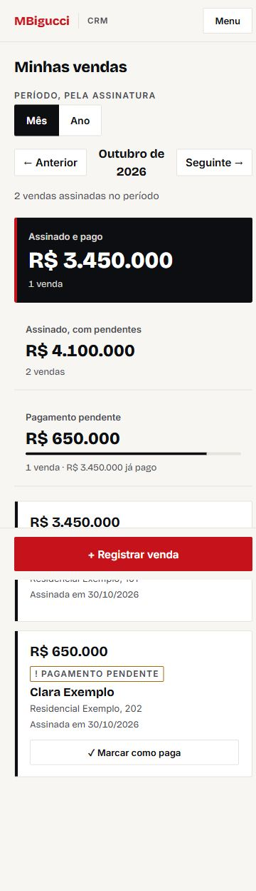 |

</details>

## Metas

**Ação principal:** ler quanto atingiu e quanto falta; ao editar, salvar a própria meta. “Meta de VGV” já é a única ação vermelha do estado vazio.

| Prioridade | Problema em 375px / desktop | Proposta |
| --- | --- | --- |
| Alta | Meta de R$ 10 milhões aparecia como complemento pequeno do realizado; rótulos e regra de apuração em `concrete`. | Separar “Assinado e pago” e “Meta do ano” numa faixa escura, com valores grandes; rótulos e explicação em `ink-soft`. |
| Média | Realizado repetido em várias posições; cinco indicadores competindo na grade. | Agrupar “Falta” e “Ritmo necessário” como próximo passo; detalhes de projeção em bloco secundário. |
| Média | Nas metas próprias já cadastradas, “Editar” e “Excluir” são links vermelhos no mesmo grupo secundário. | Neutralizar o grupo de gestão e reservar vermelho ao salvamento ou à confirmação de exclusão. A captura desta rodada cobre a meta anual e o estado vazio das metas próprias. |
| Baixa | Barra fina pouco expressiva. | Avaliar espessura após a hierarquia numérica, mantendo percentual acessível. |

Capturas: [375 antes](revisao-visual/antes/metas-375.jpg) · [375 depois](revisao-visual/depois/metas-375.jpg) · [desktop antes](revisao-visual/antes/metas-1440.jpg) · [desktop depois](revisao-visual/depois/metas-1440.jpg).

<details>
<summary>Comparação em 375px</summary>

| Antes | Depois |
| --- | --- |
| 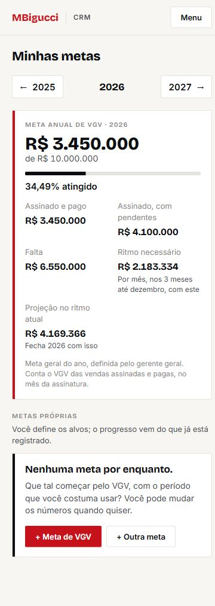 | 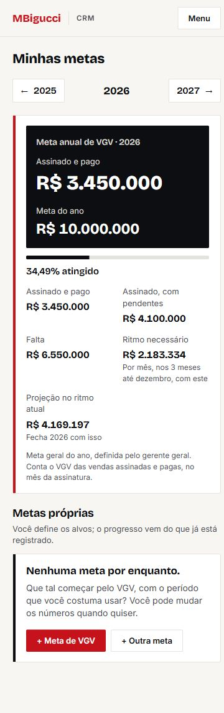 |

</details>

## Empreendimentos

**Ação principal:** escolher o imóvel e mandar ao cliente. Antes, esse botão parecia igual a “Como chegar”, “Tabela” e “Apresentação”.

| Prioridade | Problema em 375px / desktop | Proposta |
| --- | --- | --- |
| Alta | Compartilhamento e preço sem destaque suficiente para a decisão. | “Mandar ao cliente” vermelho por grupo do empreendimento; preço maior em Bricolage. Manter aviso textual de tabela antiga. |
| Alta | Filtros e estado com fonte pequena/baixo contraste. | Correção compartilhada de labels e selos. |
| Média | Catálogo repete cards sem facilitar comparação. | Alternativa de lista/tabela no desktop por nome, bairro, entrega e preço; cards no celular com ações secundárias agrupadas. |
| Baixa | Marca repetida como eyebrow em cada imóvel. | Avaliar mostrar a marca só quando diferir dentro do catálogo. |

Capturas: [375 antes](revisao-visual/antes/empreendimentos-375.jpg) · [375 depois](revisao-visual/depois/empreendimentos-375.jpg) · [desktop antes](revisao-visual/antes/empreendimentos-1440.jpg) · [desktop depois](revisao-visual/depois/empreendimentos-1440.jpg).

<details>
<summary>Comparação em 375px</summary>

| Antes | Depois |
| --- | --- |
| 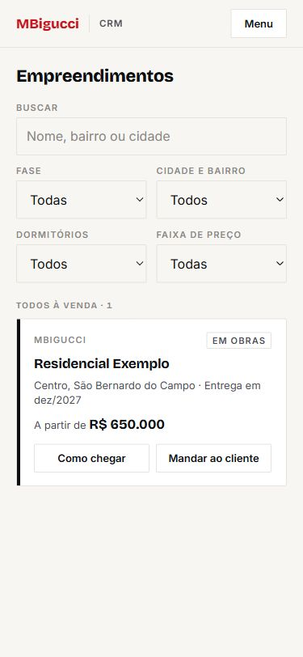 | 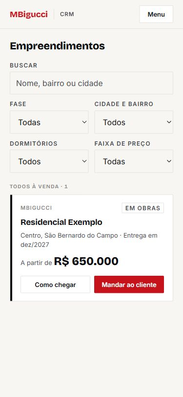 |

</details>

## Minha conta

**Ação principal:** manter o WhatsApp de recebimento e os avisos do aparelho. Antes, trocar senha recebia mais destaque que salvar o contato.

| Prioridade | Problema em 375px / desktop | Proposta |
| --- | --- | --- |
| Alta | “Salvar WhatsApp” secundário e labels apagados. | Barra brand no formulário de contato, salvar em vermelho, troca de senha secundária; labels pela correção compartilhada. |
| Média | Identidade, contato, avisos, senha e instalação repetem a mesma moldura. | Identidade em cabeçalho simples; orientações de instalação em lista ou acordeão. |
| Baixa | Texto longo de instalação no iPhone antes de alguns controles. | Avaliar ajuda expansível, mantendo a orientação acessível. |

Capturas: [375 antes](revisao-visual/antes/minha-conta-375.jpg) · [375 depois](revisao-visual/depois/minha-conta-375.jpg) · [desktop antes](revisao-visual/antes/minha-conta-1440.jpg) · [desktop depois](revisao-visual/depois/minha-conta-1440.jpg).

<details>
<summary>Comparação em 375px</summary>

| Antes | Depois |
| --- | --- |
| 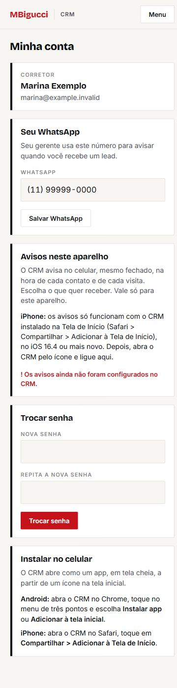 | 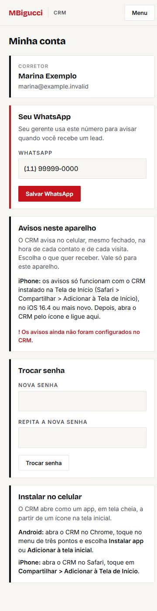 |

</details>

## Configurações

**Ação principal:** salvar a seção em edição. Uma ação vermelha por formulário/confirmação; não há “Salvar tudo”. Textos e funcionamento das chaves permanecem intactos.

| Prioridade | Problema em 375px / desktop | Proposta |
| --- | --- | --- |
| Alta | Estado desligado e data de alteração em `concrete`; essenciais para conferir a configuração vigente. | Estado e carimbo em `ink-soft`; títulos de seção mais legíveis. |
| Alta | Menu sobrepunha logo no desktop do gerente geral. | Correção compartilhada de quebra do menu. |
| Média | Muitas chaves e permissões geram cards quase idênticos e página longa. | Chaves em lista e permissões em matriz no desktop; grupos expansíveis no celular. |
| Baixa | Repetição do nome do perfil no bloco de permissões. | Remover redundância visual numa próxima revisão de densidade. |

Capturas usam **uma chave fictícia**, sem conteúdo do programa: [375 antes](revisao-visual/antes/configuracoes-375.jpg) · [375 depois](revisao-visual/depois/configuracoes-375.jpg) · [desktop antes](revisao-visual/antes/configuracoes-1440.jpg) · [desktop depois](revisao-visual/depois/configuracoes-1440.jpg).

<details>
<summary>Comparação em 375px</summary>

| Antes | Depois |
| --- | --- |
| 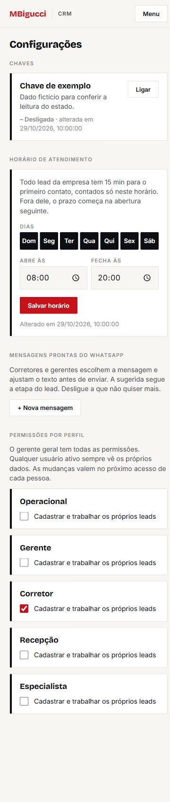 | 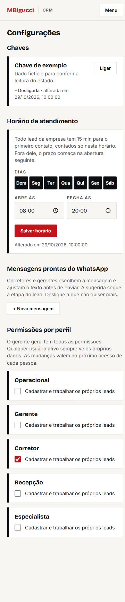 |

</details>

## Pendências de média e baixa

**Média:** listas/tabelas compactas para carteira, vendas e catálogo; visão móvel dos resumos de equipe e painel; eliminar cards dentro de cards na ficha; agrupar ações de visitas; compactar atalhos do cadastro; reorganizar indicadores secundários de metas; simplificar identidade/ajuda na conta e a matriz de configurações.

**Baixa:** eyebrows auxiliares, metadados repetidos, títulos da etapa de colagem, mensagens de colunas vazias, composição dos controles de período, espessura da barra de metas e repetição de marca/perfil.

## Validação e reprodução

### Contraste e tipografia

Razões calculadas a partir dos tokens sRGB, sem arredondar antes da comparação com 4,5:1:

| Combinação | Contraste | Decisão |
| --- | ---: | --- |
| `concrete` / `paper` | 3,31:1 | Retirado dos rótulos e dados essenciais alterados. |
| `concrete` / branco | 3,58:1 | Restrito aos metadados auxiliares remanescentes, listados como baixa. |
| `wa` / `paper` | 3,92:1 | Avisos corrigidos para texto escuro, mantendo a borda e o sinal. |
| `wa` / branco | 4,24:1 | Mesma correção nos selos de leads, visitas e vendas. |
| `ink-soft` / `paper` | 8,03:1 | Labels, placeholders, cabeçalhos e informações secundárias de leitura. |
| `ink-soft` / branco | 8,68:1 | Rótulos e dados dentro dos cards. |
| `brand` / `paper` | 4,52:1 | Urgência; sempre acompanhada de texto/sinal. |
| Branco / `brand` | 4,89:1 | Ação principal. |
| `on-dark-soft` / `ink` | 13,30:1 | Rótulos das faixas escuras. |

Labels e selos passaram a 12px. Os campos mantêm 16px. Eyebrows auxiliares de 11px ainda existem em identificação de marca, metadados e títulos secundários da ficha; são uma pendência explícita, não uma alegação de conformidade integral de acessibilidade.

### Conferência renderizada

- Doze telas em 375 × 812 e 1440 × 900, mais Colar mensagem com dados completos e incompletos: 56 capturas antes/depois.
- Nenhuma página ultrapassou a largura do viewport nessas duas medidas. Quadro e tabelas extensas preservam sua rolagem interna; a versão móvel dessas tabelas é prioridade média.
- Conferidos visualmente: ordem das urgências; WhatsApp principal por grupo; horários e quebra dos selos; números de VGV/meta; aviso de nome/WhatsApp ausentes; menu do gerente geral sem sobreposição; rodapés móveis com espaço no conteúdo.
- Conferida a transferência de nome, WhatsApp e empreendimento de “Colar mensagem” para o formulário, sem salvar um lead.
- Conferidos os novos acessos: a síntese do painel abre a lista correspondente; “Registrar venda” abre a seleção de cliente e retira o botão fixo enquanto o formulário está aberto.
- O adaptador fictício não representa todas as combinações de dados, permissões ou estados de erro. A conferência não substitui um teste com sessão real e base de homologação.

### Reprodução

Em `crm/`, com o servidor de desenvolvimento parado:

```bash
node scripts/visual-preview.mjs
npm --prefix .visual-preview run build
node scripts/visual-preview.mjs --serve
```

Abrir `http://127.0.0.1:4173/crm/`. Para a ficha, usar `/crm/leads/ficha/?id=lead-1`. Trocar o viewport entre 375 × 812 e 1440 × 900. Os perfis da cópia são escolhidos por rota, somente no adaptador de QA; código de autenticação/permissões do app permanece intacto. A cópia e seus builds são ignorados pelo Git e pelo typecheck do app.

As capturas `antes/` preservam a interface anterior. As de `depois/` mostram os ajustes aplicados. Há comparações adicionais para o aviso de colagem incompleta: [375 antes](revisao-visual/antes/colar-incompleta-375.jpg), [375 depois](revisao-visual/depois/colar-incompleta-375.jpg), [desktop antes](revisao-visual/antes/colar-incompleta-1440.jpg), [desktop depois](revisao-visual/depois/colar-incompleta-1440.jpg).

### Verificações e commits

`npm run typecheck`, `npm test` e `npm run build` executados e aprovados em `crm/` antes de cada commit desta revisão. Suíte final: **171 testes aprovados, zero falhas**. Exportação estática concluída. Nenhum servidor `npm run dev` foi ligado durante os builds; a conferência usou apenas o servidor estático da cópia isolada.

| Commit | Escopo |
| --- | --- |
| `86cb516` | Base: contraste dos labels/selos, números em Bricolage e menu sem sobreposição. |
| `514d711` | Lista do dia: ordem de urgências, síntese e primeiro contato de cada grupo. |
| `700b6f4` | Ficha: contato principal, registro no topo e leitura dos dados/histórico. |
| `51ad659` | Cadastro e Colar mensagem: rótulos, dados encontrados e aviso de obrigatórios. |
| `590f13c` | Quadro: prazo existente, cabeçalhos e totais. |
| `ee9f9b6` | Leads da equipe: pendências e contraste do resumo. |
| `d1ee62f` | Painel: síntese, títulos e tabelas legíveis. |
| `cb9e1e8` | Agenda: horário, estado e confirmação da visita. |
| `c2e338e` | Vendas: VGV pago e registro principal. |
| `cbe2e90` | Metas: realizado, alvo anual e links da tabela. |
| `dd28856` | Empreendimentos: preço e ação de enviar ao cliente. |
| `37557f3` | Minha conta: salvar WhatsApp. |
| `e5aa056` | Configurações: títulos, estados e datas. |
| `df615d8` | Lista do dia: ação de aniversário. |

O commit da documentação acompanha este relatório, as capturas e os scripts de QA. Alterações paralelas de outra frente foram preservadas; os commits acima contêm somente os ajustes visuais descritos. `ref/` e textos do programa sigiloso não foram alterados por esta revisão. Não houve push.

## Modo escuro (item 18)

Concluído em 30/10/2026. Os tokens, limites de uso e **84 pares de contraste aprovados** estão em [Design System](design-system.md#temas-do-crm--item-18). Esta seção atualiza o contraste histórico da revisão anterior: `concrete` e `wa` agora também atingem 4,5:1 nos fundos de leitura. A borda `line` continua decorativa; campos, seletores e botões usam `control` (mínimo 3:1).

### Resultado da conferência

- **134 capturas JPEG**: 130 de interface, incluindo todas as 24 rotas, relatório por corretor, estados restritos, colagem completa/incompleta, diálogo, foco e menu; mais 4 de impressão. Medidas: **375 × 812** e **1440 × 900**, em claro e escuro.
- Auditoria dos textos renderizados: **zero pares abaixo do limite** nos cenários capturados. Texto normal ≥ 4,5:1; grande ≥ 3:1. Verifica cor calculada e composição dos fundos; controles desabilitados são isentos. Não representa todos os dados possíveis nem uma certificação integral de acessibilidade.
- **Zero páginas com largura maior que o viewport.** Quadro e tabelas largas mantêm a rolagem interna já existente.
- Conferidos visualmente: faixas escuras, barra brand, estados ✓ ! ✕ com palavra e cor, números, campos nativos, foco de 2px, menu e rodapés. O diálogo usa overlay escuro nos dois temas. O logo ausente usa “MBigucci” em brand; o componente mantém o PNG original sobre selo branco quando disponível.
- Minha conta: escolha Automático / Claro / Escuro, persistência após recarga, navegação, sincronização em outra aba, reação à mudança do sistema e respeito à escolha explícita.
- Inicialização: com os bundles de hidratação bloqueados, o tema salvo e a meta `theme-color` já correspondem à escolha antes de a aplicação carregar. Valor inválido volta ao automático; bloqueio de leitura/escrita do `localStorage` não quebra a página nem a troca.
- Sem JavaScript, o CSS acompanha o sistema. A impressão força o esquema claro inclusive nesse caso. Em claro e escuro, relatório com fundo branco, texto/bordas pretos e sem menu/ações. PDFs de conferência: [partindo do claro](revisao-visual/temas/claro/relatorio.pdf) e [partindo do escuro](revisao-visual/temas/escuro/relatorio.pdf).
- A cópia isolada continua sem credenciais e com escritas bloqueadas. A chave fictícia do programa permanece desligada. As três capturas adicionais `*-geral` usam o acesso já previsto do gerente geral, escolhido **somente pelo adaptador de QA**, para conferir o conteúdo restrito. Os estados de acesso negado do corretor também foram mantidos. Nenhum texto do programa, regra, permissão ou arquivo de `ref/` foi alterado.
- Relógio de QA em 30/10/2026, 12h, no fuso de São Paulo, para manter os mesmos exemplos nos dois temas. O tempo continua avançando durante cada captura.

### Capturas

| Tela / estado | Claro 375 | Claro desktop | Escuro 375 | Escuro desktop |
| --- | --- | --- | --- | --- |
| Lista do dia | [captura](revisao-visual/temas/claro/lista-do-dia-375.jpg) | [captura](revisao-visual/temas/claro/lista-do-dia-1440.jpg) | [captura](revisao-visual/temas/escuro/lista-do-dia-375.jpg) | [captura](revisao-visual/temas/escuro/lista-do-dia-1440.jpg) |
| Ficha do lead | [captura](revisao-visual/temas/claro/ficha-375.jpg) | [captura](revisao-visual/temas/claro/ficha-1440.jpg) | [captura](revisao-visual/temas/escuro/ficha-375.jpg) | [captura](revisao-visual/temas/escuro/ficha-1440.jpg) |
| Cadastro | [captura](revisao-visual/temas/claro/cadastro-375.jpg) | [captura](revisao-visual/temas/claro/cadastro-1440.jpg) | [captura](revisao-visual/temas/escuro/cadastro-375.jpg) | [captura](revisao-visual/temas/escuro/cadastro-1440.jpg) |
| Colar mensagem | [captura](revisao-visual/temas/claro/colar-mensagem-375.jpg) | [captura](revisao-visual/temas/claro/colar-mensagem-1440.jpg) | [captura](revisao-visual/temas/escuro/colar-mensagem-375.jpg) | [captura](revisao-visual/temas/escuro/colar-mensagem-1440.jpg) |
| Colagem incompleta | [captura](revisao-visual/temas/claro/colar-incompleta-375.jpg) | [captura](revisao-visual/temas/claro/colar-incompleta-1440.jpg) | [captura](revisao-visual/temas/escuro/colar-incompleta-375.jpg) | [captura](revisao-visual/temas/escuro/colar-incompleta-1440.jpg) |
| Quadro | [captura](revisao-visual/temas/claro/quadro-375.jpg) | [captura](revisao-visual/temas/claro/quadro-1440.jpg) | [captura](revisao-visual/temas/escuro/quadro-375.jpg) | [captura](revisao-visual/temas/escuro/quadro-1440.jpg) |
| Leads da equipe | [captura](revisao-visual/temas/claro/leads-equipe-375.jpg) | [captura](revisao-visual/temas/claro/leads-equipe-1440.jpg) | [captura](revisao-visual/temas/escuro/leads-equipe-375.jpg) | [captura](revisao-visual/temas/escuro/leads-equipe-1440.jpg) |
| Painel | [captura](revisao-visual/temas/claro/painel-375.jpg) | [captura](revisao-visual/temas/claro/painel-1440.jpg) | [captura](revisao-visual/temas/escuro/painel-375.jpg) | [captura](revisao-visual/temas/escuro/painel-1440.jpg) |
| Relatório do corretor | [captura](revisao-visual/temas/claro/relatorio-375.jpg) | [captura](revisao-visual/temas/claro/relatorio-1440.jpg) | [captura](revisao-visual/temas/escuro/relatorio-375.jpg) | [captura](revisao-visual/temas/escuro/relatorio-1440.jpg) |
| Agenda | [captura](revisao-visual/temas/claro/agenda-375.jpg) | [captura](revisao-visual/temas/claro/agenda-1440.jpg) | [captura](revisao-visual/temas/escuro/agenda-375.jpg) | [captura](revisao-visual/temas/escuro/agenda-1440.jpg) |
| Vendas | [captura](revisao-visual/temas/claro/vendas-375.jpg) | [captura](revisao-visual/temas/claro/vendas-1440.jpg) | [captura](revisao-visual/temas/escuro/vendas-375.jpg) | [captura](revisao-visual/temas/escuro/vendas-1440.jpg) |
| Metas | [captura](revisao-visual/temas/claro/metas-375.jpg) | [captura](revisao-visual/temas/claro/metas-1440.jpg) | [captura](revisao-visual/temas/escuro/metas-375.jpg) | [captura](revisao-visual/temas/escuro/metas-1440.jpg) |
| Empreendimentos | [captura](revisao-visual/temas/claro/empreendimentos-375.jpg) | [captura](revisao-visual/temas/claro/empreendimentos-1440.jpg) | [captura](revisao-visual/temas/escuro/empreendimentos-375.jpg) | [captura](revisao-visual/temas/escuro/empreendimentos-1440.jpg) |
| Detalhe do empreendimento | [captura](revisao-visual/temas/claro/empreendimento-375.jpg) | [captura](revisao-visual/temas/claro/empreendimento-1440.jpg) | [captura](revisao-visual/temas/escuro/empreendimento-375.jpg) | [captura](revisao-visual/temas/escuro/empreendimento-1440.jpg) |
| Editar empreendimento | [captura](revisao-visual/temas/claro/editar-empreendimento-375.jpg) | [captura](revisao-visual/temas/claro/editar-empreendimento-1440.jpg) | [captura](revisao-visual/temas/escuro/editar-empreendimento-375.jpg) | [captura](revisao-visual/temas/escuro/editar-empreendimento-1440.jpg) |
| Importar tabela | [captura](revisao-visual/temas/claro/importar-tabela-375.jpg) | [captura](revisao-visual/temas/claro/importar-tabela-1440.jpg) | [captura](revisao-visual/temas/escuro/importar-tabela-375.jpg) | [captura](revisao-visual/temas/escuro/importar-tabela-1440.jpg) |
| Minha conta | [captura](revisao-visual/temas/claro/minha-conta-375.jpg) | [captura](revisao-visual/temas/claro/minha-conta-1440.jpg) | [captura](revisao-visual/temas/escuro/minha-conta-375.jpg) | [captura](revisao-visual/temas/escuro/minha-conta-1440.jpg) |
| Aparência com foco | [captura](revisao-visual/temas/claro/aparencia-foco-375.jpg) | [captura](revisao-visual/temas/claro/aparencia-foco-1440.jpg) | [captura](revisao-visual/temas/escuro/aparencia-foco-375.jpg) | [captura](revisao-visual/temas/escuro/aparencia-foco-1440.jpg) |
| Configurações | [captura](revisao-visual/temas/claro/configuracoes-375.jpg) | [captura](revisao-visual/temas/claro/configuracoes-1440.jpg) | [captura](revisao-visual/temas/escuro/configuracoes-375.jpg) | [captura](revisao-visual/temas/escuro/configuracoes-1440.jpg) |
| Entrar | [captura](revisao-visual/temas/claro/entrar-375.jpg) | [captura](revisao-visual/temas/claro/entrar-1440.jpg) | [captura](revisao-visual/temas/escuro/entrar-375.jpg) | [captura](revisao-visual/temas/escuro/entrar-1440.jpg) |
| Equipes | [captura](revisao-visual/temas/claro/equipes-375.jpg) | [captura](revisao-visual/temas/claro/equipes-1440.jpg) | [captura](revisao-visual/temas/escuro/equipes-375.jpg) | [captura](revisao-visual/temas/escuro/equipes-1440.jpg) |
| Usuários | [captura](revisao-visual/temas/claro/usuarios-375.jpg) | [captura](revisao-visual/temas/claro/usuarios-1440.jpg) | [captura](revisao-visual/temas/escuro/usuarios-375.jpg) | [captura](revisao-visual/temas/escuro/usuarios-1440.jpg) |
| Faixas | [captura](revisao-visual/temas/claro/faixas-375.jpg) | [captura](revisao-visual/temas/claro/faixas-1440.jpg) | [captura](revisao-visual/temas/escuro/faixas-375.jpg) | [captura](revisao-visual/temas/escuro/faixas-1440.jpg) |
| Programa (gerente geral) | [captura](revisao-visual/temas/claro/programa-375.jpg) | [captura](revisao-visual/temas/claro/programa-1440.jpg) | [captura](revisao-visual/temas/escuro/programa-375.jpg) | [captura](revisao-visual/temas/escuro/programa-1440.jpg) |
| Aprovação (gerente geral) | [captura](revisao-visual/temas/claro/aprovacao-375.jpg) | [captura](revisao-visual/temas/claro/aprovacao-1440.jpg) | [captura](revisao-visual/temas/escuro/aprovacao-375.jpg) | [captura](revisao-visual/temas/escuro/aprovacao-1440.jpg) |
| Meus pontos (gerente geral fictício) | [captura](revisao-visual/temas/claro/meus-pontos-geral-375.jpg) | [captura](revisao-visual/temas/claro/meus-pontos-geral-1440.jpg) | [captura](revisao-visual/temas/escuro/meus-pontos-geral-375.jpg) | [captura](revisao-visual/temas/escuro/meus-pontos-geral-1440.jpg) |
| Ranking (gerente geral fictício) | [captura](revisao-visual/temas/claro/ranking-geral-375.jpg) | [captura](revisao-visual/temas/claro/ranking-geral-1440.jpg) | [captura](revisao-visual/temas/escuro/ranking-geral-375.jpg) | [captura](revisao-visual/temas/escuro/ranking-geral-1440.jpg) |
| Plantão (gerente geral fictício) | [captura](revisao-visual/temas/claro/plantao-geral-375.jpg) | [captura](revisao-visual/temas/claro/plantao-geral-1440.jpg) | [captura](revisao-visual/temas/escuro/plantao-geral-375.jpg) | [captura](revisao-visual/temas/escuro/plantao-geral-1440.jpg) |
| Meus pontos (acesso negado) | [captura](revisao-visual/temas/claro/meus-pontos-375.jpg) | [captura](revisao-visual/temas/claro/meus-pontos-1440.jpg) | [captura](revisao-visual/temas/escuro/meus-pontos-375.jpg) | [captura](revisao-visual/temas/escuro/meus-pontos-1440.jpg) |
| Ranking (acesso negado) | [captura](revisao-visual/temas/claro/ranking-375.jpg) | [captura](revisao-visual/temas/claro/ranking-1440.jpg) | [captura](revisao-visual/temas/escuro/ranking-375.jpg) | [captura](revisao-visual/temas/escuro/ranking-1440.jpg) |
| Plantão (acesso negado) | [captura](revisao-visual/temas/claro/plantao-375.jpg) | [captura](revisao-visual/temas/claro/plantao-1440.jpg) | [captura](revisao-visual/temas/escuro/plantao-375.jpg) | [captura](revisao-visual/temas/escuro/plantao-1440.jpg) |
| Diálogo de mensagem | [captura](revisao-visual/temas/claro/dialogo-mensagem-375.jpg) | [captura](revisao-visual/temas/claro/dialogo-mensagem-1440.jpg) | [captura](revisao-visual/temas/escuro/dialogo-mensagem-375.jpg) | [captura](revisao-visual/temas/escuro/dialogo-mensagem-1440.jpg) |
| Impressão | [captura](revisao-visual/temas/claro/impressao-375.jpg) | [captura](revisao-visual/temas/claro/impressao-1440.jpg) | [captura](revisao-visual/temas/escuro/impressao-375.jpg) | [captura](revisao-visual/temas/escuro/impressao-1440.jpg) |

Menu móvel: [claro](revisao-visual/temas/claro/menu-375.jpg) · [escuro](revisao-visual/temas/escuro/menu-375.jpg).

### Reprodução dos temas

Em `crm/`, sem servidor de desenvolvimento:

```bash
node scripts/contraste-temas.mjs
node scripts/visual-preview.mjs
npm --prefix .visual-preview run build
node scripts/visual-preview.mjs --serve
```

Em outro terminal, executar `node scripts/visual-temas.mjs`. O script usa Playwright disponível no ambiente de QA; `PLAYWRIGHT_MODULE` aceita o caminho do pacote e `CHROME_PATH` o executável do Chrome já instalado. Não adiciona dependências ao app. No Windows com isolamento de rede, navegador e servidor local precisam de acesso ao mesmo loopback.

O arquivo [auditoria.json](revisao-visual/temas/auditoria.json) registra os pares, cada captura, larguras, falhas de contraste e erros de execução. O script falha quando encontra regressão. O parâmetro `?qa=geral` existe apenas na cópia isolada; não é reconhecido pela sessão do app.

### Verificações desta entrega

Antes do commit local: `npm run typecheck`, `npm test` (**171 aprovados**) e `npm run build` em `crm/`. Exportação estática concluída, sem servidor de desenvolvimento ligado. Validações adicionais de contraste e navegador concluídas. Item 18 marcado em `docs/referencia-crm-bruna.md`. Sem push.

## Ajustes da ficha (04/11/2026)

Capturas da prévia fictícia (`crm/scripts/visual-preview.mjs`, lead "Ana Exemplo" com toque no WhatsApp hoje e sem detalhe), em 375 e 1440, claro e escuro, em `revisao-visual/ajustes-ficha/`. As de antes são cópias das capturas de temas de 30/10/2026, guardadas em `revisao-visual/ajustes-ficha/antes/`.

| Tela | 375 claro | 1440 claro | 375 escuro | 1440 escuro |
| --- | --- | --- | --- | --- |
| Ficha | [captura](revisao-visual/ajustes-ficha/ficha-375-claro.jpg) | [captura](revisao-visual/ajustes-ficha/ficha-1440-claro.jpg) | [captura](revisao-visual/ajustes-ficha/ficha-375-escuro.jpg) | [captura](revisao-visual/ajustes-ficha/ficha-1440-escuro.jpg) |
| Lista do dia | [captura](revisao-visual/ajustes-ficha/lista-do-dia-375-claro.jpg) | [captura](revisao-visual/ajustes-ficha/lista-do-dia-1440-claro.jpg) | [captura](revisao-visual/ajustes-ficha/lista-do-dia-375-escuro.jpg) | [captura](revisao-visual/ajustes-ficha/lista-do-dia-1440-escuro.jpg) |

- No computador, a ficha tem duas colunas (740px + 380px na largura de 1440); em 375 continua uma coluna, sem rolagem lateral.
- "Detalhe o contato" aparece logo abaixo de "Aguardando primeiro contato", e nenhum card tem mais o Sem resposta (+1).

## Revisão de 05/11/2026 (antes de subir)

**Corrigir antes de subir o CRM:** a confirmação de outra carteira fica fora da primeira tela do celular e a tabela da recepção corta a ação “Corrigir” quando entram as duas colunas. **Antes de publicar o cadastro público de parceiros:** corrigir o contraste do texto que explica o que a pessoa autoriza ao enviar.

### O que bloqueia subir

#### Recepção do stand

| Severidade | Problema observado | Onde reproduzir | Ajuste proposto no Design System |
| --- | --- | --- | --- |
| Alta | Em 375 × 812, o aviso de outra carteira começa em y = 1.194. O rodapé continua oferecendo “Registrar cliente” em vermelho antes de a recepcionista ver “Trocar para Retorno” e “Registrar mesmo assim”. [Captura](revisao-visual/2026-11-05/claro/aviso-375.jpg) | `/recepcao/` · RegistrarCliente / Pergunta · `crm/src/components/recepcao/cliente.tsx` | Ao receber a pendência, levar o foco e a rolagem à pergunta. Enquanto ela estiver aberta, usar o rodapé para as respostas e reservar a ação principal para a escolha recomendada. |
| Alta | A 900 px, a página ocupa 1.046 px. Na tabela Clientes de hoje, o botão “Corrigir” termina em x = 1.045. A recepcionista precisa deslocar a página inteira para alcançá-lo. [Captura](revisao-visual/2026-11-05/claro/recepcao-limiar-900.jpg) | `/recepcao/` · TelaDoStand / ClientesDeHoje · `crm/src/app/recepcao/page.tsx` · `crm/src/components/recepcao/clientes-hoje.tsx` | Manter as duas colunas a partir de 900 px. Quando a coluna direita for estreita, usar nela as linhas compactas de clientes do celular, com “Corrigir” junto do nome. |

#### Cadastro público de parceiro

| Severidade | Problema observado | Onde reproduzir | Ajuste proposto no Design System |
| --- | --- | --- | --- |
| Alta | A autorização de contato sob “Enviar cadastro” tem 13 px e contraste de 2,84:1. O parceiro precisa dessa informação para decidir se envia os dados. A indicação “se tiver” do CRECI usa o mesmo par. [Captura](revisao-visual/2026-11-05/claro/cadastro-publico-375.jpg) | `/corretores/ (avulsa local)` · bloco #mbParceiro · `crm/wordpress/corretores/src/estilo.css` | Aplicar o equivalente a ink-soft à autorização e à indicação opcional no tema do site. Conferir pelo menos 4,5:1 também nos exemplos dos campos. |

### O que pode vir depois

#### Menu do gerente geral

| Severidade | Problema observado | Onde reproduzir | Ajuste proposto no Design System |
| --- | --- | --- | --- |
| Média | O menu aberto ultrapassa os 812 px. Depois de rolar 1.300 px, “Sair” ainda começa em y = 1.055. Só chega à área visível no fim da página de Início. O esforço para chegar aos últimos destinos depende do tamanho da página por trás. [Captura](revisao-visual/2026-11-05/claro/menu-375.jpg) | `/ (menu aberto)` · Cabecalho · `crm/src/components/cabecalho.tsx` | Limitar a lista à altura disponível abaixo de “Fechar” e permitir rolar dentro dela. Manter os alvos de toque atuais. |

#### Lista do dia

| Severidade | Problema observado | Onde reproduzir | Ajuste proposto no Design System |
| --- | --- | --- | --- |
| Média | A faixa de atenção permite ir a “Detalhe o contato” e aos atrasados, mas omite a visita de hoje. Com um lead em cada um dos três grupos de urgência, o título “Visitas de hoje” só aparece em y = 1.239 no celular. [Captura](revisao-visual/2026-11-05/claro/lista-do-dia-375.jpg) | `/` · ListaDoDia · `crm/src/components/leads/lista-do-dia.tsx` | Acrescentar à síntese um atalho neutro com quantidade e horário da próxima visita de hoje, preservando o primeiro contato estourado no topo. |

#### Ficha do lead

| Severidade | Problema observado | Onde reproduzir | Ajuste proposto no Design System |
| --- | --- | --- | --- |
| Baixa | Na ficha sem número, “– Sem telefone” aparece abaixo do nome. Depois de prazo, origem e perfil, o rótulo volta a dizer “Sem telefone. Digite quando o cliente der”, sem nomear o campo para o dono. [Captura](revisao-visual/2026-11-05/claro/sem-telefone-375.jpg) | `/leads/ficha/` · DigitarWhatsapp · `crm/src/app/leads/ficha/page.tsx` | Manter o estado no resumo e rotular o campo “WhatsApp com DDD”. Aproximar o campo do estado na versão de uma coluna. |

#### Cadastro na recepção

| Severidade | Problema observado | Onde reproduzir | Ajuste proposto no Design System |
| --- | --- | --- | --- |
| Média | “Telefone” aparece entre “Cliente” e “E-mail · opcional”. A diferença de rótulo sugere que o telefone é obrigatório, embora a recepção possa registrar o atendimento sem o número. [Captura](revisao-visual/2026-11-05/claro/registrar-cliente-375.jpg) | `/recepcao/` · RegistrarCliente · `crm/src/components/recepcao/cliente.tsx` | Usar “Telefone · se o cliente der”, no mesmo padrão de rótulos dos demais campos. |

#### Relatório do stand impresso

| Severidade | Problema observado | Onde reproduzir | Ajuste proposto no Design System |
| --- | --- | --- | --- |
| Média | O PDF começa com “Todos os stands” e a semana. O título “Relatório do stand”, visível na tela, some no papel. Uma folha solta perde a identificação do relatório. [Captura](revisao-visual/2026-11-05/claro/impressao-stand-1440.jpg) | `/recepcao/relatorio/` · Relatorio / estilo de impressão · `crm/src/app/recepcao/relatorio/page.tsx` · `crm/src/app/globals.css` | Incluir um cabeçalho de impressão com o título, o stand selecionado e o período. Usar a classe de título de impressão existente. |

#### Painel da equipe

| Severidade | Problema observado | Onde reproduzir | Ajuste proposto no Design System |
| --- | --- | --- | --- |
| Média | Na tabela “Clientes no stand, por corretor”, o nome e as cinco contagens exigem rolagem lateral interna em 375 px. Na ponta direita é preciso voltar à esquerda para conferir a quem pertence o número. [Captura](revisao-visual/2026-11-05/claro/painel-375.jpg) | `/painel/` · TabelaStand · `crm/src/components/recepcao/painel-stand.tsx` | Fixar a identificação da linha durante a rolagem ou apresentar cada corretor com total e detalhamento expansível no celular. |

#### Relatório do corretor

| Severidade | Problema observado | Onde reproduzir | Ajuste proposto no Design System |
| --- | --- | --- | --- |
| Baixa | No card do stand, o total de clientes e os quatro detalhamentos usam cartões e números do mesmo tamanho. No celular, o último indicador ocupa sozinho a terceira linha. [Captura](revisao-visual/2026-11-05/claro/relatorio-375.jpg) | `/painel/?c=corretor-1` · StandDoCorretor · `crm/src/components/recepcao/painel-stand.tsx` | Dar a primeira linha ao total e agrupar os quatro detalhamentos abaixo em duas colunas. |

#### Lista e ficha de parceiros

| Severidade | Problema observado | Onde reproduzir | Ajuste proposto no Design System |
| --- | --- | --- | --- |
| Média | Os nomes “Indicou” e “Vendeu” quase desaparecem na trilha de estágio. A lista também exibe as duas opções indisponíveis em texto esmaecido. A legenda da sequência perde legibilidade. [Captura](revisao-visual/2026-11-05/claro/parceiro-375.jpg) | `/parceiros/ e /parceiros/ficha/` · TrilhaEstagio e filtros da carteira · `crm/src/components/parceiros/partes.tsx` · `crm/src/app/parceiros/page.tsx` | Apresentar as etapas futuras como texto auxiliar legível, com indicação de indisponibilidade. Usar contorno ou preenchimento para distinguir o estágio atual. |

#### Cadastro manual de parceiro

| Severidade | Problema observado | Onde reproduzir | Ajuste proposto no Design System |
| --- | --- | --- | --- |
| Média | A regra de identificação fica dentro do campo CRECI, no exemplo “Opcional se tiver WhatsApp”. Ela desaparece durante o preenchimento. Os rótulos dos dois campos, lidos sozinhos, não explicam que basta um deles. [Captura](revisao-visual/2026-11-05/claro/parceiro-novo-375.jpg) | `/parceiros/novo/` · CamposCadastro · `crm/src/components/parceiros/partes.tsx` | Agrupar os dois campos sob a instrução persistente “Informe WhatsApp ou CRECI”, em ink-soft. |

#### Início do gerente geral

| Severidade | Problema observado | Onde reproduzir | Ajuste proposto no Design System |
| --- | --- | --- | --- |
| Baixa | O atalho de Configurações ainda promete “Chaves do sistema”. Na tela de destino aparecem horário, mensagens e permissões. A descrição orienta o gerente a procurar um ajuste retirado. [Captura](revisao-visual/2026-11-05/claro/inicio-geral-375.jpg) | `/` · Inicio / Atalho · `crm/src/app/page.tsx` | Descrever as três configurações disponíveis hoje no texto auxiliar do atalho. |

### Auditoria de contraste

Os 84 pares de tokens passaram no teste do projeto. A medição complementar usou as cores calculadas pelo Chrome, com composição dos fundos e da opacidade dos elementos e ancestrais. O limite de texto normal é 4,5:1 e o de texto grande é 3:1. A tabela distingue os resultados do CRM dos da página pública, que usa a paleta do site.

| Texto e superfície renderizados | Claro | Escuro | Leitura |
| --- | ---: | ---: | --- |
| “Indicou” e “Vendeu”, na trilha ou na lista de parceiros | 2,34–2,42:1 | 3,29–3,47:1 | A opacidade de 60% reduz o contraste do texto auxiliar. As etapas são futuras, mas seus nomes fazem parte da legenda visível. |
| Indicação do CRECI e autorização de contato, no card público branco | 2,84:1 | 2,84:1 | A página avulsa manteve a paleta clara nas duas preferências de sistema. |
| Exemplos de WhatsApp e CRECI no formulário público | 2,61:1 | 2,61:1 | Medição adicional dos placeholders, em `#9d998f` sobre `#f6f5f1`. |
| “+ Foto ou PDF”, sem categoria escolhida, na ficha do lead | 3,62:1 | Acima do limite | Controle desabilitado, isento. O auditor registra o rótulo externo ao input. |

O arquivo de auditoria contém 38 ocorrências automáticas abaixo do limite, incluindo repetições por tema, largura e estado. Dessas, seis são o controle de arquivo desabilitado. Os exemplos dentro dos campos públicos foram medidos à parte. Nas 31 rotas, a largura da página coube em 375 e 1440 px. O transbordamento da Recepção ocorreu no teste adicional de 900 px. [Auditoria por captura](revisao-visual/2026-11-05/auditoria.json).

### Cobertura, reprodução e limites

Foram gerados **188 JPEGs e dois PDFs A4** com relógio fictício em 05/11/2026 às 12h, horário de São Paulo. A varredura cobriu as 31 rotas do CRM em **375 × 812 e 1440 × 900**, claro e escuro, além da página pública avulsa e dos estados da tabela abaixo. Cada PDF do stand tem uma página no cenário com um atendimento. [Capturas claras](revisao-visual/2026-11-05/claro/) · [Capturas escuras](revisao-visual/2026-11-05/escuro/) · [PDF partindo do claro](revisao-visual/2026-11-05/claro/stand.pdf) · [PDF partindo do escuro](revisao-visual/2026-11-05/escuro/stand.pdf).

| Fluxo prioritário | Estado conferido |
| --- | --- |
| Lista e ficha do lead | Prazo estourado, “Detalhe o contato”, atraso, visita de hoje e baixa. Ficha com duas colunas no desktop e uma no celular, seleção de “Sem resposta” com a tentativa preenchida e campo de WhatsApp do dono sem telefone. [Tentativa](revisao-visual/2026-11-05/escuro/tentativa-1440.jpg) |
| Recepção | Fila de corretor e especialista, cliente do dia, abas móveis, formulário, Anuncie com Desfazer, confirmação de outra carteira, manutenção dos stands e relatório. [Anuncie](revisao-visual/2026-11-05/claro/anuncie-375.jpg) |
| Parcerias | Carteira, ficha com prazo em risco, formulário de interação, linha do tempo, cadastro manual, evento, contato de hoje no Início do gerente e cadastro público. [Ficha](revisao-visual/2026-11-05/escuro/parceiro-1440.jpg) |
| Agenda, Usuários, Avisos e painel | Retornos do dia, seleção do lead e formulário de visita, edição com Apelido e CRECI, tipos de aviso de equipe e parceiros, tabela da equipe e card do corretor com um cliente de stand. [Agendar](revisao-visual/2026-11-05/claro/agenda-agendar-375.jpg) · [Avisos](revisao-visual/2026-11-05/escuro/avisos-375.jpg) |
| Menu e programa | Recepção, Parceiros e Simulador → no menu, conteúdo de Meus pontos, Ranking, Pontos e Plantão com perfil habilitado. A busca no texto renderizado das capturas encontrou zero ocorrências de “Só você vê” e “Ligue a chave”. [Menu](revisao-visual/2026-11-05/claro/menu-375.jpg) · [Plantão](revisao-visual/2026-11-05/escuro/plantao-geral-375.jpg) |

**Reprodução em `crm/`**, com o desenvolvimento parado e Playwright/Chrome nas variáveis descritas na revisão anterior:

```sh
node scripts/visual-preview.mjs
node scripts/visual-pre-subida.mjs
npm --prefix .visual-preview run build
node scripts/contraste-temas.mjs
node scripts/visual-temas.mjs --pre-subida
```

A preparação usa o adaptador fictício da revisão anterior. O roteiro de novembro acrescenta dados de recepção e parcerias e prepara na cópia os estados transitórios de Anuncie, confirmação e disponibilidade de avisos. O Chrome recebeu os arquivos de `.visual-preview/out/` por interceptação local, pois o isolamento do Windows bloqueou o servidor de loopback. O roteiro só atende leituras desse export, bloqueia as demais requisições e desativa os service workers.

**Limites.** Os avisos na linha foram amostrados com o conflito de outra carteira. Repetição no dia, mudança concorrente da vez, demais tipos de anúncio, temporização real de Desfazer e retorno de gravação ficam para homologação funcional. A página pública é o HTML avulso de conferência da pasta WordPress. Tema instalado, envio do cadastro, entrega de push, WhatsApp externo e permissões reais ficam fora desta revisão. As medidas se referem aos dados fictícios e estados capturados.
